# 📱 dam2_2627_a — App multiplataforma con Flutter + Firebase


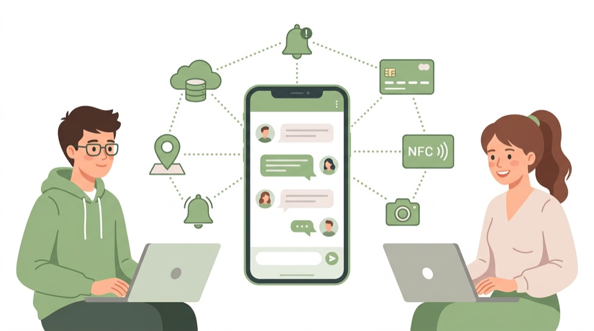

Proyecto de clase de **2º de DAM** (Desarrollo de Aplicaciones Multiplataforma). Empezó como una app
de mensajes y, semana a semana, ha ido sumando piezas reales de una app profesional: login con
varios proveedores, base de datos en tiempo real, subida de fotos, mapa con GPS, una API externa,
funciones en la nube, notificaciones push por cercanía, pagos con tarjeta y lectura de NFC.

> 🎯 **Objetivo de este repositorio:** que puedas entender **todo** lo que se ha hecho, por qué se ha
> hecho así y qué falla todavía. El código está comentado en español y cada módulo tiene su propia
> **guía didáctica** en [`docs/`](docs/README.md) con diagramas, paso a paso, ejercicios y autoevaluación.

---

## 📑 Índice

1. [¿Qué hace la app?](#-qué-hace-la-app)
2. [Puesta en marcha](#-puesta-en-marcha)
3. [Mapa del proyecto](#-mapa-del-proyecto)
4. [Línea de tiempo del curso](#-línea-de-tiempo-del-curso)
5. [Guías por módulo](#-guías-por-módulo)
6. [Estructura de carpetas](#-estructura-de-carpetas)
7. [Dependencias](#-dependencias)
8. [Aprende con el tutor IA](#-aprende-con-el-tutor-ia)
9. [Fallos conocidos](#-fallos-conocidos)
10. [Ejercicios propuestos](#-ejercicios-propuestos)

---

## ✨ ¿Qué hace la app?

| | Funcionalidad | Guía |
|---|---|---|
| 🔐 | **Registro e inicio de sesión** con email/contraseña, Google (Android) y Apple (iOS) | [04](docs/04-autenticacion.md) |
| 👤 | **Perfil** en Firestore (nombre, edad, altura, avatar, posición, token del móvil) | [03](docs/03-firestore-modelo-datos.md) |
| 💬 | **Mensajes en tiempo real**: lista, detalle y estado leído/no leído | [02](docs/02-navegacion-y-pantallas.md) · [03](docs/03-firestore-modelo-datos.md) |
| 🖼️ | **Avatar** desde cámara o galería, comprimido y subido a Firebase Storage | [05](docs/05-storage-avatar.md) |
| 🗺️ | **Mapa** con puntos de interés, tu posición GPS y **terremotos** de una API pública | [06](docs/06-mapa-gps.md) · [07](docs/07-api-http-terremotos.md) |
| ☁️ | **Cloud Functions en Python**: lógica en el servidor, triggers de Firestore | [08](docs/08-cloud-functions-python.md) |
| 🔔 | **Notificaciones push** y avisos a los móviles que están **dentro de un radio** | [09](docs/09-notificaciones-push-fcm.md) |
| 💳 | **Cobros con tarjeta** con Stripe y confirmación por webhook | [10](docs/10-pagos-stripe.md) |
| 📶 | **NFC**: la app se abre al acercar un tag y lee su identificador | [11](docs/11-nfc.md) |
| 🖥️ | **Diseño adaptable**: pantallas distintas para móvil y escritorio/web | [02](docs/02-navegacion-y-pantallas.md) |

### 📸 Capturas (Android)

| Login | Registro | Inicio | Mensajes |
|:---:|:---:|:---:|:---:|
| 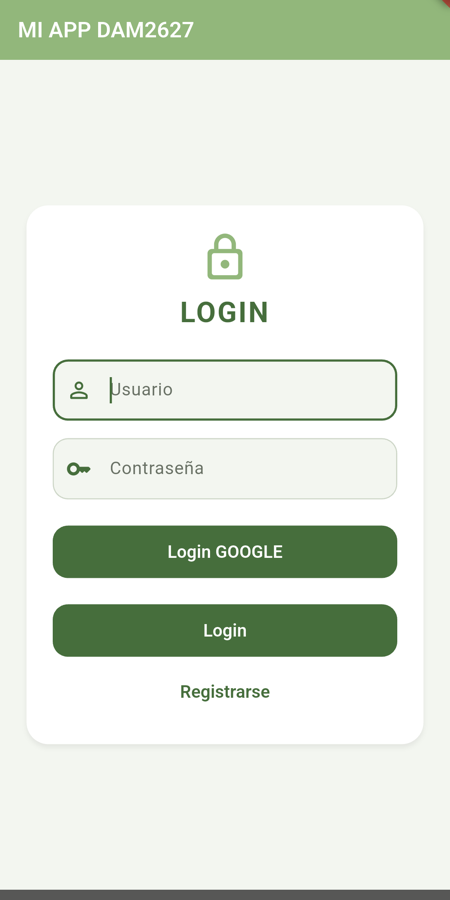 | 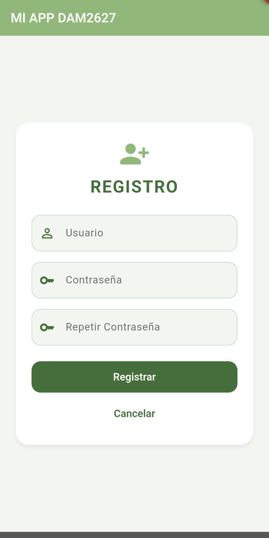 | 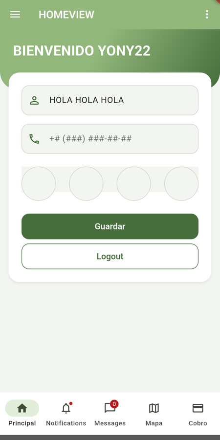 | 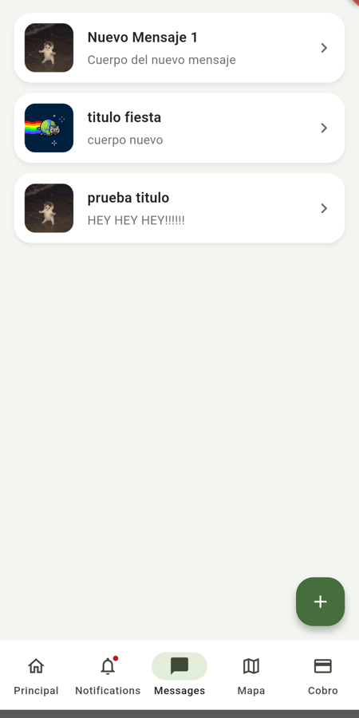 |

| Detalle | Mapa | Cobro |
|:---:|:---:|:---:|
| 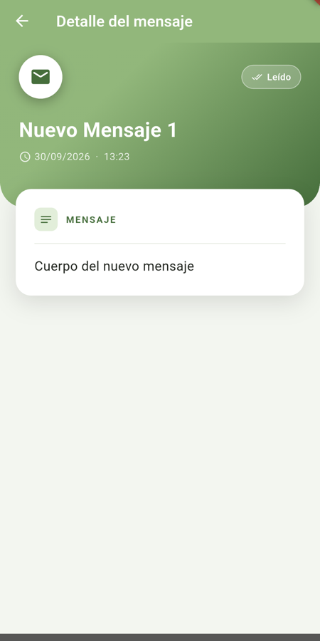 | 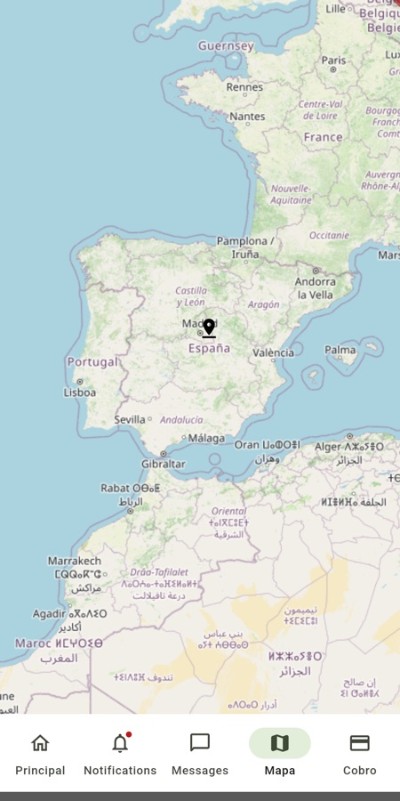 | 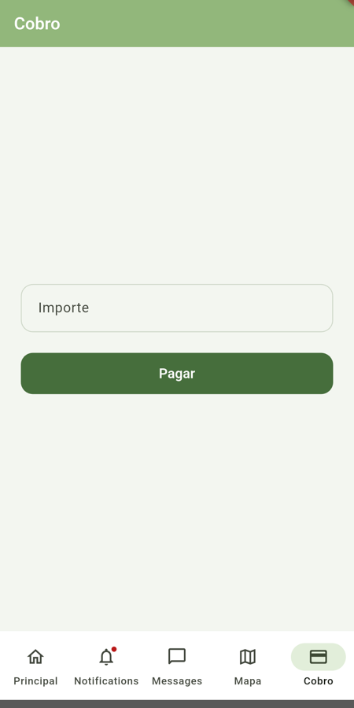 |

> Capturas hechas en un móvil Android real con una cuenta de pruebas (versión *debug*).

---

## 🚀 Puesta en marcha

```bash
# 1. Descargar dependencias
flutter pub get

# 2. Ejecutar (elige un emulador o dispositivo conectado)
flutter run
```

| Herramienta | Versión / nota |
|---|---|
| Flutter SDK | 3.x (Dart `^3.11.0`) |
| Android | `minSdk` 24 (el valor por defecto de Flutter; lo exige `nfc_manager`) |
| Firebase | Plataformas registradas: Android, Web, iOS, macOS y Windows (`firebase.json`) |
| Cloud Functions | Python 3.12 y Firebase CLI — ver [guía 08](docs/08-cloud-functions-python.md) |

> ⚠️ **Los archivos de configuración de Firebase no están en Git** (`lib/firebase_options.dart`,
> `android/app/google-services.json`, `GoogleService-Info.plist`). En tu copia, genera los tuyos con
> `flutterfire configure` apuntando a tu proyecto de Firebase. Ese archivo lo genera la herramienta
> y **no se edita a mano**. Para Google Sign-In, cada alumno debe registrar su huella SHA
> ([guía 04](docs/04-autenticacion.md)).

> 💡 ¿No ves tus `print()`? Mira la habilidad [`probar-en-movil`](.claude/skills/probar-en-movil/SKILL.md):
> `adb logcat -s flutter`.

---

## 🗺 Mapa del proyecto

Toda la app sigue la misma idea: las **pantallas** no hablan directamente con Firebase ni con
Android; piden las cosas al **`Dataholder`** (un *singleton*, la "mochila compartida" de la app), que
tiene un **Admin** especializado para cada servicio.

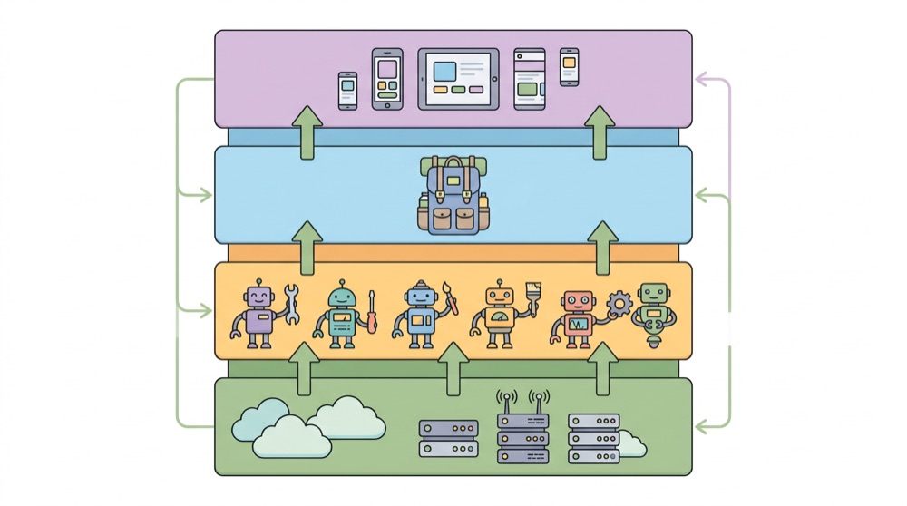

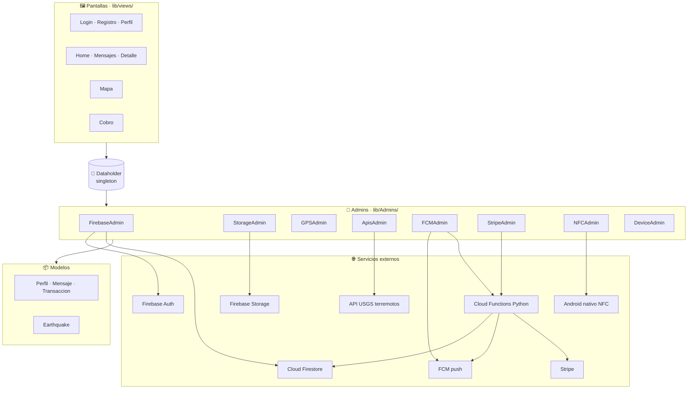

👉 La explicación completa (capas, patrón Admin, orden de arranque en `main.dart`) está en
**[🏛 01 · Arquitectura](docs/01-arquitectura.md)**.

---

## 🕰 Línea de tiempo del curso

Así ha crecido el proyecto, según el historial de Git. Cada hito tiene su guía.

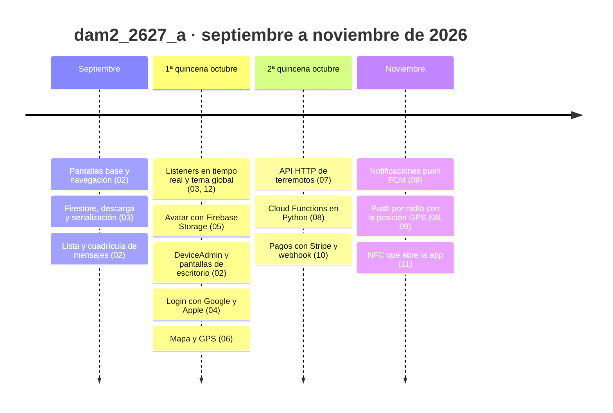

---

## 📚 Guías por módulo

Todas siguen la misma plantilla: 🎯 objetivos · 🧠 conceptos · 📁 archivos · 🗺 diagramas ·
👣 paso a paso · ⚙️ configuración · 🧪 cómo probar · 🐞 fallos conocidos · 🛠 ejercicios · ❓ autoevaluación.
Índice completo y ruta de lectura recomendada: **[docs/README.md](docs/README.md)**.

| | Guía | Qué aprendes |
|---|---|---|
|  | [01 · Arquitectura](docs/01-arquitectura.md) | Capas, singleton `Dataholder`, patrón Admin, arranque |
| 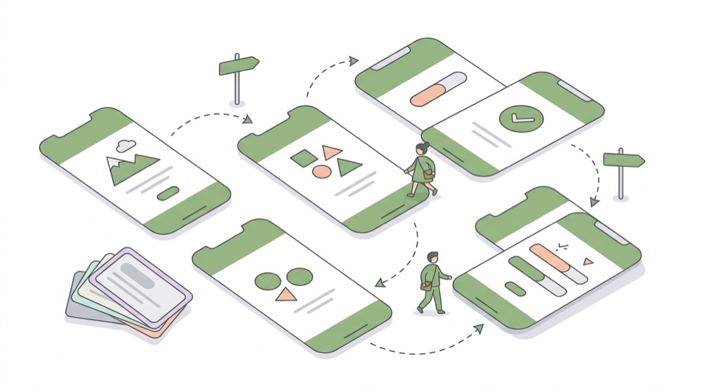 | [02 · Navegación y pantallas](docs/02-navegacion-y-pantallas.md) | Rutas con nombre, OnBoarding, cada pantalla, escritorio |
|  | [03 · Firestore y modelo de datos](docs/03-firestore-modelo-datos.md) | Colecciones, conversión Dart↔Firestore, tiempo real, reglas |
|  | [04 · Autenticación](docs/04-autenticacion.md) | Email, Google, Apple y el perfil del usuario |
| 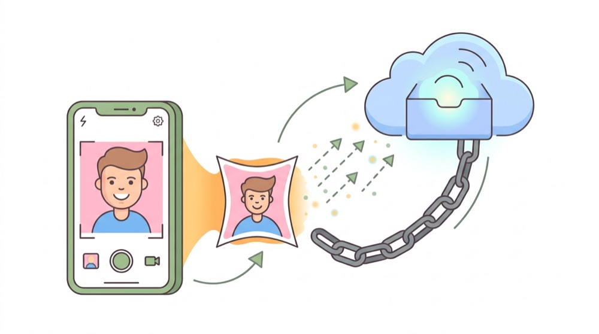 | [05 · Storage y avatar](docs/05-storage-avatar.md) | Cámara, compresión y subida de archivos |
| 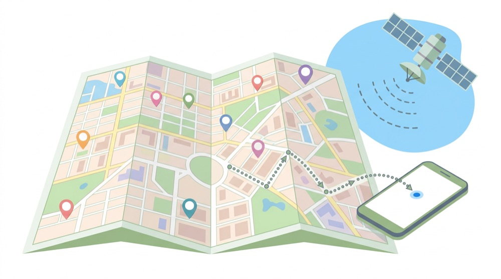 | [06 · Mapa y GPS](docs/06-mapa-gps.md) | Permisos, Streams de posición, `flutter_map` |
| 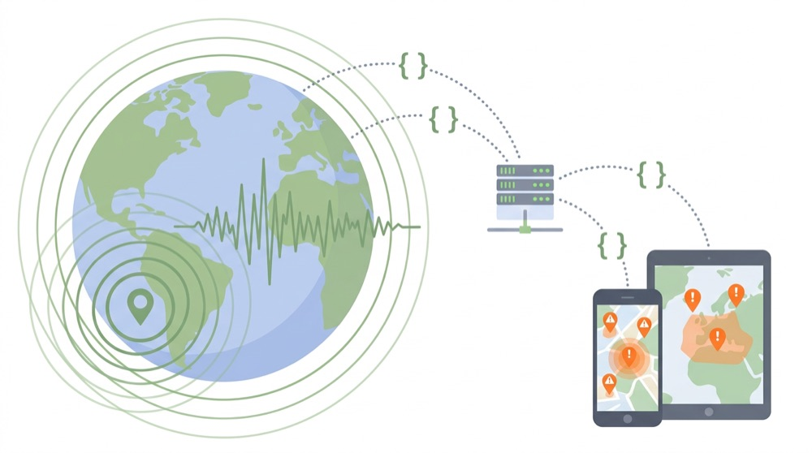 | [07 · API HTTP: terremotos](docs/07-api-http-terremotos.md) | HTTP, JSON/GeoJSON, de JSON a objetos |
| 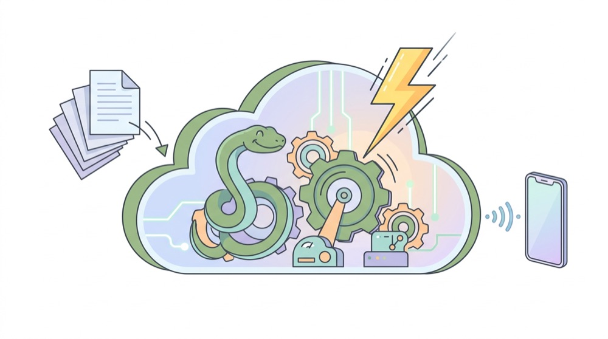 | [08 · Cloud Functions en Python](docs/08-cloud-functions-python.md) | Serverless, triggers, secretos, Postman |
| 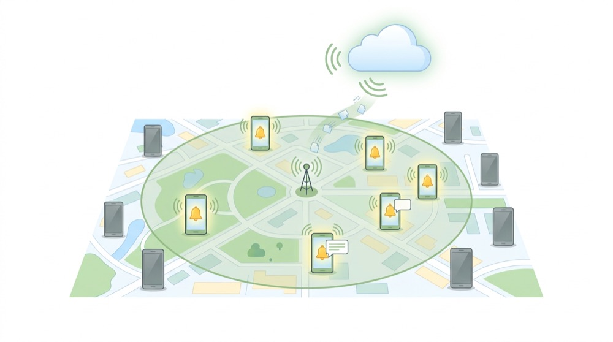 | [09 · Notificaciones push (FCM)](docs/09-notificaciones-push-fcm.md) | Token, estados de la app, push por radio |
| 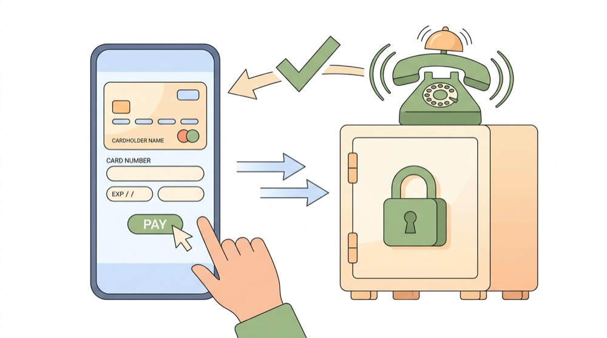 | [10 · Pagos con Stripe](docs/10-pagos-stripe.md) | PaymentIntent, PaymentSheet, webhook |
| 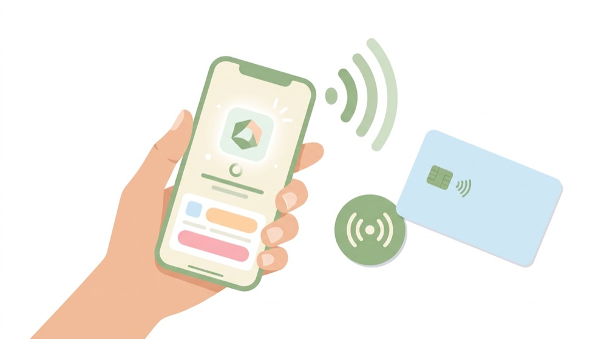 | [11 · NFC](docs/11-nfc.md) | Intents de Android, Kotlin, MethodChannel |
|  | [12 · Tema y estilos](docs/12-tema-y-estilos.md) | Tokens de diseño y `ThemeData` |
|  | [13 · Glosario](docs/13-glosario.md) | Todas las palabras técnicas, con analogías |

---

## 🗂 Estructura de carpetas

```
dam2_2627_a/
├── lib/
│   ├── main.dart                 ← Punto de entrada: Firebase, NFC, FCM y runApp()
│   ├── MiApp.dart                ← MaterialApp: rutas con nombre y tema global
│   ├── DataHolder.dart           ← Singleton con el estado compartido y todos los Admins
│   ├── firebase_options.dart     ← Generado por flutterfire (no está en Git)
│   ├── Admins/                   ← Un "Admin" por servicio
│   │   ├── FirebaseAdmin.dart    ← Perfil, POIs, transacciones en Firestore
│   │   ├── StorageAdmin.dart     ← Subida del avatar a Storage
│   │   ├── DeviceAdmin.dart      ← Plataforma, tamaño de pantalla, idioma
│   │   ├── GPSAdmin.dart         ← Permisos y posición GPS
│   │   ├── ApisAdmin.dart        ← Llamada HTTP a la API de terremotos
│   │   ├── FCMAdmin.dart         ← Notificaciones push
│   │   ├── StripeAdmin.dart      ← Pagos
│   │   └── NFCAdmin.dart         ← Lectura de tags NFC
│   ├── FbObjects/                ← Modelos que se guardan en Firestore
│   │   ├── Perfil.dart
│   │   ├── Mensaje.dart
│   │   └── Transaccion.dart
│   ├── APIObjects/
│   │   └── EarthQuake.dart       ← Modelo de un terremoto de la API
│   ├── views/                    ← Todas las pantallas (Login, Home, Mensajes, Mapa, Cobro…)
│   └── insLib/                   ← Widgets reutilizables y tema
│       ├── bot_bars/InsBotBarStyle1.dart
│       └── theme/AppTheme.dart
├── functions/                    ← Cloud Functions en Python (main.py, requirements.txt)
├── android/app/src/main/
│   ├── AndroidManifest.xml       ← Permisos (Internet, ubicación, NFC) e intent-filters
│   ├── kotlin/…/MainActivity.kt  ← Código nativo: canal NFC hacia Dart
│   └── res/xml/nfc_tech_filter.xml
├── docs/                         ← Guías didácticas, ilustraciones y capturas
├── .claude/                      ← Tutor IA (agente) y habilidades para Claude Code
├── .codex/                       ← Habilidades para Codex
├── firebase.json                 ← Configuración de Firebase CLI (Functions, Storage, emuladores, Hosting)
├── firestore.rules · storage.rules · firestore.indexes.json
└── pubspec.yaml                  ← Dependencias de Flutter
```

---

## 📦 Dependencias

| Paquete | Para qué | Dónde |
|---|---|---|
| `firebase_core` | Conectar con Firebase | `main.dart` |
| `firebase_auth` | Login | `LoginView`, `RegisterView`, `HomeProfileGate` |
| `cloud_firestore` | Base de datos | `FirebaseAdmin`, `Perfil`, `Mensaje` |
| `firebase_storage` | Archivos (avatar) | `StorageAdmin` |
| `cloud_functions` | Llamar a funciones *callable* | `StripeAdmin`, `FCMAdmin` |
| `firebase_messaging` | Notificaciones push | `FCMAdmin`, `main.dart` |
| `google_sign_in` | Login con Google | `LoginView` |
| `image_picker` · `flutter_image_compress` | Elegir y comprimir la foto | `EditProfileView`, `StorageAdmin` |
| `flutter_map` · `latlong2` | Mapa OpenStreetMap | `MapView`, `EarthQuake` |
| `geolocator` | GPS | `GPSAdmin`, `DataHolder`, `Perfil` |
| `flutter_stripe` | Pagos | `StripeAdmin` |
| `nfc_manager` | NFC | `NFCAdmin` |
| `intl` | Idioma y formatos | `DeviceAdmin` |

La lista exacta y las versiones están en [`pubspec.yaml`](pubspec.yaml).
> ⚠️ `ApisAdmin.dart` usa el paquete `http`, pero **no está declarado** en `pubspec.yaml` (llega de
> rebote por otra dependencia). Ver [guía 07](docs/07-api-http-terremotos.md).

---

## 🤖 Aprende con el tutor IA


El repositorio incluye un **tutor** preparado para este proyecto. Lee las guías de `docs/`, comprueba
el código real antes de contestar, te señala el `archivo:línea` exacto y, en los ejercicios, te da
**pistas** antes que soluciones.

**Con Claude Code** (en la carpeta del proyecto):

```bash
claude --agent tutor-dam2
```

Ejemplos de preguntas:

- *«¿Cómo llega una notificación push a los móviles que están a menos de 10 km?»*
- *«Explícame el NFC como si no supiera nada de Android.»*
- *«Quiero añadir un Admin para el acelerómetro, guíame.»*
- *«¿Por qué al abrir la app me sale la pantalla negra?»*

| Pieza | Qué hace |
|---|---|
| [`.claude/agents/tutor-dam2.md`](.claude/agents/tutor-dam2.md) | El tutor: cómo explica, qué guía lee para cada tema y sus límites |
| [`explicar-modulo`](.claude/skills/explicar-modulo/SKILL.md) | Explicación guiada de un módulo con diagrama y pregunta final |
| [`anadir-admin`](.claude/skills/anadir-admin/SKILL.md) | Receta para integrar un servicio nuevo siguiendo el patrón Admin |
| [`probar-en-movil`](.claude/skills/probar-en-movil/SKILL.md) | `flutter run`, `logcat`, simular NFC con `adb`, errores típicos |
| [`documentar-cambios`](.claude/skills/documentar-cambios/SKILL.md) | Mantener este README y `docs/` al día tras cada cambio |

**Con Codex:** las mismas habilidades están en [`.codex/skills/`](.codex/skills/) y
[`AGENTS.md`](AGENTS.md) le indica que actúe como el tutor. Pídele, por ejemplo:
**«Usa `$explicar-modulo` con el módulo de pagos»**.

---

## 🐞 Fallos conocidos

Este es un proyecto **de aprendizaje**: hay errores reales en el código y no se han escondido. Cada
guía los explica en su sección 🐞 (qué pasa · por qué · cómo se arreglaría), y son un buen punto de
partida para ejercicios. Los más importantes:

| Área | Fallo | Guía |
|---|---|---|
| 🔒 Seguridad | `firestore.rules` permite leer y escribir **a cualquiera** hasta 2030 (y no se despliega desde `firebase.json`); `storage.rules` igual hasta 2028 | [03](docs/03-firestore-modelo-datos.md) |
| ☁️ Functions | `enviarPushEnRadio` no devuelve el resultado y `pushMensajeRadio` usa una variable `req` que no existe → error cuando se excluye al emisor | [08](docs/08-cloud-functions-python.md) |
| 🔔 Push | El botón ➕ de Mensajes provoca **dos** notificaciones (la callable y el trigger `mensajeCreado`) | [09](docs/09-notificaciones-push-fcm.md) |
| 🗺 GPS | `initGPSUpdate()` se llama dentro de `build()`: abre un Stream nuevo en cada repintado | [06](docs/06-mapa-gps.md) |
| 🧭 Navegación | Las rutas `/HomeDesktopView` y `/LoginDesktopView` se usan pero no están registradas | [02](docs/02-navegacion-y-pantallas.md) |
| 🔐 Login | `LoginView` imprime la contraseña en consola; Apple no navega tras el login | [04](docs/04-autenticacion.md) |
| 🖼 Avatar | Volver a guardar un perfil que ya tiene foto puede fallar (`ficheroCargado!`) | [05](docs/05-storage-avatar.md) |
| 🌍 API | Fechas fijas en la URL y sin control de errores | [07](docs/07-api-http-terremotos.md) |
| 💳 Stripe | La transacción se guarda antes de pagar y queda "Incomplete" si se cancela | [10](docs/10-pagos-stripe.md) |
| 📶 NFC | Verificado con un *intent* simulado; **pendiente de probar con un tag real** | [11](docs/11-nfc.md) |

> 📖 **Caso real resuelto — la pantalla negra.** Al acercar un tag NFC con la sesión cerrada, la app
> se quedaba en negro: `FCMAdmin.iniciar()` lanzaba una excepción **antes de `runApp()`** y Flutter
> nunca llegaba a dibujar. Lección: el código que se ejecuta antes de `runApp` no debe poder fallar.
> Historia completa en la [guía 09](docs/09-notificaciones-push-fcm.md) y la [guía 11](docs/11-nfc.md).

---

## 🛠 Ejercicios propuestos

Ejercicios generales (cada guía tiene además los suyos, de menor a mayor dificultad):

- [ ] **Ruta inicial:** `MiApp` calcula `rutaInicial` pero luego usa siempre `"/Onboardingview"`.
- [ ] **Nombre fijo:** `ProfileView` guarda siempre `name: "Yony"`. Añade un campo para el nombre.
- [ ] **Errores visibles:** los errores de login y registro solo salen por consola (`print`). Muéstralos con un `SnackBar`.
- [ ] **Validación de campos:** `int.parse` / `double.parse` fallan si el texto no es un número. Usa `tryParse` o un `Form` con validadores.
- [ ] **Teclado numérico:** edad y altura deberían usar `keyboardType: TextInputType.number`.
- [ ] **Idioma de la barra inferior:** "Notifications" y "Messages" están en inglés.
- [ ] **`nombreController.text = "HOLA HOLA HOLA"`** está dentro de `build()` de `HomeView`: el campo se reinicia en cada repintado.
- [ ] **Pantalla de notificaciones:** el botón 🔔 aún no abre ninguna pantalla; conéctalo con `FCMAdmin.onPushReceived`.
- [ ] **NFC visible:** muestra el UID del tag en un `SnackBar` en vez de solo en consola.
- [ ] **Reglas seguras:** escribe reglas de Firestore para que cada usuario solo pueda escribir su `Perfiles/{uid}`.
- [ ] **Modo oscuro:** añade un `darkTheme` con los tokens de `AppTheme.dart`.
- [ ] **Código de plantilla:** `main.dart` y `test/widget_test.dart` todavía contienen el contador de ejemplo de Flutter (`MyApp`).

---

## 📝 Mantener la documentación

[`AGENTS.md`](AGENTS.md) (Codex) y [`CLAUDE.md`](CLAUDE.md) (Claude Code) piden usar la habilidad
`documentar-cambios` al terminar cualquier cambio de comportamiento, configuración o dependencias:
compara los cambios de Git con el código y actualiza solo la documentación afectada.

---

<p align="center">Hecho con 💚 en clase de DAM2 · Flutter + Firebase</p>
