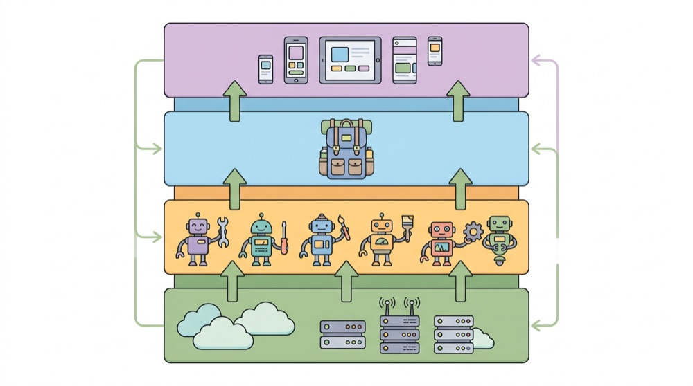
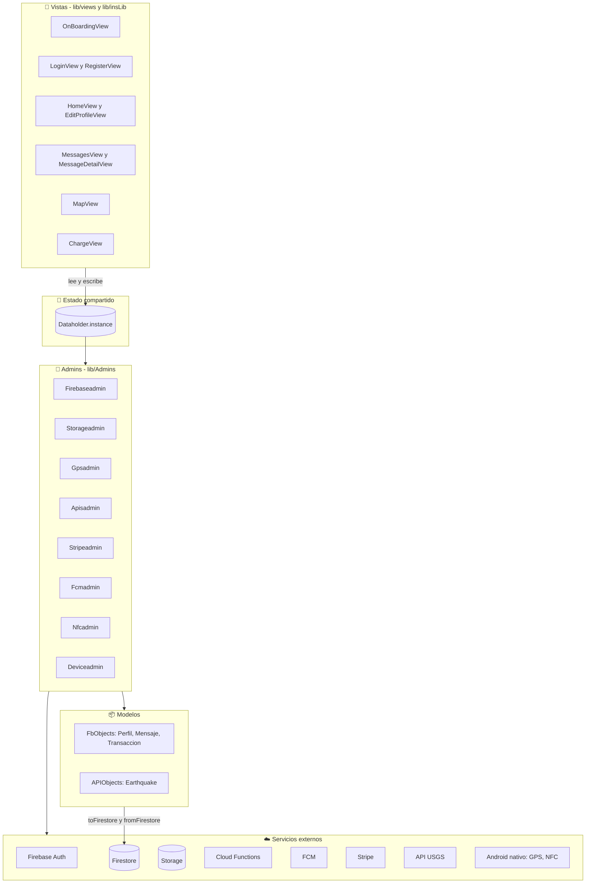
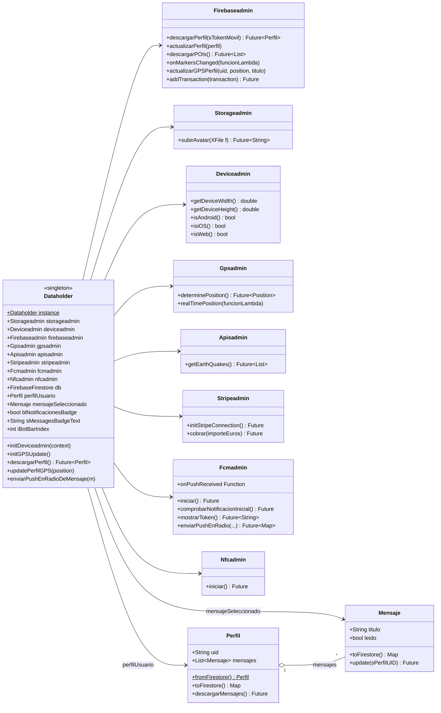
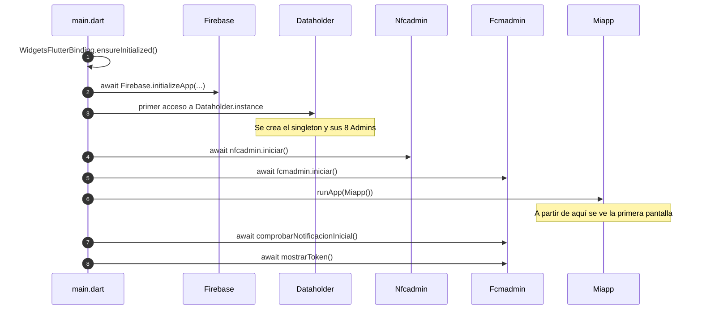
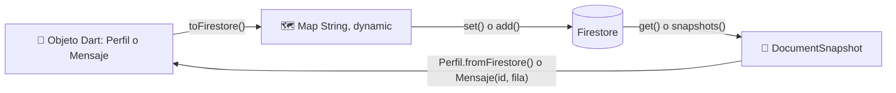
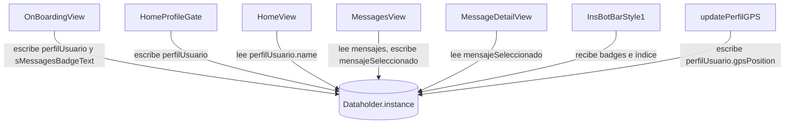

# 🏛 Arquitectura de la app

> [⬅ Índice de guías](README.md) · [🏠 README principal](../README.md)



Esta guía es el **mapa general** del proyecto. Antes de abrir el código de una pantalla concreta,
conviene saber en qué capa vive cada pieza, quién guarda los datos compartidos y en qué orden
arranca la app. El resto de guías profundizan en cada servicio por separado.

## 🎯 Qué vas a aprender

- Cómo se reparte el código en **capas**: vistas → `Dataholder` → *Admins* → modelos → servicios externos.
- Qué es el patrón **Singleton** y por qué `Dataholder` lo usa.
- Qué es el **"patrón Admin"** del proyecto: una clase por servicio, todas colgadas de `Dataholder`.
- En qué orden arranca la app en `main.dart` y por qué **nada que vaya antes de `runApp()` debe lanzar una excepción**.
- Cómo se convierte un objeto Dart en un documento de Firestore y al revés (`toFirestore` / `fromFirestore`).

## 🧠 Conceptos clave

| Término | Qué significa aquí |
|---|---|
| [Capa](13-glosario.md#capa) | Grupo de clases con una misma responsabilidad (dibujar, guardar estado, hablar con un servicio...). |
| [Singleton](13-glosario.md#singleton) | Clase de la que solo existe **un objeto** en toda la app. Piensa en ella como *la mochila compartida de la app*: todas las pantallas meten y sacan cosas de la misma mochila. |
| Admin | Nombre que usa este proyecto para una clase que **envuelve un servicio** (Firebase, GPS, Stripe...). No es un término de Flutter, es una convención de clase. |
| [Modelo](13-glosario.md#modelo) | Clase que solo representa datos (`Perfil`, `Mensaje`...). No dibuja nada. |
| [Callback](13-glosario.md#callback) | Función que pasas como parámetro para que *otro* la llame cuando ocurra algo. |
| [Future](13-glosario.md#future-y-await) / [async](13-glosario.md#future-y-await) | Valor que llegará más tarde; `await` espera a que llegue sin congelar la pantalla. |
| [late](13-glosario.md#late) | "Prometo darle valor antes de usarla". Si la lees antes, `LateInitializationError`. |

## 📁 Archivos implicados

| Archivo | Qué hace |
|---|---|
| [../lib/main.dart](../lib/main.dart) | Punto de entrada: inicializa Firebase, NFC y FCM y lanza `Miapp`. |
| [../lib/MiApp.dart](../lib/MiApp.dart) | `MaterialApp`: rutas con nombre y tema global. |
| [../lib/DataHolder.dart](../lib/DataHolder.dart) | Singleton con el estado compartido y los 8 *Admins*. |
| [../lib/Admins/](../lib/Admins/) | Un archivo por servicio externo (ver tabla de *Admins* más abajo). |
| [../lib/FbObjects/](../lib/FbObjects/) | Modelos que se guardan en Firestore: `Perfil`, `Mensaje`, `Transaccion`. |
| [../lib/APIObjects/](../lib/APIObjects/) | Modelos que vienen de una API HTTP externa: `Earthquake`. |
| [../lib/views/](../lib/views/) | Una clase por pantalla. |
| [../lib/insLib/](../lib/insLib/) | "Librería interna": barra inferior reutilizable y tokens de tema. |
| [../functions/main.py](../functions/main.py) | Código de **servidor** (Cloud Functions en Python). No se ejecuta en el móvil. |

Estructura de carpetas de `lib/`:

```
lib/
├── main.dart                  ← Punto de entrada
├── MiApp.dart                 ← MaterialApp: rutas y tema global
├── DataHolder.dart            ← Singleton: estado compartido + Admins
├── firebase_options.dart      ← Configuración de Firebase (autogenerado, no se edita)
├── Admins/                    ← Una clase por servicio
│   ├── ApisAdmin.dart          ← API HTTP de terremotos (USGS)
│   ├── DeviceAdmin.dart        ← Tamaño de pantalla y plataforma
│   ├── FCMAdmin.dart           ← Notificaciones push
│   ├── FirebaseAdmin.dart      ← Lecturas/escrituras de Firestore
│   ├── GPSAdmin.dart           ← Permisos y posición GPS
│   ├── NFCAdmin.dart           ← Lectura de tags NFC (Android)
│   ├── StorageAdmin.dart       ← Subida del avatar a Storage
│   └── StripeAdmin.dart        ← Cobros con Stripe
├── APIObjects/
│   └── EarthQuake.dart        ← Un terremoto leído de la API
├── FbObjects/
│   ├── Perfil.dart            ← Perfil del usuario + sus mensajes
│   ├── Mensaje.dart           ← Un mensaje
│   └── Transaccion.dart       ← Un intento de pago
├── views/                     ← Una clase por pantalla (ver guía 02)
└── insLib/
    ├── bot_bars/InsBotBarStyle1.dart  ← Barra inferior
    └── theme/AppTheme.dart            ← Colores, espacios, radios y textos
```

> ⚠️ `NFCAdmin.dart` y los cambios de NFC son trabajo reciente: si no los ves en GitHub es que
> todavía no se han subido al repositorio. Consulta [11-nfc.md](11-nfc.md).

## 🗺 Diagramas

### 1. Las capas

Cada capa solo habla con la de al lado. Las vistas no llaman directamente a Stripe ni al GPS:
piden las cosas a través de `Dataholder` y sus *Admins*.



| Capa | Responsabilidad | Ejemplo |
|---|---|---|
| **Vistas** | Dibujar y reaccionar a los toques | `MessagesView` pinta la lista |
| **Estado compartido** | Guardar datos que usan varias pantallas | `Dataholder.instance.perfilUsuario` |
| **Admins** | Hablar con *un* servicio externo | `Gpsadmin.determinePosition()` |
| **Modelos** | Representar datos y convertirlos | `Perfil.toFirestore()` |
| **Servicios externos** | Fuera de nuestro código | Firestore, Stripe, USGS... |

> 💡 Hay una excepción honesta a este dibujo: algunas vistas (por ejemplo `LoginView`,
> `ProfileView` o `HomeView`) todavía usan `FirebaseAuth.instance` o `FirebaseFirestore.instance`
> directamente. Es código de clase que ha ido creciendo; moverlo a `Firebaseadmin` es un buen
> ejercicio (ver abajo).

### 2. Diagrama de clases: Dataholder y sus Admins



### 3. Arranque de la app



### 4. Conversión Dart ↔ Firestore



## 👣 Paso a paso

### 1. El Singleton `Dataholder`

Abre [../lib/DataHolder.dart](../lib/DataHolder.dart). Fíjate en estas dos líneas
([DataHolder.dart:51](../lib/DataHolder.dart#L51) y [:55](../lib/DataHolder.dart#L55)):

```dart
Dataholder._();
static final Dataholder instance = Dataholder._();
```

- `Dataholder._()` es un **constructor privado**: el guion bajo lo hace privado al archivo, así
  nadie puede escribir `Dataholder()` desde otra clase y fabricar una segunda mochila.
- `static final instance` es **la única** instancia. `static` = pertenece a la clase;
  `final` = no se puede reasignar.

Desde cualquier pantalla se usa así:

```dart
Dataholder.instance.perfilUsuario.name
```

> 🔑 En Dart, una variable `static final` se crea **la primera vez que alguien la usa** (de forma
> perezosa). En este proyecto el primer uso ocurre en `main.dart`, *después* de
> `Firebase.initializeApp()`. Es importante: `Dataholder` guarda `FirebaseFirestore.instance` en
> sus campos, y eso fallaría si Firebase todavía no estuviera inicializado.

### 2. El "patrón Admin"

En lugar de que cada pantalla hable con Firebase, el GPS o Stripe a su manera, el proyecto crea
**una clase por servicio** y las cuelga todas de `Dataholder`
([DataHolder.dart:38-45](../lib/DataHolder.dart#L38-L45)):

```dart
Storageadmin storageadmin=Storageadmin();
late Deviceadmin deviceadmin;
Firebaseadmin firebaseadmin=Firebaseadmin();
Gpsadmin gpsadmin=Gpsadmin();
Apisadmin apisadmin=Apisadmin();
Stripeadmin stripeadmin =Stripeadmin();
Fcmadmin fcmadmin=Fcmadmin();
Nfcadmin nfcadmin=Nfcadmin();
```

| Admin | Archivo | En una línea | Guía |
|---|---|---|---|
| `Firebaseadmin` | [FirebaseAdmin.dart](../lib/Admins/FirebaseAdmin.dart) | Descarga/actualiza el perfil, POIs y transacciones en Firestore. | [03](03-firestore-modelo-datos.md) |
| `Storageadmin` | [StorageAdmin.dart](../lib/Admins/StorageAdmin.dart) | Comprime y sube el avatar a Firebase Storage. | [05](05-storage-avatar.md) |
| `Deviceadmin` | [DeviceAdmin.dart](../lib/Admins/DeviceAdmin.dart) | Ancho/alto de pantalla y plataforma (Android, iOS, web...). | [02](02-navegacion-y-pantallas.md) |
| `Gpsadmin` | [GPSAdmin.dart](../lib/Admins/GPSAdmin.dart) | Permisos de ubicación, posición actual y flujo de posiciones. | [06](06-mapa-gps.md) |
| `Apisadmin` | [ApisAdmin.dart](../lib/Admins/ApisAdmin.dart) | Descarga terremotos de la API HTTP de USGS. | [07](07-api-http-terremotos.md) |
| `Stripeadmin` | [StripeAdmin.dart](../lib/Admins/StripeAdmin.dart) | Configura Stripe y lanza la hoja de pago. | [10](10-pagos-stripe.md) |
| `Fcmadmin` | [FCMAdmin.dart](../lib/Admins/FCMAdmin.dart) | Permisos y recepción de notificaciones push; llama a la función de push por radio. | [09](09-notificaciones-push-fcm.md) |
| `Nfcadmin` | [NFCAdmin.dart](../lib/Admins/NFCAdmin.dart) | Lee el UID de tags NFC (solo Android). | [11](11-nfc.md) |

La parte de servidor (Cloud Functions en Python) no es un Admin: vive en otro proceso, en Google.
La explica [08-cloud-functions-python.md](08-cloud-functions-python.md).

> 💡 Ventaja del patrón: si mañana cambias de proveedor de mapas o de pagos, solo tocas **un**
> archivo. Las vistas siguen llamando a `Dataholder.instance.stripeadmin.cobrar(...)`.

> ⚠️ `deviceadmin` es `late` porque necesita un `BuildContext` para leer `MediaQuery`. Se rellena
> en `Miapp.build()` con `initDeviceadmin(context)` ([MiApp.dart:184](../lib/MiApp.dart#L184)).

### 3. El arranque en `main.dart`

Abre [../lib/main.dart](../lib/main.dart) ([main.dart:29-54](../lib/main.dart#L29-L54)). El orden
real es:

```dart
WidgetsFlutterBinding.ensureInitialized();
await Firebase.initializeApp(
  options: DefaultFirebaseOptions.currentPlatform,
);
await Dataholder.instance.nfcadmin.iniciar();
await Dataholder.instance.fcmadmin.iniciar();
runApp(Miapp());
await Dataholder.instance.fcmadmin.comprobarNotificacionInicial();
await Dataholder.instance.fcmadmin.mostrarToken();
```

1. `ensureInitialized()` crea el puente entre Dart y la plataforma nativa. Es obligatorio si hay
   `await` antes de `runApp()`.
2. `Firebase.initializeApp()` conecta con el proyecto de Firebase (configuración en
   `firebase_options.dart`).
3. `nfcadmin.iniciar()` comprueba si la app se ha abierto acercando un tag NFC.
4. `fcmadmin.iniciar()` registra los manejadores de notificaciones y pide permiso.
5. `runApp(Miapp())` **por fin dibuja algo**. Hasta aquí, el usuario ve la pantalla de
   arranque nativa (*splash*).
6. Después de `runApp` se comprueba si la app se abrió pulsando una notificación y se imprime el
   token FCM.

#### 🔬 Caso de estudio: la app que se quedaba en negro

En una versión anterior (la del último *commit*), `Fcmadmin.iniciar()` empezaba así:

```dart
final user = FirebaseAuth.instance.currentUser;
if (user == null) {
  throw StateError('Primero inicia sesión');
}
```

¿Qué pasaba si nadie había iniciado sesión? `iniciar()` lanzaba la excepción, el `await` de
`main()` la propagaba y **`runApp()` no se llegaba a ejecutar nunca**. Resultado: la app se
quedaba para siempre en la pantalla negra de arranque. Se vio en un móvil al abrir la app
acercando un tag NFC sin sesión iniciada. En la versión actual el profesor ha quitado esa
comprobación.

> 🔑 **Lección:** todo lo que hagas con `await` **antes** de `runApp()` no debe lanzar
> excepciones nunca. Si algo puede fallar, envuélvelo en `try/catch` o muévelo a después de
> `runApp()` (o a la primera pantalla, donde puedas enseñar un mensaje al usuario).

### 4. `Miapp.build()` y el `Dataholder`

[MiApp.dart:184-185](../lib/MiApp.dart#L184-L185):

```dart
Dataholder.instance.initDeviceadmin(context);
Dataholder.instance.initGPSUpdate();
```

`initGPSUpdate()` se suscribe al flujo del GPS y, con cada posición, guarda `gpsPosition` en el
perfil ([DataHolder.dart:81-83](../lib/DataHolder.dart#L81-L83) y
[:99-102](../lib/DataHolder.dart#L99-L102)). Ojo: `build()` se puede ejecutar **muchas veces**
(por ejemplo, al girar o redimensionar la ventana), y cada vez se abre una suscripción GPS nueva.
Lo verás en *Fallos conocidos*.

### 5. Quién lee y quién escribe en `Dataholder`

| Campo | Quién lo escribe | Quién lo lee |
|---|---|---|
| `perfilUsuario` | `Dataholder.descargarPerfil()` (lo llaman `OnBoardingView` y `LoginView`), `OnBoardingView`, `HomeProfileGate`, `LoginDesktopView`; `updatePerfilGPS` cambia su `gpsPosition` | `HomeView`, `HomeDesktopView`, `EditProfileView`, `MessagesView`, `MapView`, `Storageadmin`, `Stripeadmin` |
| `mensajeSeleccionado` | `MessagesView` al pulsar una fila | `MessageDetailView` |
| `sMessagesBadgeText` | `descargarPerfil()`, `OnBoardingView`, `HomeProfileGate`, `MessagesView` (lo vacía), `HomeDesktopView` | Pantallas que crean la barra inferior |
| `blNotificacionesBadge` | `HomeDesktopView` | Pantallas que crean la barra inferior |
| `iBotBarIndex` | `HomeView` (0), `MessagesView` (2), `MapView` (3), `ChargeView` (4), `HomeDesktopView` (0) | Barra inferior |
| `fcmadmin.onPushReceived` | `MessagesView` (en `initState`) | `Fcmadmin` al llegar una notificación |



### 6. Conversión Dart ↔ Firestore

Firestore no guarda objetos Dart: guarda **mapas** `clave: valor`. Por eso cada modelo sabe
convertirse en los dos sentidos.

**De objeto a mapa** — [Perfil.dart:91-100](../lib/FbObjects/Perfil.dart#L91-L100):

```dart
Map<String, dynamic> toFirestore() {
  return {
    if (name != null) "name": name,
    if (edad != null) "edad": edad,
    ...
  };
}
```

El `if` dentro del mapa (*collection if*) solo añade la clave si el valor no es `null`.

**De documento a objeto** — [Perfil.dart:73-87](../lib/FbObjects/Perfil.dart#L73-L87):

```dart
factory Perfil.fromFirestore(
    DocumentSnapshot<Map<String, dynamic>> snapshot,
    SnapshotOptions? options,
    ) {
  final data = snapshot.data();
  return Perfil(
    uid:snapshot.id,
    name: data?['name'] as String?,
    edad: (data?['edad'] as num?)?.toInt(),
    ...
```

Se conectan con `withConverter`, que enseña a Firestore a devolver un `Perfil` en lugar de un
`Map` ([FirebaseAdmin.dart:28-32](../lib/Admins/FirebaseAdmin.dart#L28-L32)):

```dart
final docRef = db.collection("Perfiles")
    .doc(fa.currentUser!.uid).withConverter(
  fromFirestore: Perfil.fromFirestore,
  toFirestore: (Perfil perfil, _) => perfil.toFirestore(),
);
```

`Mensaje` lo hace de otra forma (constructor `Mensaje(uid, fila)`,
[Mensaje.dart:46-55](../lib/FbObjects/Mensaje.dart#L46-L55)), y usa *casts* duros como
`fila["titulo"] as String`. Compara las dos formas en
[03-firestore-modelo-datos.md](03-firestore-modelo-datos.md).

## ⚙️ Configuración necesaria

- `lib/firebase_options.dart` y `android/app/google-services.json` deben corresponder **a tu**
  proyecto de Firebase. Se generan con `flutterfire configure`; no se editan a mano y no se
  copian de otro compañero.
- Cada servicio tiene su propia configuración (SHA para Google, claves de Stripe, permisos de GPS
  y NFC...). Está explicada en su guía.

## 🧪 Cómo probarlo

1. Ejecuta `flutter run` y mira la consola: verás los `print` del arranque (idioma del
   dispositivo de `Deviceadmin`, token FCM...).
2. Pon un *breakpoint* en `runApp(Miapp())` ([main.dart:49](../lib/main.dart#L49)) y comprueba
   que se alcanza tanto **con** sesión iniciada como **sin** ella.
3. Experimento del caso de estudio (en una rama tuya, no en `main`): añade
   `throw StateError('prueba');` al principio de `Nfcadmin.iniciar()`. Arranca la app: se queda
   en el *splash*. Ahora envuelve la llamada en `try/catch` en `main.dart` y comprueba que vuelve
   a arrancar.

## 🐞 Fallos conocidos y limitaciones

- **Suscripciones GPS repetidas** · `Miapp.build()` llama a `initGPSUpdate()` en cada *rebuild*, y
  `HomeView.initState` y `MapView` abren más flujos con `realTimePosition` · nunca se guarda ni
  se cancela la `StreamSubscription` · se arreglaría guardando la suscripción en `Gpsadmin`,
  abriéndola una sola vez (por ejemplo tras cargar el perfil) y cancelándola al cerrar sesión.
- **GPS antes del perfil** · `updatePerfilGPS` usa `perfilUsuario`, que es `late`; si llega una
  posición antes de que se haya cargado el perfil, salta `LateInitializationError` · el GPS se
  arranca en `Miapp.build()`, antes de saber quién es el usuario · se arreglaría arrancando el GPS
  después de `descargarPerfil()`.
- **El patrón Admin no se cumple en todas partes** · varias vistas usan `FirebaseFirestore.instance`
  o `FirebaseAuth.instance` directamente · el código ha crecido por fases · se arreglaría
  moviendo esas llamadas a métodos de `Firebaseadmin`.
- **Código de plantilla sin usar** · `main.dart` aún contiene `MyApp` y `MyHomePage` del ejemplo de
  `flutter create`, y `test/widget_test.dart` prueba esa plantilla en lugar de la app real · se
  dejó como referencia · se arreglaría borrándolas y escribiendo un test de `Miapp`.
- **Comentario de cabecera desactualizado** · el comentario de `MiApp.dart` dice que "no usa
  Dataholder", pero `build()` sí lo usa · se arreglaría actualizando el comentario.

## 🛠 Ejercicios

- [ ] Dibuja en papel las 5 capas y coloca en cada una 3 archivos del proyecto.
- [ ] Busca en `lib/views/` todas las llamadas directas a `FirebaseFirestore.instance` y haz una lista.
- [ ] Mueve el guardado del nombre de `HomeView.clickActualizarNombre` a un método nuevo
      `Firebaseadmin.guardarNombre(...)`.
- [ ] Envuelve `nfcadmin.iniciar()` y `fcmadmin.iniciar()` de `main.dart` en `try/catch` para que
      un fallo nunca impida llegar a `runApp()`.
- [ ] Haz que `Gpsadmin.realTimePosition` guarde su `StreamSubscription` y añade un método
      `pararGPS()`. Llama a `initGPSUpdate()` solo una vez.
- [ ] Reto: crea un Admin nuevo (`PreferenciasAdmin`) con `shared_preferences`, cuélgalo de
      `Dataholder` y úsalo para recordar el último email con el que se inició sesión.

## ❓ Autoevaluación

1. ¿Qué impide que alguien cree un segundo `Dataholder`?
   <details><summary>Ver respuesta</summary>El constructor privado <code>Dataholder._()</code>: solo se puede llamar desde el propio archivo. La única instancia es <code>static final instance</code>.</details>

2. ¿Por qué la app se quedaba en negro cuando `Fcmadmin.iniciar()` lanzaba `StateError`?
   <details><summary>Ver respuesta</summary>Porque se llamaba con <code>await</code> antes de <code>runApp()</code>. La excepción salía de <code>main()</code> y <code>runApp()</code> nunca se ejecutaba, así que no se dibujaba ninguna pantalla.</details>

3. ¿Qué Admin usarías para saber si la pantalla mide más de 1000 píxeles de ancho? ¿Y para pedir un `PaymentIntent`?
   <details><summary>Ver respuesta</summary><code>Deviceadmin.getDeviceWidth()</code> para el ancho. Para el pago, <code>Stripeadmin.cobrar()</code>, que a su vez llama a la Cloud Function <code>createPaymentIntent</code>.</details>

4. ¿Para qué sirve `withConverter`?
   <details><summary>Ver respuesta</summary>Para que Firestore convierta automáticamente el documento en un objeto Dart (con <code>fromFirestore</code>) y el objeto en mapa al guardarlo (con <code>toFirestore</code>). Así <code>docSnap.data()</code> devuelve un <code>Perfil</code> y no un <code>Map</code>.</details>

5. ¿Por qué es importante que el primer uso de `Dataholder.instance` ocurra después de `Firebase.initializeApp()`?
   <details><summary>Ver respuesta</summary>Porque al crearse, <code>Dataholder</code> y sus Admins leen <code>FirebaseFirestore.instance</code>, <code>FirebaseAuth.instance</code>, etc. Si Firebase no está inicializado, esas llamadas lanzan una excepción.</details>
