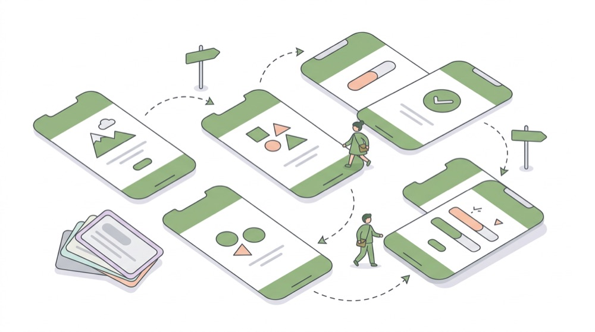
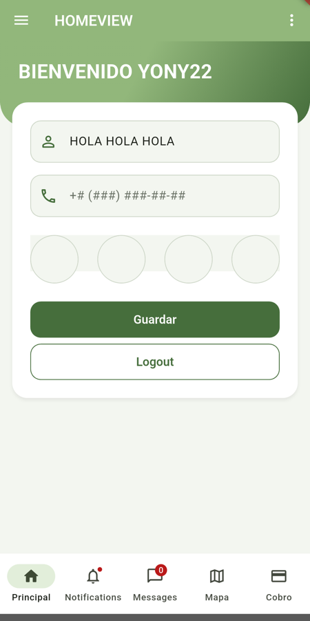
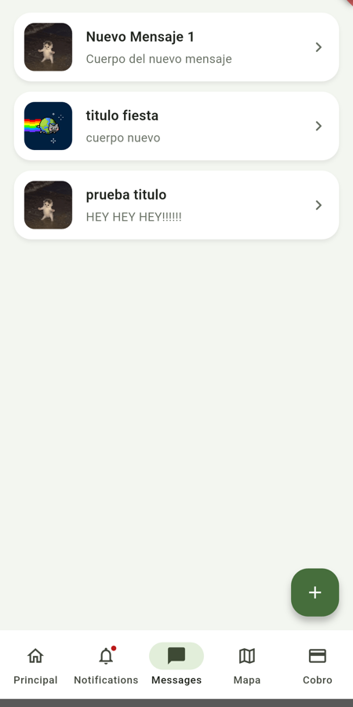
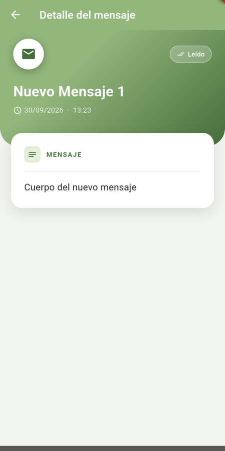
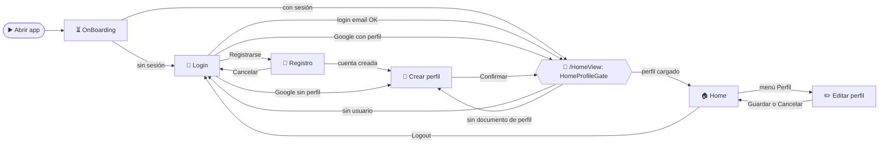
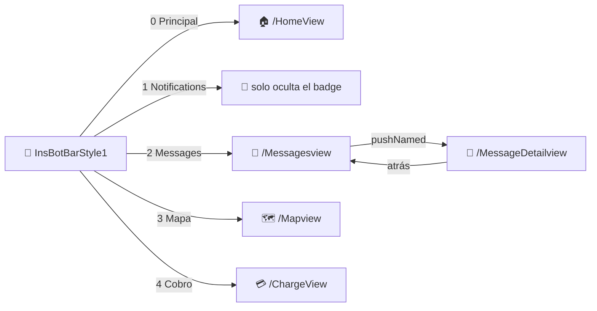
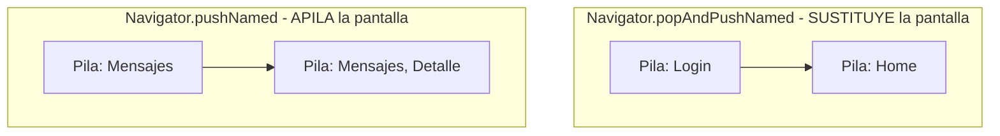
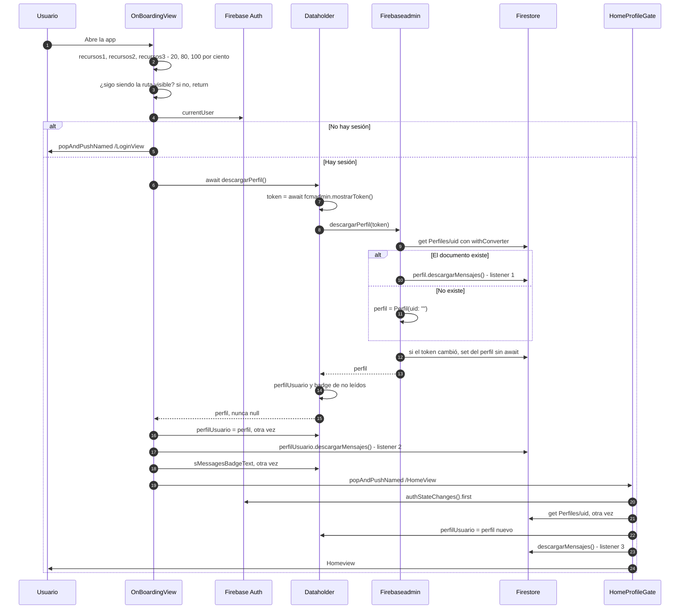
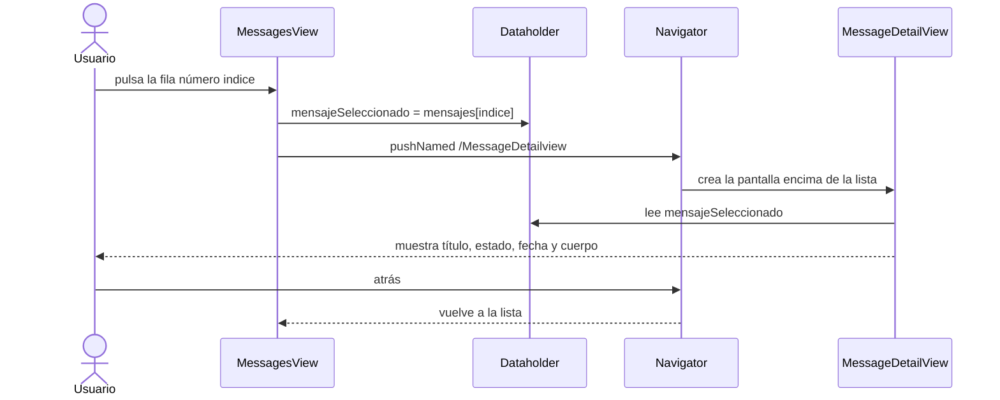

# 🧭 Navegación y pantallas

> [⬅ Índice de guías](README.md) · [🏠 README principal](../README.md)



**📸 Así se ve en Android:**

| Inicio | Mensajes | Detalle |
|:---:|:---:|:---:|
|  |  |  |

Una app de Flutter es una **pila de pantallas**. Esta guía explica cómo se registran las
pantallas como rutas con nombre, cómo se pasa de una a otra, qué decide la pantalla de carga
(`OnBoardingView`) y qué hace cada pantalla del proyecto.

## 🎯 Qué vas a aprender

- Qué son las **rutas con nombre** y cuáles tiene la app (son 10).
- La diferencia entre `pushNamed`, `popAndPushNamed` y `pushReplacementNamed`.
- Qué pasa **de verdad** al abrir la app: `OnBoardingView` y `HomeProfileGate`.
- Cómo cambia la app en pantallas anchas (más de 1000 px) y por qué hay un fallo con dos rutas.
- Cómo se pasa un dato de la lista al detalle **sin argumentos de ruta**, usando `Dataholder`.

## 🧠 Conceptos clave

| Término | Qué significa aquí |
|---|---|
| [Ruta](13-glosario.md#ruta) | Nombre de texto (`"/HomeView"`) asociado a una función que construye una pantalla. |
| [Navigator](13-glosario.md#navigator) | Objeto de Flutter que gestiona la **pila** de pantallas. Imagina una pila de platos: solo ves el de arriba. |
| [Widget](13-glosario.md#widget) | Pieza de interfaz. Una pantalla también es un widget. |
| [StatefulWidget](13-glosario.md#statefulwidget) | Widget con datos que cambian; se redibuja con `setState()`. |
| [initState](13-glosario.md#initstate) | Método que se ejecuta **una vez** al crear el estado de una pantalla. |
| [FutureBuilder](13-glosario.md#futurebuilder) | Widget que dibuja una cosa mientras espera un `Future` y otra cuando llega. |
| [Badge](13-glosario.md#badge) | Puntito o número encima de un icono (por ejemplo, mensajes sin leer). |

## 📁 Archivos implicados

| Archivo | Qué hace |
|---|---|
| [../lib/MiApp.dart](../lib/MiApp.dart) | Tabla de rutas, ruta inicial y variante de escritorio. |
| [../lib/views/OnBoardingView.dart](../lib/views/OnBoardingView.dart) | Pantalla de carga: decide si ir a Login o a Home. |
| [../lib/views/HomeProfileGate.dart](../lib/views/HomeProfileGate.dart) | "Puerta" de `/HomeView`: carga el perfil antes de enseñar Home. |
| [../lib/views/LoginView.dart](../lib/views/LoginView.dart) | Inicio de sesión (email, Google, Apple). |
| [../lib/views/RegisterView.dart](../lib/views/RegisterView.dart) | Crear cuenta. |
| [../lib/views/ProfileView.dart](../lib/views/ProfileView.dart) | Crear el perfil (edad y altura). |
| [../lib/views/HomeView.dart](../lib/views/HomeView.dart) | Pantalla principal (móvil). |
| [../lib/views/HomeDesktopView.dart](../lib/views/HomeDesktopView.dart) | Pantalla principal para pantallas anchas. |
| [../lib/views/LoginDesktopView.dart](../lib/views/LoginDesktopView.dart) | Login para pantallas anchas (**no conectado**). |
| [../lib/views/EditProfileView.dart](../lib/views/EditProfileView.dart) | Editar nombre, edad, altura y avatar. |
| [../lib/views/MessagesView.dart](../lib/views/MessagesView.dart) | Lista de mensajes. |
| [../lib/views/MessageDetailView.dart](../lib/views/MessageDetailView.dart) | Detalle de un mensaje. |
| [../lib/views/MapView.dart](../lib/views/MapView.dart) | Mapa con POIs y terremotos. |
| [../lib/views/ChargeView.dart](../lib/views/ChargeView.dart) | Formulario de cobro con Stripe. |
| [../lib/insLib/bot_bars/InsBotBarStyle1.dart](../lib/insLib/bot_bars/InsBotBarStyle1.dart) | Barra de navegación inferior (5 pestañas). |
| [../lib/Admins/DeviceAdmin.dart](../lib/Admins/DeviceAdmin.dart) | Da el ancho de pantalla para elegir la variante de escritorio. |

## 🗺 Diagramas

### 1. Mapa de navegación



### 2. Barra inferior: las 4 pantallas con pestañas



### 3. `popAndPushNamed` vs `pushNamed`



### 4. Qué pasa realmente en el OnBoarding

Este diagrama corrige el que había en el README antiguo (allí aparecía un método
`initFirebaseListeners()` que **no existe**).



> ⚠️ Fíjate en las tres palabras "otra vez": el perfil se descarga **dos** veces y se abren
> **tres** *listeners* de mensajes para la misma subcolección. Funciona, pero gasta lecturas y es
> un buen ejercicio de limpieza.

## 👣 Paso a paso

### 1. Rutas con nombre

En [MiApp.dart:188-200](../lib/MiApp.dart#L188-L200) se construye un mapa
"nombre de ruta → función que crea la pantalla":

```dart
Map<String, Widget Function(BuildContext)> rutasApp=
{
  "/LoginView" : (context) =>  Loginview(),
  "/HomeView" : (context) => HomeProfileGate(homeBuilder: (_) => Homeview()),
  ...
};
```

Y se le pasa al `MaterialApp` con la ruta inicial ([MiApp.dart:234-236](../lib/MiApp.dart#L234-L236)):

```dart
routes:rutasApp ,
initialRoute: "/Onboardingview",
```

Las 10 rutas registradas:

| Ruta | Pantalla | Cómo se llega |
|---|---|---|
| `/Onboardingview` | `Onboardingview` | **Ruta inicial** |
| `/LoginView` | `Loginview` | OnBoarding sin sesión, Logout, Cancelar registro |
| `/RegisterView` | `Registerview` | Botón *Registrarse* del login |
| `/Profileview` | `Profileview` | Tras registrarse, o Google sin perfil |
| `/HomeView` | `HomeProfileGate` → `Homeview` (o `HomeDesktopView` si ancho > 1000) | Login, OnBoarding, pestaña 0 |
| `/EditProfileview` | `Editprofileview` | Menú ⋮ → *Perfil* de Home |
| `/Messagesview` | `Messagesview` | Pestaña 2 |
| `/MessageDetailview` | `Messagedetailview` | Pulsar un mensaje |
| `/Mapview` | `Mapview` | Pestaña 3 |
| `/ChargeView` | `ChargeView` | Pestaña 4 |

> ⚠️ Los nombres se escriben **exactamente igual** (mayúsculas incluidas). Fíjate en que no son
> uniformes: `/LoginView` lleva `V` mayúscula pero `/Profileview` no. Un error de una letra
> provoca una excepción al navegar.

> 💡 En [MiApp.dart:221-224](../lib/MiApp.dart#L221-L224) se calcula una variable `rutaInicial`
> que **no se usa**: quien decide de verdad es `OnBoardingView`.

### 2. Tres formas de navegar

| Método | Qué hace con la pila | Dónde se usa |
|---|---|---|
| `Navigator.pushNamed` | Pone la pantalla nueva **encima**. Con ⬅ vuelves. | Lista → detalle; Home → editar perfil |
| `Navigator.popAndPushNamed` | **Quita** la actual y pone la nueva. No hay vuelta atrás. | Login, OnBoarding, barra inferior |
| `Navigator.pushReplacementNamed` | Parecido a `popAndPushNamed` (sustituye), con otra animación. | `LoginDesktopView`, `HomeDesktopView` |

Ejemplo de `pushNamed` esperando el regreso ([HomeView.dart:101-107](../lib/views/HomeView.dart#L101-L107)):

```dart
Future<void> funClickPerfil() async{
  await Navigator.pushNamed(miContext, "/EditProfileview");
  if(!mounted) return;
  setState(() {
    sNombre=Dataholder.instance.perfilUsuario.name ?? "";
  });
}
```

El `await` espera **hasta que el usuario vuelve** de la pantalla de edición; entonces refresca
el saludo.

### 3. OnBoardingView: la pantalla de carga

[OnBoardingView.dart:66-133](../lib/views/OnBoardingView.dart#L66-L133). Simula tres cargas de
1 segundo con barra de progreso y luego decide:

```dart
if(FirebaseAuth.instance.currentUser==null){
  Navigator.popAndPushNamed(context, "/LoginView");
}
else{
  ...
  final perfil=await Dataholder.instance.descargarPerfil();
  if (!mounted) return;
  if (perfil == null) {
    Navigator.popAndPushNamed(context, "/Profileview");
    return;
  }
```

> ⚠️ La rama `perfil == null` **nunca se ejecuta**: `Firebaseadmin.descargarPerfil()` siempre
> devuelve un `Perfil` (si no hay documento, devuelve `Perfil(uid: "")`,
> [FirebaseAdmin.dart:39-41](../lib/Admins/FirebaseAdmin.dart#L39-L41)). Mira la sección de fallos.

Antes de decidir, comprueba que sigue siendo la pantalla visible
([OnBoardingView.dart:84](../lib/views/OnBoardingView.dart#L84)):

```dart
if (!mounted || ModalRoute.of(context)?.isCurrent != true) return;
```

Esto sirve para la web: si alguien recarga directamente la URL `/HomeView`, OnBoarding queda
debajo y no debe navegar.

### 4. HomeProfileGate: la puerta de Home

`/HomeView` no construye `Homeview` directamente, sino `HomeProfileGate`
([HomeProfileGate.dart:28-51](../lib/views/HomeProfileGate.dart#L28-L51)):

```dart
final user = await FirebaseAuth.instance.authStateChanges().first;
if (user == null) return _HomeDestination.login;
...
final perfil = doc.data();
if (perfil == null) return _HomeDestination.profile;
```

Con un `FutureBuilder` enseña un indicador de carga, y luego **dibuja en el mismo sitio**
`Loginview()`, `Profileview()` o la Home ([HomeProfileGate.dart:77-81](../lib/views/HomeProfileGate.dart#L77-L81)).
Ojo: no navega; la URL sigue siendo `/HomeView` aunque veas el login.

> 🔑 `authStateChanges().first` espera a que Firebase Auth termine de restaurar la sesión. Al
> recargar la web, `currentUser` puede ser `null` durante un instante aunque haya sesión.

### 5. Las pantallas una a una

#### 🔐 LoginView — Iniciar sesión

```
┌──────────────────────────┐
│ MI APP DAM2627           │  ← AppBar verde (tema global)
├──────────────────────────┤
│ ╭──────────────────────╮ │
│ │        (🔒)          │ │  ← tarjeta centrada
│ │       LOGIN          │ │
│ │ 👤 Usuario           │ │
│ │ 🔑 Contraseña ●●●●●● │ │
│ │ [█████ Login █████]  │ │  ← acción principal (FilledButton)
│ │     Registrarse      │ │  ← acción secundaria (TextButton)
│ ╰──────────────────────╯ │
└──────────────────────────┘
```

- `funClickLogin` ([LoginView.dart:45-109](../lib/views/LoginView.dart#L45-L109)) llama a
  `signInWithEmailAndPassword`, después a `Dataholder.instance.descargarPerfil()` y navega
  **siempre** a `/HomeView` (la comprobación `temp==null` tampoco puede cumplirse). Es
  `HomeProfileGate` quien decide después.
- Botón Google solo en Android y botón Apple solo en iOS. Todo lo de autenticación está en
  [04-autenticacion.md](04-autenticacion.md).

#### 📝 RegisterView — Crear cuenta

- Tres campos: email, contraseña y repetir contraseña.
- Si no coinciden, solo lo imprime en consola ([RegisterView.dart:39-41](../lib/views/RegisterView.dart#L39-L41)).
- Si `createUserWithEmailAndPassword` va bien, `popAndPushNamed("/Profileview")`.

#### 👤 ProfileView — Crear perfil

- Pide **edad** y **altura**; botones `[ Salir ]  [█ Confirmar █]`.
- Guarda `Perfiles/{uid}` con `set()` y el nombre **fijo a "Yony"**
  ([ProfileView.dart:46-55](../lib/views/ProfileView.dart#L46-L55)).
- *Salir* llama a `exit(0)`, que no funciona en web.

#### 🏠 HomeView — Pantalla principal

```
┌──────────────────────────┐
│ ☰  HOMEVIEW          ⋮  │  ← menú lateral (Drawer) y menú de opciones
├──────────────────────────┤
│ ▓▓ BIENVENIDO <nombre> ▓▓│  ← cabecera con degradado verde
╰─┬──────────────────────┬─╯
  │ 👤 NOMBRE            │  ← tarjeta superpuesta: cambiar el nombre
  │ +# (###) ###-##-##   │  ← campo con máscara de teléfono
  │      ○ ○ ○ ○         │  ← PIN de 4 dígitos
  │ [█ Guardar █][Logout]│
  └──────────────────────┘
├──────────────────────────┤
│ 🏠   🔔   💬(3)   🗺️   💳 │  ← barra inferior con badges (5 pestañas)
└──────────────────────────┘
```

- **Guardar** cambia el nombre en pantalla, en `Dataholder` y en Firestore.
- **Logout** hace `signOut()` y `popAndPushNamed("/LoginView")` ([HomeView.dart:110-113](../lib/views/HomeView.dart#L110-L113)).
- Menú ⋮ con *Buscar*, *Perfil* y *Salir*. *Perfil* abre `EditProfileView`.
- Los botones `MENU1..MENU4` del Drawer no hacen nada todavía.

#### ✏️ EditProfileView — Editar perfil

- Formulario con nombre, edad y altura, relleno desde `Dataholder.instance.perfilUsuario`.
- Botones para elegir avatar con cámara o galería; al guardar lo sube a Storage y guarda la URL.
- Vuelve con `Navigator.pop(context)` ([EditProfileView.dart:132](../lib/views/EditProfileView.dart#L132)).
- Detalles y fallos del avatar en [05-storage-avatar.md](05-storage-avatar.md).

#### 💬 MessagesView — Lista de mensajes

```
┌──────────────────────────┐
│ ╭──────────────────────╮ │
│ │ 🐱  Título       ›   │ │  ← cada tarjeta es pulsable
│ │     Cuerpo (máx. 2…) │ │
│ ╰──────────────────────╯ │
│ ╭──────────────────────╮ │
│ │ 🐱  Título       ›   │ │
│ │     Cuerpo (máx. 2…) │ │
│ ╰──────────────────────╯ │
│                     (+)  │  ← añade un mensaje nuevo
├──────────────────────────┤
│ 🏠   🔔   💬   🗺️   💳     │
└──────────────────────────┘
```

- `ListView.separated` con `creadorDeItem` y `creadorDeSeparador`.
- En `initState` marca todos los mensajes como leídos y vacía el badge
  ([MessagesView.dart:47-64](../lib/views/MessagesView.dart#L47-L64)).
- El botón ➕ crea un mensaje, lo sube a Firestore **y** pide una notificación push por radio.
  El tiempo real se explica en [03-firestore-modelo-datos.md](03-firestore-modelo-datos.md); las
  push, en [09-notificaciones-push-fcm.md](09-notificaciones-push-fcm.md).
- `crearGrid()` es un ejemplo de `GridView` que no se usa.

#### 🔎 MessageDetailView — Detalle de un mensaje

```
┌──────────────────────────┐
│ ⬅ Detalle del mensaje    │
├──────────────────────────┤
│ (✉)            [✓ Leído] │  ← cabecera con degradado verde
│ Título del mensaje       │
│ 🕒 01/10/2026 · 14:05    │
╰─┬──────────────────────┬─╯
  │ 📝 MENSAJE           │   ← tarjeta superpuesta (con animación)
  │ ──────────────────── │
  │ Cuerpo del mensaje,  │
  │ se puede seleccionar │
  │ y copiar.            │
  └──────────────────────┘
```

- Lee `Dataholder.instance.mensajeSeleccionado!` ([MessageDetailView.dart:194](../lib/views/MessageDetailView.dart#L194)).
- Animación de entrada con `TweenAnimationBuilder` y texto copiable con `SelectableText`.
- Solo lee: no toca Firestore.

#### 🗺️ MapView — Mapa

- `FlutterMap` con teselas de OpenStreetMap, centrado en Madrid, con los POIs de Firestore y los
  terremotos de la API de USGS como marcadores.
- Al pulsar un terremoto aparece un panel naranja con su título y magnitud.
- Mientras está abierta, escribe tu posición en `POIs/{uid}`.
- Todo el detalle en [06-mapa-gps.md](06-mapa-gps.md) y [07-api-http-terremotos.md](07-api-http-terremotos.md).

#### 💳 ChargeView — Cobro

- Un `Form` con un campo *Importe* (0,50 € a 999.999,99 €, máximo dos decimales) y un botón
  *Pagar* que llama a `Dataholder.instance.stripeadmin.cobrar(amount)`
  ([ChargeView.dart:48-73](../lib/views/ChargeView.dart#L48-L73)).
- Todo el flujo de pago en [10-pagos-stripe.md](10-pagos-stripe.md).

### 6. La barra inferior `InsBotBarStyle1`

Es un widget reutilizable que crean `HomeView`, `MessagesView`, `MapView` y `ChargeView`. Cada
pantalla le pasa los datos de `Dataholder`
([MapView.dart:133-137](../lib/views/MapView.dart#L133-L137)):

```dart
bottomNavigationBar: Insbotbarstyle1(
    blBadge1: Dataholder.instance.blNotificacionesBadge,
    sBadge2: Dataholder.instance.sMessagesBadgeText,
    iBarIndex: Dataholder.instance.iBotBarIndex
),
```

| Índice | Botón | Qué hace ([InsBotBarStyle1.dart:48-85](../lib/insLib/bot_bars/InsBotBarStyle1.dart#L48-L85)) |
|---|---|---|
| 0 | 🏠 Principal | `popAndPushNamed("/HomeView")` |
| 1 | 🔔 Notifications | Solo oculta su badge. **No abre ninguna pantalla.** |
| 2 | 💬 Messages | Vacía el badge y `popAndPushNamed("/Messagesview")` |
| 3 | 🗺️ Mapa | Vacía el badge de mensajes (¡también!) y `popAndPushNamed("/Mapview")` |
| 4 | 💳 Cobro | `popAndPushNamed("/ChargeView")` |

> 💡 ¿Por qué los badges viven en `Dataholder` y no en la barra? Porque **cada pantalla crea su
> propia barra**. Si el dato estuviera dentro de la barra, se perdería al cambiar de pantalla.

### 7. Variantes de escritorio (más de 1000 px)

En [MiApp.dart:202-215](../lib/MiApp.dart#L202-L215), si el ancho supera 1000 píxeles lógicos,
el mapa de rutas se sustituye por otro idéntico salvo `/HomeView`:

```dart
if(Dataholder.instance.deviceadmin.getDeviceWidth()>1000){
  rutasApp={
    ...
    "/HomeView" : (context) => HomeProfileGate(homeBuilder: (_) => HomeDesktopView()),
```

`HomeDesktopView` tiene un menú lateral propio en lugar de la barra inferior.
`LoginDesktopView` existe pero **ninguna ruta la construye**.

### 8. De la lista al detalle



Código clave ([MessagesView.dart:92-100](../lib/views/MessagesView.dart#L92-L100)):

```dart
return GestureDetector(
  onTap: () {
    Dataholder.instance.mensajeSeleccionado=Dataholder.instance.perfilUsuario.mensajes[indice];
    Navigator.pushNamed(context, "/MessageDetailview");
  },
```

> 💡 Otra forma habitual sería pasar el mensaje como argumento de la ruta
> (`pushNamed(context, ruta, arguments: mensaje)` y leerlo con
> `ModalRoute.of(context)!.settings.arguments`). Aquí se usa `Dataholder` porque ya es la
> mochila compartida.

## ⚙️ Configuración necesaria

No hace falta nada especial: las rutas están en código. Para probar la variante de escritorio
necesitas una ventana de más de 1000 px de ancho (web, macOS o una tablet en horizontal).

## 🧪 Cómo probarlo

1. **Sin sesión:** borra los datos de la app (o usa una cuenta nueva). Verás 3 segundos de
   OnBoarding y después el login.
2. **Con sesión:** vuelve a abrir la app. Debe pasar por OnBoarding, un indicador de carga
   breve (la puerta) y Home.
3. **Pila:** desde Mensajes abre un detalle y pulsa ⬅ (vuelves). Desde Home pulsa *Logout* y
   luego el botón atrás del sistema: no vuelves a Home porque se usó `popAndPushNamed`.
4. **Escritorio:** `flutter run -d chrome`, maximiza la ventana y entra en Home: verás
   `HomeDesktopView`. Ahora pulsa su botón de cerrar sesión y mira la consola (ver fallos).

## 🐞 Fallos conocidos y limitaciones

- **Rutas de escritorio sin registrar** · `HomeDesktopView` hace
  `pushReplacementNamed(context, '/LoginDesktopView')` al cerrar sesión
  ([HomeDesktopView.dart:82](../lib/views/HomeDesktopView.dart#L82)) y `LoginDesktopView` navega a
  `'/HomeDesktopView'` ([LoginDesktopView.dart:67](../lib/views/LoginDesktopView.dart#L67)), pero
  **ninguna de esas dos rutas está en `rutasApp`** · Flutter no encuentra la ruta y lanza una
  excepción (la sesión ya se ha cerrado, pero la pantalla no cambia) · se arreglaría registrando
  `/LoginDesktopView` en el mapa de escritorio, o usando `/LoginView` y `/HomeView`, que ya eligen
  la variante correcta.
- **Usuario con sesión pero sin perfil se queda atascado** · si alguien se registra y cierra la app
  antes de pulsar *Confirmar* en ProfileView, al volver `descargarPerfil()` devuelve
  `Perfil(uid: "")` y OnBoarding llama a `descargarMensajes()` con un `uid` vacío; la ruta
  `"Perfiles//Mensajes"` hace que `cloud_firestore` lance `ArgumentError` y la barra se queda en
  100 % · `descargarPerfil` nunca devuelve `null` y además escribe un documento con solo
  `sTokenMovil` · se arreglaría devolviendo `Perfil?` (`null` si no hay documento) y no escribiendo
  el token hasta que exista el perfil.
- **`HomeView` con perfil incompleto** · `sNombre=Dataholder.instance.perfilUsuario.name!`
  ([HomeView.dart:45](../lib/views/HomeView.dart#L45)) falla si el documento existe pero no tiene
  `name` (el caso anterior, en la siguiente apertura) · se arreglaría con `name ?? ""`.
- **Listeners de mensajes duplicados** · ver diagrama 4 · se arreglaría abriendo el listener en un
  solo sitio (por ejemplo, solo en `HomeProfileGate`).
- **Pestaña 🔔 sin pantalla y badge que reaparece** · `case 1` solo cambia `widget.blBadge1` dentro
  de esa barra; no guarda nada en `Dataholder` · se arreglaría poniendo
  `Dataholder.instance.blNotificacionesBadge=false` y creando una pantalla de notificaciones.
- **La pestaña Mapa borra el badge de mensajes** · `case 3` copia el `setState` de `case 2` ·
  se arreglaría quitando esas líneas.
- **Comentario de cabecera desactualizado** · `InsBotBarStyle1.dart` dice que la barra tiene 3
  pestañas; tiene 5.
- **Mezcla de idiomas** · "Notifications" y "Messages" en inglés; el resto en español.

## 🛠 Ejercicios

- [ ] Traduce las etiquetas "Notifications" y "Messages" de la barra inferior.
- [ ] Quita el `setState` que vacía `sBadge2` en la pestaña *Mapa*.
- [ ] Haz que la pestaña 🔔 guarde `Dataholder.instance.blNotificacionesBadge=false`.
- [ ] Registra `/LoginDesktopView` y comprueba que cerrar sesión en escritorio ya no falla.
- [ ] Pasa el mensaje al detalle con `arguments` en vez de con `Dataholder.mensajeSeleccionado`.
- [ ] Crea una pantalla `NotificationsView`, regístrala como ruta y ábrela desde la pestaña 1.
- [ ] Reto: haz que `descargarPerfil()` devuelva `Perfil?` y que OnBoarding, de verdad, envíe a
      `/Profileview` a quien no tiene perfil. Elimina los listeners duplicados.

## ❓ Autoevaluación

1. ¿Qué diferencia hay entre `pushNamed` y `popAndPushNamed`?
   <details><summary>Ver respuesta</summary><code>pushNamed</code> apila la pantalla nueva encima de la actual (se puede volver con atrás). <code>popAndPushNamed</code> quita la actual y pone la nueva, así que no se puede volver.</details>

2. ¿Por qué tras el login se usa `popAndPushNamed` y no `pushNamed`?
   <details><summary>Ver respuesta</summary>Para que el botón atrás no devuelva al usuario a la pantalla de login una vez dentro.</details>

3. Si recargas la web en la URL `/HomeView` sin sesión, ¿qué ves y quién lo decide?
   <details><summary>Ver respuesta</summary>Ves el login. Lo decide <code>HomeProfileGate</code>: <code>authStateChanges().first</code> devuelve <code>null</code> y el <code>FutureBuilder</code> dibuja <code>Loginview()</code> en el mismo sitio, sin cambiar la URL.</details>

4. ¿Por qué el badge de mensajes se guarda en `Dataholder` y no dentro de `Insbotbarstyle1`?
   <details><summary>Ver respuesta</summary>Porque cada pantalla crea una barra nueva. Si el valor viviera dentro de la barra, se perdería al cambiar de pantalla; en <code>Dataholder</code> lo comparten todas.</details>

5. ¿Qué pasa si en una pantalla ancha cierras sesión desde `HomeDesktopView`? ¿Por qué?
   <details><summary>Ver respuesta</summary>Se cierra la sesión pero la navegación falla con una excepción, porque <code>/LoginDesktopView</code> no está registrada en el mapa de rutas de <code>MiApp</code>.</details>
