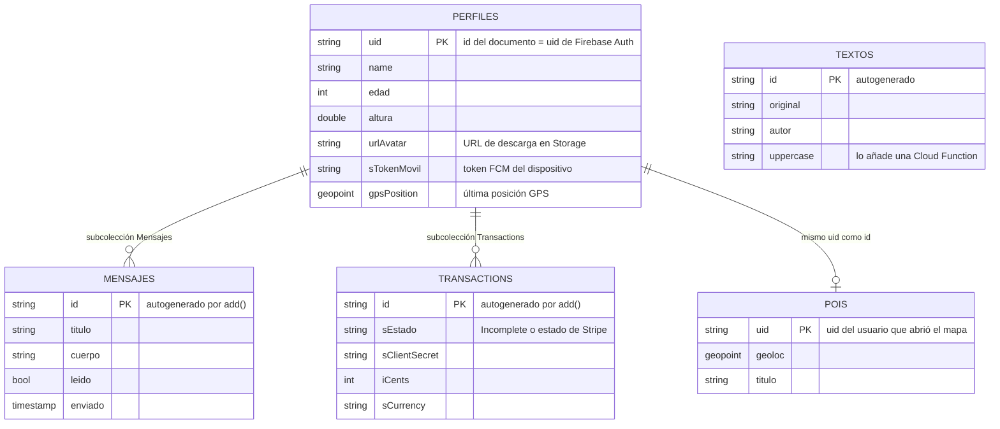
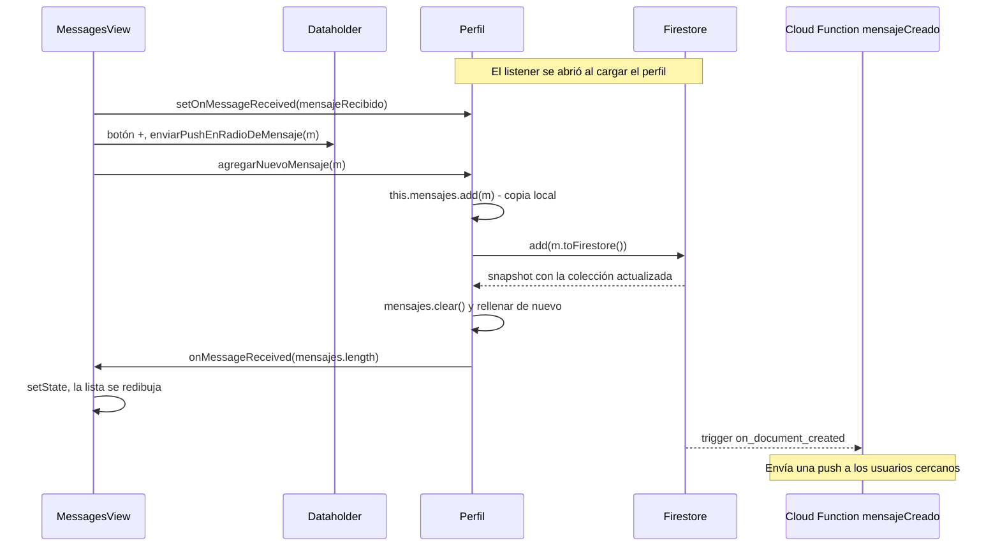
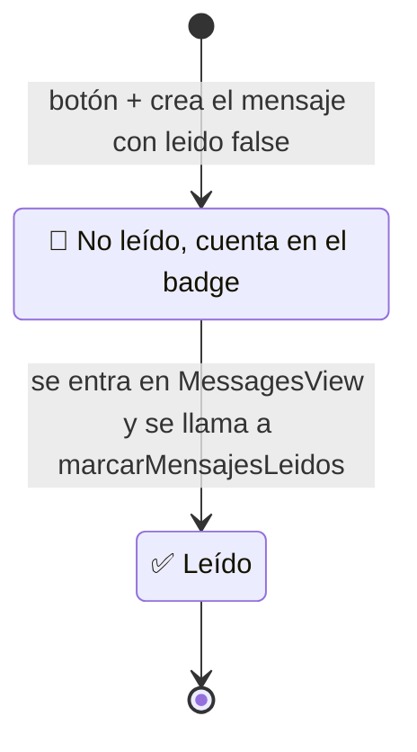

# 🔥 Firestore: modelo de datos, tiempo real y reglas

> [⬅ Índice de guías](README.md) · [🏠 README principal](../README.md)


Cloud Firestore es la base de datos de la app. Aquí verás **qué colecciones existen**, qué campos
tiene cada documento, **quién escribe y quién lee** cada campo, cómo funcionan los mensajes en
tiempo real y por qué las reglas de seguridad actuales son peligrosas.

## 🎯 Qué vas a aprender

- Cómo se organiza la base de datos: colecciones, documentos y subcolecciones.
- Qué campos tiene cada documento, de qué tipo son y qué parte del código los toca.
- Cómo funciona un *listener* en tiempo real (`snapshots().listen`) y el ciclo leído/no leído.
- Qué dicen `firestore.rules` y `storage.rules`, por qué son peligrosas y cómo escribir una regla más segura.
- Para qué sirve `firestore.indexes.json` y por qué ahora mismo **no se despliega**.

## 🧠 Conceptos clave

| Término | Qué significa aquí |
|---|---|
| [Colección](13-glosario.md#coleccion) | Carpeta de documentos (`Perfiles`, `POIs`...). |
| [Documento](13-glosario.md#documento) | Una "ficha" con campos `clave: valor`, identificada por un id. |
| [Subcolección](13-glosario.md#subcoleccion) | Colección que cuelga de un documento: `Perfiles/{uid}/Mensajes`. |
| [UID](13-glosario.md#uid) | Identificador del usuario en Firebase Auth. Aquí también es el id de su documento de perfil. |
| [Listener](13-glosario.md#listener) | Suscripción que recibe un aviso cada vez que cambian los datos. Como seguir a alguien en una red social: no preguntas, te avisan. |
| [Stream](13-glosario.md#stream) | Secuencia de valores que llegan con el tiempo (`snapshots()` devuelve uno). |
| [Timestamp](13-glosario.md#timestamp) / [GeoPoint](13-glosario.md#geopoint) | Tipos propios de Firestore para fechas y coordenadas. |
| [Reglas de seguridad](13-glosario.md#reglas-de-seguridad) | Código que decide en el servidor quién puede leer o escribir cada documento. |
| [Índice](13-glosario.md#indice) | Estructura que Firestore necesita para responder consultas con varios filtros. |

## 📁 Archivos implicados

| Archivo | Qué hace |
|---|---|
| [../lib/FbObjects/Perfil.dart](../lib/FbObjects/Perfil.dart) | Modelo del perfil; escucha la subcolección de mensajes. |
| [../lib/FbObjects/Mensaje.dart](../lib/FbObjects/Mensaje.dart) | Modelo de un mensaje; sabe guardarse con `update()`. |
| [../lib/FbObjects/Transaccion.dart](../lib/FbObjects/Transaccion.dart) | Modelo de un intento de pago. |
| [../lib/Admins/FirebaseAdmin.dart](../lib/Admins/FirebaseAdmin.dart) | Descarga/actualiza el perfil, POIs y transacciones. |
| [../lib/views/MessagesView.dart](../lib/views/MessagesView.dart) | Muestra los mensajes y crea mensajes nuevos. |
| [../functions/main.py](../functions/main.py) | Cloud Functions que leen y escriben Firestore desde el servidor. |
| [../firestore.rules](../firestore.rules) | Reglas de seguridad de Firestore (**no se despliegan**, ver abajo). |
| [../storage.rules](../storage.rules) | Reglas de seguridad de Storage (sí se despliegan). |
| [../firestore.indexes.json](../firestore.indexes.json) | Índice compuesto para `Mensajes` (**no se despliega**). |
| [../firebase.json](../firebase.json) | Configuración de la CLI de Firebase: qué se despliega y emuladores. |

> ⚠️ `firestore.rules` y `firestore.indexes.json` son archivos recientes. Si los enlaces no
> funcionan en GitHub es que todavía no se han subido al repositorio.

## 🗺 Diagramas

### 1. Diagrama entidad-relación



### 2. Árbol de rutas

```
Perfiles/                          ← colección
└── {uid}                          ← un documento por usuario (id = uid de Auth)
    ├── name: "Yony"
    ├── edad: 20
    ├── altura: 1.80
    ├── urlAvatar: "https://..."   ← solo si se ha guardado una foto
    ├── sTokenMovil: "..."         ← token FCM para notificaciones push
    ├── gpsPosition: GeoPoint      ← se actualiza con el GPS
    ├── Mensajes/                  ← subcolección
    │   ├── {idMensaje}
    │   │   ├── titulo: "Hola"
    │   │   ├── cuerpo: "..."
    │   │   ├── leido: false
    │   │   └── enviado: Timestamp
    │   └── ...
    └── Transactions/              ← subcolección
        └── {idTransaccion}
            ├── sEstado: "Incomplete"
            ├── sClientSecret: "..."
            ├── iCents: 1050
            └── sCurrency: "eur"

POIs/
└── {uid}                          ← misma clave que el perfil
    ├── geoloc: GeoPoint
    └── titulo: ""

Textos/                            ← solo para la demo de Cloud Functions
└── {idAuto}
    ├── original: "hola"
    ├── autor: "..."
    └── uppercase: "HOLA"
```

> 💡 El **id del documento del perfil es el mismo `uid`** que da Firebase Auth. Así, sabiendo quién
> ha iniciado sesión, encuentras su perfil sin buscar: `Perfiles/{uid}`.

### 3. Mensajes en tiempo real



### 4. Ciclo de vida de un mensaje



> 🔑 Fíjate en un detalle: `marcarMensajesLeidos()` se llama en `initState` de `MessagesView`. Si
> creas un mensaje **mientras estás en la lista**, se queda como *no leído* hasta que vuelvas a
> entrar.

## 👣 Paso a paso

### 1. Campo a campo: quién escribe y quién lee

**`Perfiles/{uid}`**

| Campo | Tipo | Quién lo escribe | Quién lo lee |
|---|---|---|---|
| `name` | string | `ProfileView.funConfirmar` (siempre `"Yony"`), `HomeView.clickActualizarNombre`, `EditProfileView.clickGuardar` | `Perfil.fromFirestore` → `HomeView`, `EditProfileView` |
| `edad` | int | `ProfileView`, `EditProfileView` | `EditProfileView` |
| `altura` | double | `ProfileView`, `EditProfileView` | `EditProfileView` |
| `urlAvatar` | string | `EditProfileView` tras `Storageadmin.subirAvatar` | Constructor de `Perfil` (crea `Image.network`) |
| `sTokenMovil` | string | `Firebaseadmin.descargarPerfil` si el token cambió | Cloud Function `pushMensajeRadio` |
| `gpsPosition` | GeoPoint | `Dataholder.updatePerfilGPS` → `Firebaseadmin.actualizarPerfil` | `Dataholder.enviarPushEnRadioDeMensaje`, Cloud Functions `mensajeCreado` y `pushMensajeRadio` |

**`Perfiles/{uid}/Mensajes/{id}`**

| Campo | Tipo | Quién lo escribe | Quién lo lee |
|---|---|---|---|
| `titulo` | string | `Perfil.agregarNuevoMensaje` (botón ➕) | `Perfil.descargarMensajes`, Cloud Function `mensajeCreado` |
| `cuerpo` | string | `Perfil.agregarNuevoMensaje` | `Perfil.descargarMensajes`, `mensajeCreado` |
| `leido` | bool | `agregarNuevoMensaje` (`false`), `Mensaje.update` desde `marcarMensajesLeidos` (`true`) | Badge de no leídos, `MessageDetailView` |
| `enviado` | Timestamp | `agregarNuevoMensaje` | `MessageDetailView` (fecha) |

**`Perfiles/{uid}/Transactions/{id}`** (detalles en [10-pagos-stripe.md](10-pagos-stripe.md))

| Campo | Tipo | Quién lo escribe | Quién lo lee |
|---|---|---|---|
| `sEstado` | string | `Firebaseadmin.addTransaction` (`"Incomplete"`); Cloud Function `stripeWebhook` | *Listener* de `addTransaction` (solo `print`) |
| `sClientSecret` | string | `Firebaseadmin.addTransaction` | `stripeWebhook` (busca la transacción por este campo) |
| `iCents` | int | `addTransaction`; `stripeWebhook` | — |
| `sCurrency` | string | `addTransaction`; `stripeWebhook` | — |

**`POIs/{uid}`** (detalles en [06-mapa-gps.md](06-mapa-gps.md))

| Campo | Tipo | Quién lo escribe | Quién lo lee |
|---|---|---|---|
| `geoloc` | GeoPoint | `Firebaseadmin.actualizarGPSPerfil` desde `MapView` | `Firebaseadmin.descargarPOIs` |
| `titulo` | string | `actualizarGPSPerfil` (siempre `""`) | — |

**`Textos/{id}`** — solo la demo de [08-cloud-functions-python.md](08-cloud-functions-python.md):
`addmessage` escribe `original` y `autor`; el *trigger* `makeuppercase` añade `uppercase`.

### 2. Leer el perfil con `withConverter`

[FirebaseAdmin.dart:24-52](../lib/Admins/FirebaseAdmin.dart#L24-L52):

```dart
final docSnap = await docRef.get();
perfilTemp=docSnap.data();

if(perfilTemp==null){
  perfilTemp=Perfil(uid: "");
}
else{
  perfilTemp.descargarMensajes();
}

if(perfilTemp.sTokenMovil!=sTokenMovil){
  perfilTemp.sTokenMovil=sTokenMovil;
  docRef.set(perfilTemp);
}
```

Fíjate en dos cosas:

- Si no existe el documento, **no devuelve `null`**, sino un perfil con `uid` vacío.
- Si el token FCM ha cambiado, **guarda el perfil entero** con `set()` (sin `await`).

### 3. Escribir: `set()` vs `set(merge)` vs `add()` vs `update()`

| Operación | Qué hace | Dónde se usa |
|---|---|---|
| `doc(id).set(mapa)` | Crea o **sustituye entero** el documento | `ProfileView`, `HomeView`, `Firebaseadmin.actualizarPerfil`, `Mensaje.update` |
| `doc(id).set(mapa, SetOptions(merge: true))` | Crea o **mezcla**: solo cambia los campos que envías | `EditProfileView` ([EditProfileView.dart:126](../lib/views/EditProfileView.dart#L126)) |
| `collection.add(mapa)` | Crea un documento con **id automático** | `Perfil.agregarNuevoMensaje`, `Firebaseadmin.addTransaction` |
| `doc(id).update(mapa)` | Cambia campos de un documento que **ya existe** | Cloud Functions (`makeuppercase`) |

> ⚠️ `Firebaseadmin.actualizarPerfil` ([FirebaseAdmin.dart:54-61](../lib/Admins/FirebaseAdmin.dart#L54-L61))
> usa `set()` **sin** `merge` y se llama **con cada posición del GPS**. Sustituye el documento
> por lo que haya en memoria: si otro dispositivo cambió el nombre, se pierde.

### 4. Los mensajes en tiempo real

[Perfil.dart:118-142](../lib/FbObjects/Perfil.dart#L118-L142):

```dart
final docRef=db.collection("Perfiles/"+uid!+"/Mensajes")
    .limit(20);

docRef.snapshots().listen(
      (event) {
        mensajes.clear();
        for (var docSnapshot in event.docs) {
          Map<String,dynamic> fila=docSnapshot.data();
          mensajes.add(Mensaje(docSnapshot.id,fila));
        }
        onMessageReceived?.call(mensajes.length);
      } ,
  onError: (error) => print("Listen failed: $error"),
);
```

- `snapshots()` devuelve un `Stream`; `listen` registra una función que se ejecuta **con cada
  cambio** (también los hechos desde otro móvil o desde la consola de Firebase).
- Cada evento trae **todos** los documentos de la consulta, por eso se vacía la lista y se rellena.
- `onMessageReceived` es un [callback](13-glosario.md#callback): `MessagesView` le pasa su método
  `mensajeRecibido`, que hace `setState`. Así el modelo avisa a la vista **sin conocerla**.

> 🔑 `listen()` **no espera** a que lleguen los datos. Por eso el `print("HAY EN TOTAL: ...")` de
> la línea 156 casi siempre muestra 0, y el `await descargarMensajes()` de OnBoarding no garantiza
> que la lista esté llena al contar los no leídos.

### 5. Leer un mensaje: dos estilos

`Perfil` usa `fromFirestore` con `as String?` (tolera campos que faltan). `Mensaje` usa *casts*
duros ([Mensaje.dart:50-53](../lib/FbObjects/Mensaje.dart#L50-L53)):

```dart
this.titulo=fila["titulo"] as String;
this.cuerpo=fila["cuerpo"] as String;
this.leido=fila["leido"] as bool;
this.enviado=fila["enviado"] as Timestamp;
```

Si creas a mano en la consola un mensaje sin `enviado`, el `as Timestamp` lanza una excepción
dentro del *listener* y la lista deja de actualizarse.

### 6. Reglas de seguridad

Las reglas se ejecutan **en el servidor de Google**, no en la app. Son la única protección real:
cualquiera puede sacar la configuración de Firebase de tu APK y hablar con tu base de datos sin
pasar por tu código.

[firestore.rules:15-17](../firestore.rules):

```
match /{document=**} {
  allow read, write: if request.time < timestamp.date(2030, 1, 10);
}
```

[storage.rules:18-20](../storage.rules):

```
match /{allPaths=**} {
  allow read, write: if request.time < timestamp.date(2028, 2, 20);
}
```

Traducido: **cualquier persona, sin iniciar sesión**, puede leer, modificar y borrar **todo**
hasta esa fecha. Es la plantilla de "modo de prueba" de Firebase.

> ⚠️ ¿Qué podría hacer un atacante? Leer los `sTokenMovil` y `gpsPosition` de todos los usuarios
> (¡dónde está cada uno!), cambiar el nombre de otro, marcar sus mensajes como leídos, borrar
> `Perfiles` entero o sustituir avatares en Storage.

**Una regla más segura** (para practicar; ver ejercicios):

```
rules_version = '2';
service cloud.firestore {
  match /databases/{database}/documents {
    match /Perfiles/{uid} {
      allow read, write: if request.auth != null && request.auth.uid == uid;

      match /Mensajes/{mensajeId} {
        allow read, write: if request.auth != null && request.auth.uid == uid;
      }
    }
    match /POIs/{uid} {
      allow read: if request.auth != null;
      allow write: if request.auth != null && request.auth.uid == uid;
    }
  }
}
```

- `request.auth` es el usuario que hace la petición (`null` si no ha iniciado sesión).
- `{uid}` captura el id del documento; la regla exige que **coincida** con quien pide.

> 💡 Las Cloud Functions usan el **Admin SDK**, que se salta las reglas. Por eso
> `pushMensajeRadio` puede seguir leyendo todos los perfiles aunque cierres las reglas.
> `Transactions` merece una regla propia: el cliente debería poder crear, pero no cambiar
> `sEstado` (solo el *webhook* debería hacerlo).

### 7. Índices: `firestore.indexes.json`

Firestore indexa cada campo por separado de forma automática. Pero una consulta que combina
**igualdad en un campo y rango en otro** necesita un **índice compuesto**. En
[Perfil.dart:119-120](../lib/FbObjects/Perfil.dart#L119-L120) hay dos filtros comentados:

```dart
//.where("leido",isEqualTo: false)
//.where("enviado",isGreaterThan: timestamp)
```

Si los descomentas, Firestore responde con un error que incluye un enlace para crear el índice.
`firestore.indexes.json` describe justo ese índice: colección `Mensajes`, `leido` ascendente +
`enviado` ascendente (el `__name__` final lo añade Firebase solo).

### 8. El problema de `firebase.json`

[firebase.json](../firebase.json) tiene claves `storage`, `functions`, `hosting` y `emulators`,
pero **no tiene clave `firestore`**. Consecuencia: `firebase deploy` **no sube**
`firestore.rules` ni `firestore.indexes.json`. Las reglas que están activas de verdad son las que
haya en la consola de Firebase, y pueden ser distintas de las del archivo.

Para que se desplieguen habría que añadir:

```json
"firestore": {
  "rules": "firestore.rules",
  "indexes": "firestore.indexes.json"
},
```

## ⚙️ Configuración necesaria

- Base de datos Firestore creada en tu proyecto (consola de Firebase → *Firestore Database*).
- Para desplegar reglas e índices: Firebase CLI (`npm i -g firebase-tools`), `firebase login` y la
  clave `firestore` en `firebase.json`. Después: `firebase deploy --only firestore`.
- Para probar sin tocar la base real, `firebase.json` ya configura el emulador de Firestore en el
  puerto 8080 (`firebase emulators:start`). La conexión al emulador **no** está activada en el
  código Dart.

## 🧪 Cómo probarlo

1. Abre la app en el móvil y la consola de Firebase en el ordenador, en
   `Perfiles/{tu uid}/Mensajes`.
2. Pulsa ➕ en la lista de mensajes: aparece un documento nuevo en la consola.
3. En la consola, cambia el `titulo` de un mensaje: la lista del móvil se actualiza **sola**
   (eso es el *listener*).
4. Pon `leido` a `false` en varios mensajes, cierra y abre la app: el badge 💬 muestra cuántos
   hay sin leer (si los mensajes han llegado a tiempo, ver punto 4 del paso a paso).
5. Reglas: en la consola, pestaña *Reglas*, usa el **simulador** con una lectura de
   `/Perfiles/OTRO_UID` sin autenticación. Con las reglas actuales, se permite.

## 🐞 Fallos conocidos y limitaciones

- **Reglas abiertas a todo el mundo** · `firestore.rules` y `storage.rules` permiten leer y escribir
  sin autenticación hasta 2030/2028 · es la plantilla del modo de prueba · se arreglaría con
  reglas por `request.auth.uid` como la del paso 6.
- **Reglas e índices de Firestore sin desplegar** · falta la clave `firestore` en `firebase.json` ·
  se arreglaría añadiéndola (paso 8).
- **`set()` sin `merge` con cada posición GPS** · `actualizarPerfil` reescribe el perfil entero cada
  2 metros · puede pisar cambios de otro dispositivo y gasta escrituras · se arreglaría con
  `update({"gpsPosition": ...})` y limitando la frecuencia.
- **`descargarPerfil` nunca devuelve `null` y crea documentos incompletos** · si no hay perfil,
  devuelve `Perfil(uid: "")` y, si hay token, escribe un documento con solo `sTokenMovil` · ver
  [02-navegacion-y-pantallas.md](02-navegacion-y-pantallas.md) · se arreglaría devolviendo
  `Perfil?`.
- **Listeners duplicados y nunca cancelados** · `descargarMensajes()` se llama varias veces y no se
  guarda la `StreamSubscription` · cada llamada abre un *listener* más y al cerrar sesión siguen
  activos · se arreglaría guardando la suscripción y llamando a `cancel()`.
- **`setState` tras `dispose`** · `MessagesView` no se desuscribe del callback; si llega un cambio
  estando en otra pantalla, se llama a `setState` de un `State` destruido · se arreglaría con
  `dispose()` → `setOnMessageReceived(null)`.
- **Casts duros en `Mensaje`** · un documento sin algún campo rompe el *listener* · se arreglaría con
  `as String?` y valores por defecto.
- **Solo 20 mensajes y sin orden** · `.limit(20)` sin `orderBy` devuelve 20 cualquiera · se
  arreglaría con `.orderBy("enviado", descending: true).limit(20)`.

## 🛠 Ejercicios

- [ ] Crea un mensaje a mano desde la consola de Firebase con los 4 campos y comprueba que aparece.
- [ ] Ahora créalo **sin** `enviado` y observa el error. Arregla `Mensaje(uid, fila)` con `as Timestamp?`.
- [ ] Añade `.orderBy("enviado", descending: true)` a la consulta de mensajes.
- [ ] Descomenta el filtro `leido == false` + `enviado > timestamp` y crea el índice con el enlace del error.
- [ ] Añade la clave `firestore` a `firebase.json` y despliega las reglas en el **emulador** primero.
- [ ] Escribe y prueba en el simulador de la consola la regla `request.auth.uid == uid` para
      `Perfiles` y su subcolección `Mensajes`.
- [ ] Cambia `actualizarPerfil` para que use `update({"gpsPosition": ...})`.
- [ ] Reto: guarda la `StreamSubscription` de `descargarMensajes` en `Perfil`, cancélala al hacer
      *logout* y evita abrir más de un *listener*.

## ❓ Autoevaluación

1. ¿Por qué el id del documento de perfil es el `uid` de Firebase Auth?
   <details><summary>Ver respuesta</summary>Porque así se encuentra directamente el perfil del usuario conectado con <code>Perfiles/{uid}</code>, sin hacer búsquedas, y cada cuenta tiene exactamente un perfil.</details>

2. ¿Qué diferencia hay entre `get()` y `snapshots().listen()`?
   <details><summary>Ver respuesta</summary><code>get()</code> lee una vez y termina. <code>snapshots().listen()</code> se queda suscrito y ejecuta su función con cada cambio en los datos, hasta que se cancela.</details>

3. ¿Qué diferencia hay entre `set()` y `set(..., SetOptions(merge: true))`?
   <details><summary>Ver respuesta</summary><code>set()</code> sustituye el documento entero (los campos que no envías desaparecen). Con <code>merge: true</code> solo se cambian los campos enviados y se conservan los demás.</details>

4. Con las reglas actuales, ¿puede alguien sin cuenta leer la posición GPS de todos los usuarios?
   <details><summary>Ver respuesta</summary>Sí. La regla permite <code>read, write</code> sobre <code>/{document=**}</code> a cualquiera hasta 2030, incluidos <code>gpsPosition</code> y <code>sTokenMovil</code>.</details>

5. Has cambiado `firestore.rules` y ejecutado `firebase deploy`, pero en la consola siguen las reglas viejas. ¿Por qué?
   <details><summary>Ver respuesta</summary>Porque <code>firebase.json</code> no tiene la clave <code>firestore</code>, así que la CLI no sabe que tiene que subir ese archivo.</details>

6. ¿Para qué sirve el índice de `firestore.indexes.json`?
   <details><summary>Ver respuesta</summary>Para la consulta (ahora comentada) que filtra <code>leido == false</code> y <code>enviado</code> mayor que una fecha. Combinar igualdad en un campo y rango en otro necesita un índice compuesto.</details>
