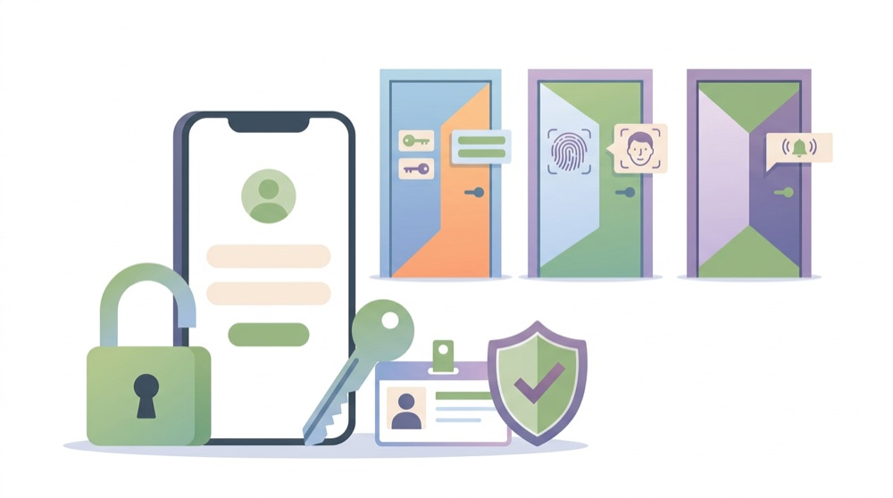
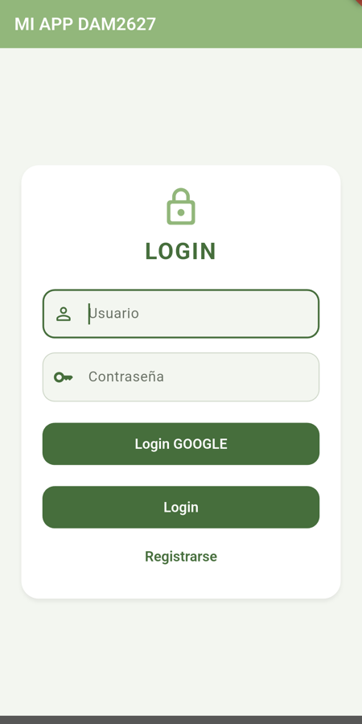
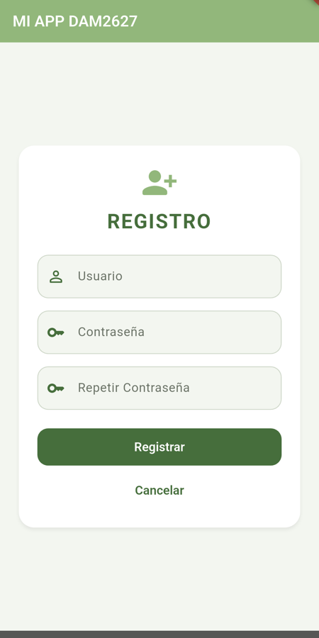
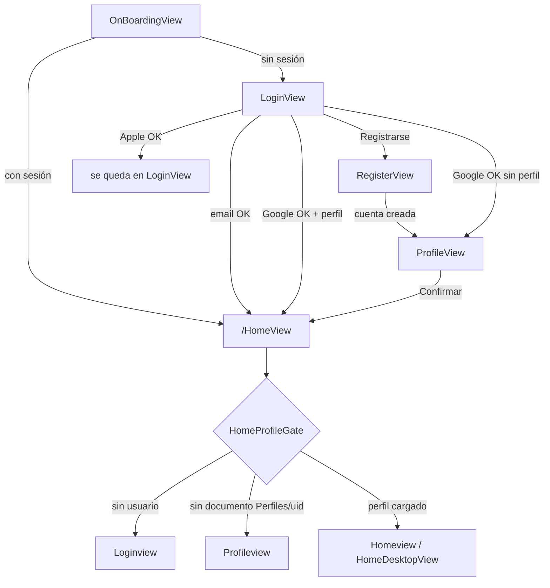
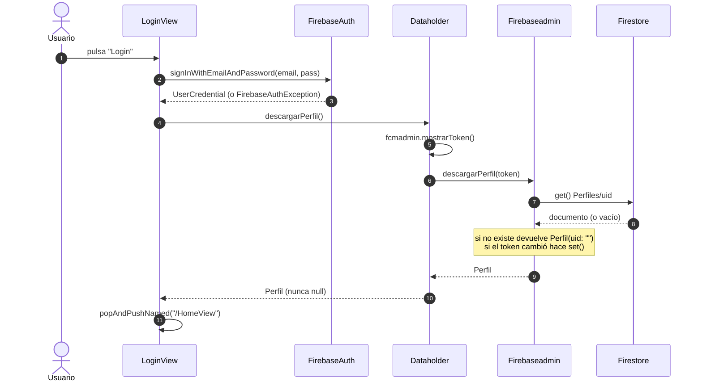
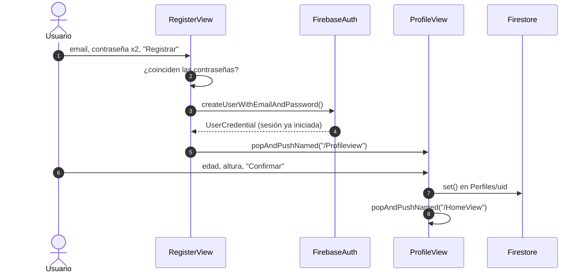
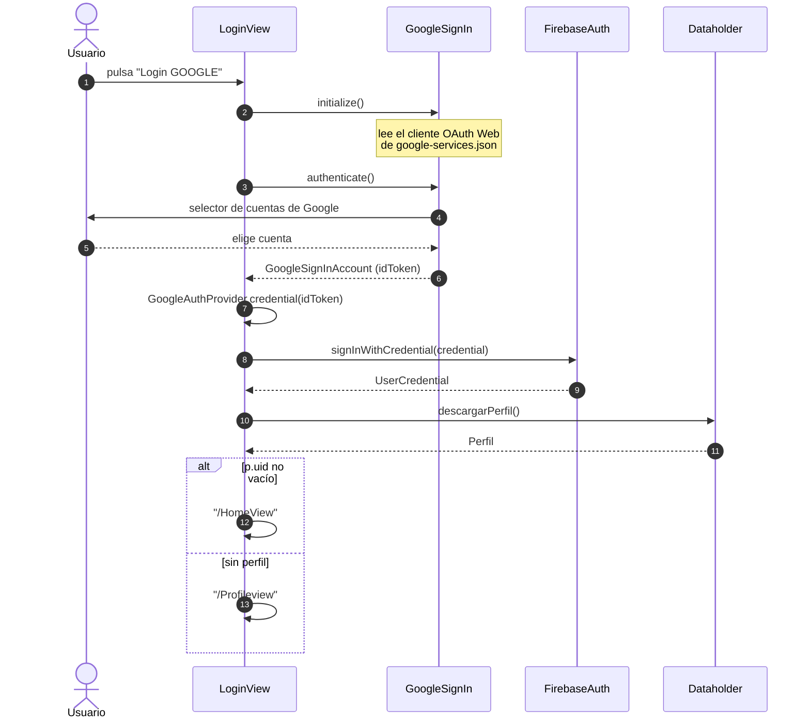
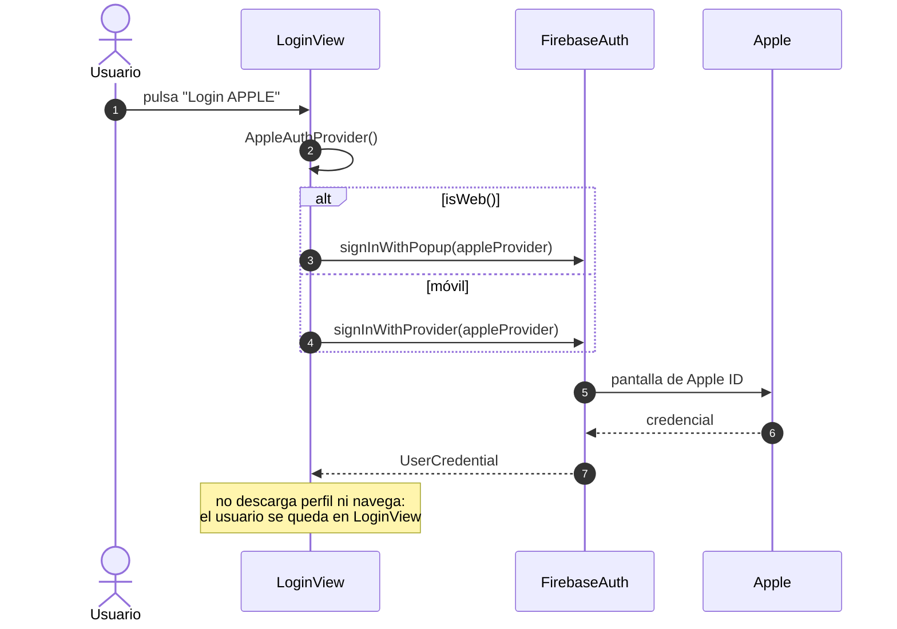

# 🔐 Autenticación: email, Google y Apple

> [⬅ Índice de guías](README.md) · [🏠 README principal](../README.md)



**📸 Así se ve en Android:**

| Login | Registro |
|:---:|:---:|
|  |  |

## 🎯 Qué vas a aprender

- Cómo se **registra** y cómo **inicia sesión** un usuario con email y contraseña en Firebase Authentication.
- Por qué una cuenta (Auth) y un perfil (Firestore) son **dos cosas distintas** unidas por el mismo `uid`.
- Cómo funciona el login con **Google** en Android y qué hay que configurar (huellas SHA, cliente OAuth Web).
- Cómo está planteado el login con **Apple** en iOS/web y qué le falta.
- Qué hace `HomeProfileGate` para no entrar en Home sin perfil.
- Qué efectos secundarios tiene `descargarPerfil()` (sí, **escribe** en Firestore).
- Cómo `Deviceadmin` decide qué botones de login aparecen.

## 🧠 Conceptos clave

| Término | Qué es (en una frase) |
|---|---|
| [Autenticación](13-glosario.md#autenticacion) | Demostrar **quién eres** (email+contraseña, cuenta de Google, Apple ID). |
| `uid` | Identificador único que Firebase Auth da a cada usuario. Lo usamos como id del documento `Perfiles/{uid}`. |
| [Proveedor](13-glosario.md#proveedor) | "Puerta de entrada" a Firebase Auth: Email/Password, Google, Apple… Se habilitan en la consola. |
| [Credencial](13-glosario.md#credencial) | Objeto que prueba que Google/Apple ya te identificaron; se entrega a Firebase con `signInWithCredential`. |
| [Token](13-glosario.md#token) | Cadena firmada que demuestra una identidad (por ejemplo, el `idToken` de Google). |
| [OAuth](13-glosario.md#oauth) | Protocolo estándar con el que Google o Apple te prestan su login sin darte la contraseña. |
| [Huella SHA](13-glosario.md#sha) | "DNI" del certificado con el que se firma tu APK. Google solo acepta logins de APKs cuya huella conoce. |
| [Future y await](13-glosario.md#future-y-await) | Un `Future` es un valor que llegará más tarde; `await` espera sin congelar la pantalla. |
| [Singleton](13-glosario.md#singleton) | Clase con una única instancia compartida (`Dataholder.instance`, `FirebaseAuth.instance`). |

> 💡 **Analogía**: Firebase Auth es el **portero** de una discoteca: comprueba tu DNI y te pone una pulsera (`uid`). Firestore es el **guardarropa**: allí, con el número de tu pulsera, guardas tus cosas (`Perfiles/{uid}`). Tener pulsera no significa tener abrigo en el guardarropa.

## 📁 Archivos implicados

| Archivo | Papel |
|---|---|
| [`lib/views/LoginView.dart`](../lib/views/LoginView.dart) | Formulario de login + botones Google y Apple. |
| [`lib/views/RegisterView.dart`](../lib/views/RegisterView.dart) | Crear cuenta con email y contraseña. |
| [`lib/views/ProfileView.dart`](../lib/views/ProfileView.dart) | Crear el documento `Perfiles/{uid}` la primera vez. |
| [`lib/views/HomeProfileGate.dart`](../lib/views/HomeProfileGate.dart) | "Puerta" que carga el perfil antes de mostrar Home. |
| [`lib/views/HomeView.dart`](../lib/views/HomeView.dart) / [`lib/views/HomeDesktopView.dart`](../lib/views/HomeDesktopView.dart) | Botón de logout. |
| [`lib/Admins/FirebaseAdmin.dart`](../lib/Admins/FirebaseAdmin.dart) | `descargarPerfil()`, `actualizarPerfil()`. |
| [`lib/Admins/DeviceAdmin.dart`](../lib/Admins/DeviceAdmin.dart) | `isAndroid()`, `isiOS()`, `isWeb()`… |
| [`lib/DataHolder.dart`](../lib/DataHolder.dart) | `descargarPerfil()` (pide el token FCM y guarda el perfil). |
| [`lib/MiApp.dart`](../lib/MiApp.dart) | Rutas; `/HomeView` se envuelve en `HomeProfileGate`. |

## 🗺 Diagramas

### Visión general: ¿a qué pantalla voy?



### Login con email y contraseña



### Registro + creación del perfil



### Login con Google (Android)



### Login con Apple (iOS / web)



## 👣 Paso a paso

### 1. Elegir qué botones se ven (`Deviceadmin`)

`Deviceadmin` pregunta a Flutter en qué plataforma corre la app:

```dart
// lib/Admins/DeviceAdmin.dart:29-39
bool isWeb(){ return kIsWeb; }
bool isAndroid() { return defaultTargetPlatform == TargetPlatform.android; }
bool isiOS() { return defaultTargetPlatform == TargetPlatform.iOS; }
```

`LoginView` usa un **`if` dentro de la lista de hijos** (collection if) para pintar o no cada botón:

```dart
// lib/views/LoginView.dart:190-193
if(Dataholder.instance.deviceadmin.isAndroid())
  FilledButton(onPressed: funGoogleLogin, child: Text("Login GOOGLE")),
if(Dataholder.instance.deviceadmin.isiOS())
  FilledButton(onPressed: funiOSLogin, child: Text("Login APPLE")),
```

> 🔑 `deviceadmin` es `late`: se crea en `MiApp.build()` con `Dataholder.instance.initDeviceadmin(context)` (`lib/MiApp.dart:184`). Si alguna pantalla lo usara antes, saltaría un `LateInitializationError`.

> ⚠️ En **web**, `defaultTargetPlatform` refleja el sistema del navegador: desde Chrome en Android verás el botón de Google, y desde Safari en iPhone el de Apple.

### 2. Registro con email

```dart
// lib/views/RegisterView.dart:48-54
final credential = await FirebaseAuth.instance.createUserWithEmailAndPassword(
  email: userController.text,
  password: passwordController.text,
);
if(credential.user!=null){
  Navigator.popAndPushNamed(miContext, "/Profileview");
}
```

Tras crear la cuenta, **Firebase deja la sesión iniciada**. Pero todavía no hay documento en Firestore: por eso vamos a `ProfileView`.

### 3. Crear el perfil (`ProfileView`)

```dart
// lib/views/ProfileView.dart:46-55
final perfil = new Perfil(
  uid:FirebaseAuth.instance.currentUser!.uid,
  name: "Yony",
  edad: int.parse(edadController.text),
  altura: double.parse(alturaController.text)
);
await perfiles.doc(FirebaseAuth.instance.currentUser!.uid).set(perfil.toFirestore());
if (miContext.mounted) Navigator.popAndPushNamed(miContext, "/HomeView");
```

El id del documento **es el `uid`**: así cuenta y perfil quedan enlazados. Más sobre el modelo en [03-firestore-modelo-datos.md](03-firestore-modelo-datos.md).

### 4. Login con email

```dart
// lib/views/LoginView.dart:56-68
await FirebaseAuth.instance.signInWithEmailAndPassword(email: usuario, password: pass);
Perfil temp=await Dataholder.instance.descargarPerfil();
if(temp==null){//NO TIENE PERFIL EN LA BASE DE DATOS
  Navigator.popAndPushNamed(miContext, "/Profileview");
}
else{
  Navigator.popAndPushNamed(miContext, "/HomeView");
}
```

Si la contraseña es incorrecta, Firebase **lanza** una `FirebaseAuthException` que se captura en `on FirebaseAuthException catch (e)` (`LoginView.dart:89`).

> ⚠️ `temp==null` **nunca** es verdadero: `descargarPerfil()` siempre devuelve un `Perfil` (ver paso 7). Este login siempre va a `/HomeView` y es `HomeProfileGate` quien decide después.

### 5. Login con Google (Android)

```dart
// lib/views/LoginView.dart:119-135
await GoogleSignIn.instance.initialize();
final googleUser = await GoogleSignIn.instance.authenticate();
final googleAuth = googleUser.authentication;
final credential = GoogleAuthProvider.credential(idToken: googleAuth.idToken);
await FirebaseAuth.instance.signInWithCredential(credential);

Perfil p=await Dataholder.instance.descargarPerfil();
if(p.uid.isNotEmpty){
  Navigator.popAndPushNamed(miContext, "/HomeView");
}
else{
  Navigator.popAndPushNamed(miContext, "/Profileview");
}
```

Son **dos logins encadenados**: primero Google te identifica y te da un `idToken`; luego ese token se convierte en una credencial y Firebase te da tu `uid`. Aquí sí se comprueba bien si hay perfil (`p.uid.isNotEmpty`).

> 💡 Con `google_sign_in` 7.x ya no se crea `GoogleSignIn()`: se usa el singleton `GoogleSignIn.instance`, y **hay que llamar a `initialize()` antes** de `authenticate()`. Si no, en Android aparece el error `serverClientId must be provided on Android`.

### 6. Login con Apple (iOS / web)

```dart
// lib/views/LoginView.dart:138-146
void funiOSLogin() async{
  final appleProvider = AppleAuthProvider();
  if (Dataholder.instance.deviceadmin.isWeb()) {
    await FirebaseAuth.instance.signInWithPopup(appleProvider);
  } else {
    await FirebaseAuth.instance.signInWithProvider(appleProvider);
  }
}
```

Aquí no se usa ningún paquete extra: `firebase_auth` habla con Apple directamente. En web abre una ventana emergente (*popup*); en iOS usa la hoja nativa de Apple. **Después no hace nada más** (ver fallos).

### 7. `descargarPerfil()`: lee… y también escribe

```dart
// lib/DataHolder.dart:85-87
Future<Perfil> descargarPerfil() async {
  String? sTokenMovil= await fcmadmin.mostrarToken();
  perfilUsuario=await firebaseadmin.descargarPerfil(sTokenMovil);
```

```dart
// lib/Admins/FirebaseAdmin.dart:37-51
perfilTemp=docSnap.data();
if(perfilTemp==null){
  perfilTemp=Perfil(uid: "");
}
else{
  perfilTemp.descargarMensajes();
}
if(perfilTemp.sTokenMovil!=sTokenMovil){
  perfilTemp.sTokenMovil=sTokenMovil;
  docRef.set(perfilTemp);
}
return perfilTemp;
```

Efectos secundarios que debes conocer:

1. Pide el **token FCM** del dispositivo (ver [09-notificaciones-push-fcm.md](09-notificaciones-push-fcm.md)).
2. Si el perfil existe, **arranca la escucha en tiempo real** de los mensajes (`descargarMensajes()`).
3. Si el token guardado no coincide, **escribe** `Perfiles/{uid}` con el token nuevo (sin `await`).
4. Si el perfil **no** existe, devuelve un `Perfil(uid: "")`… y como su token es `null` y el del móvil no, **crea** un documento `Perfiles/{uid}` que solo tiene `sTokenMovil`.
5. Guarda el resultado en `Dataholder.instance.perfilUsuario` y calcula el badge de mensajes no leídos.

### 8. `HomeProfileGate`: la puerta de Home

```dart
// lib/views/HomeProfileGate.dart:30-50
final user = await FirebaseAuth.instance.authStateChanges().first;
if (user == null) return _HomeDestination.login;
final doc = await FirebaseFirestore.instance
    .collection('Perfiles').doc(user.uid)
    .withConverter<Perfil>(...).get();
final perfil = doc.data();
if (perfil == null) return _HomeDestination.profile;
Dataholder.instance.perfilUsuario = perfil;
await perfil.descargarMensajes();
return _HomeDestination.home;
```

`MiApp` registra `/HomeView` como `HomeProfileGate(homeBuilder: (_) => Homeview())` (`lib/MiApp.dart:191`). Mientras carga muestra un `CircularProgressIndicator`; si falla, un botón **Reintentar**.

> 🔑 `authStateChanges().first` espera a que Firebase **restaure la sesión** (útil al refrescar la página en web, cuando `currentUser` todavía es `null` durante un instante).

### 9. Logout

```dart
// lib/views/HomeView.dart:110-113
void funClickLogout(){
  FirebaseAuth.instance.signOut();
  Navigator.popAndPushNamed(miContext, "/LoginView");
}
```

`HomeDesktopView._logout()` (`lib/views/HomeDesktopView.dart:79-83`) hace `await signOut()` y comprueba `mounted`, pero navega a una ruta que no existe (ver fallos).

## ⚙️ Configuración necesaria

### pubspec.yaml

```yaml
firebase_auth: ^6.7.0
google_sign_in: ^7.2.0
```

### Consola de Firebase → Authentication → Sign-in method

1. Abre `https://console.firebase.google.com/project/<TU_PROYECTO>/authentication/providers`.
2. Habilita **Correo electrónico/contraseña**.
3. **Añadir proveedor → Google** → interruptor **Habilitar** → elige el **correo de asistencia del proyecto** → **Guardar**.
4. (Solo si vas a probar Apple) **Añadir proveedor → Apple** y rellena los datos de tu cuenta de Apple Developer.

### Google Sign-In en Android, paso a paso

1. **Saca tus huellas SHA** (cada alumno tiene su propio *keystore* de depuración en `~/.android/debug.keystore`, así que **las tuyas son distintas a las del profe**):

   ```bash
   cd android && ./gradlew signingReport
   ```

   Busca la variante `debug` y copia `SHA1` y `SHA-256`.
2. En la consola: **Configuración del proyecto → Tus apps → app Android** → **Añadir huella digital** → pega las dos.
3. **Descarga de nuevo** `google-services.json` y sustituye `android/app/google-services.json` (o ejecuta `flutterfire configure`).
4. Abre el JSON y comprueba que dentro de `oauth_client` hay una entrada con `"client_type": 3` (el **cliente OAuth Web**). Con el plugin de Google Services, Gradle genera el recurso `default_web_client_id` y `GoogleSignIn.instance.initialize()` lo lee solo: **no hace falta** escribir el id en Dart.
5. Comprueba que el `package_name` del JSON coincide con el `applicationId` de `android/app/build.gradle.kts` (`com.newton.dam2_2627_a`).
6. **Reconstruye** la app (`flutter run` de nuevo). Un *hot reload* no regenera los recursos Android.

> ⚠️ Si falta tu huella, el login de Google falla en Android con **`DEVELOPER_ERROR` (código 10)**. Es el error número uno en clase.

> 🔑 Los *client ID* de OAuth y las huellas SHA son identificadores, no contraseñas. Lo que **nunca** se sube al repositorio son las contraseñas del keystore, claves privadas ni el *client secret* del cliente web.

### Google en web (si algún día lo activas)

El *Web client ID* (Authentication → Google → *Configuración del SDK web*) se pondría como `clientId` en `initialize(...)` o en la meta etiqueta `google-signin-client_id` de `web/index.html`. Hoy no está configurado.

### Apple (iOS)

- Cuenta de **Apple Developer** de pago.
- En Xcode: **Signing & Capabilities → + Capability → Sign in with Apple** (genera un archivo `.entitlements`; hoy **no existe** en `ios/Runner`).
- Proveedor Apple habilitado en la consola de Firebase.
- `ios/Runner/GoogleService-Info.plist` presente (está en el árbol de trabajo, sin versionar).

## 🧪 Cómo probarlo

1. **Registro**: en `LoginView` pulsa **Registrarse**, crea `alumno1@test.com` / `123456`. Debes acabar en `ProfileView`.
2. Rellena edad y altura → **Confirmar**. Comprueba en la consola de Firestore que existe `Perfiles/{uid}`.
3. **Logout** desde Home y vuelve a entrar con el mismo email → debes ver Home con tus datos.
4. **Contraseña errónea**: mira la consola de `flutter run`; verás la excepción impresa (la pantalla no muestra nada).
5. **Google** (dispositivo/emulador Android con Google Play): pulsa **Login GOOGLE**, elige cuenta. Si ves `DEVELOPER_ERROR` / código 10, revisa tus SHA.
6. En la consola de Firebase → Authentication → **Users** verás cada usuario con su proveedor (sobre, logo de Google…).
7. **HomeProfileGate**: en web, entra en Home y pulsa F5. Debe aparecer el *spinner* y volver a Home sin pasar por el login.

## 🐞 Fallos conocidos y limitaciones

| Qué pasa | Por qué | Cómo se arreglaría |
|---|---|---|
| La contraseña aparece en la consola. | `print("---->>>>>>>> LOGIN PRESIONADO "+usuario+"   "+pass)` (`LoginView.dart:49`). | Borrar ese `print`. Nunca registres contraseñas. |
| Los errores de login/registro no se ven en pantalla. | Solo hay `print` en los `catch`. Además, los proyectos recientes devuelven `invalid-credential` en vez de `user-not-found`/`wrong-password`. | Mostrar un `SnackBar` con un texto según `e.code`. |
| `if(temp==null)` es código muerto. | `Firebaseadmin.descargarPerfil` nunca devuelve `null`, devuelve `Perfil(uid: "")`. | Comprobar `temp.uid.isEmpty`, como hace el login de Google. |
| Un usuario sin perfil puede entrar en Home con datos vacíos. | `descargarPerfil` crea `Perfiles/{uid}` solo con `sTokenMovil`; después `HomeProfileGate` encuentra el documento y lo da por bueno. | No escribir el token si el perfil no existe, o hacer que el Gate compruebe un campo obligatorio (`name`). |
| El token FCM se pierde al crear el perfil. | `ProfileView` hace `set()` **sin** `merge`, y sobrescribe el documento que ya tenía `sTokenMovil`. | `set(..., SetOptions(merge: true))`. |
| Todos los perfiles nuevos se llaman "Yony". | Nombre fijo en `ProfileView.dart:48`. | Añadir un campo de nombre o usar `user.displayName` (Google/Apple). |
| `ProfileView` se cierra con "abc" o "1,80". | `int.parse` / `double.parse` lanzan `FormatException`. | `tryParse` + validación, como en `EditProfileView`. |
| Contraseñas distintas en el registro: no pasa nada visible. | Solo `print("CONTRASEÑAS NO COINCIDEN")`. | Validar con un `Form` y mostrar el error. |
| Si cancelas el selector de Google, salta una excepción no capturada. | `funGoogleLogin` no tiene `try/catch`; `authenticate()` lanza `GoogleSignInException`. | Envolver en `try/catch` y mostrar un aviso. |
| Google en web no funciona. | `google_sign_in_web` no soporta `authenticate()` (`supportsAuthenticate()` devuelve `false`). Aun así, el botón aparece en Chrome para Android. | Ocultar el botón con `!isWeb()` o usar el botón oficial del plugin en web. |
| Apple: tras iniciar sesión, la pantalla no cambia. | `funiOSLogin` no llama a `descargarPerfil()` ni navega. | Copiar el final de `funGoogleLogin`. |
| Apple en iOS no está configurado. | Falta la capacidad *Sign in with Apple* (no hay `.entitlements` en `ios/Runner`). | Añadirla en Xcode y habilitar el proveedor en Firebase. |
| Logout en escritorio rompe. | `HomeDesktopView` navega a `/LoginDesktopView`, que **no está registrada** en `MiApp`. | Registrar la ruta o navegar a `/LoginView`. Ver [02-navegacion-y-pantallas.md](02-navegacion-y-pantallas.md). |
| El logout no cierra la sesión de Google. | Solo se llama a `FirebaseAuth.instance.signOut()`. | Llamar también a `GoogleSignIn.instance.signOut()`. |
| `ProfileView` → **Salir** no funciona en web. | Usa `exit(0)` de `dart:io`. | Volver al login con `signOut()` + navegación. |

## 🛠 Ejercicios

- [ ] Quita el `print` que muestra la contraseña en `LoginView`.
- [ ] Muestra un `SnackBar` con "Usuario o contraseña incorrectos" cuando falle el login.
- [ ] Corrige la condición `temp==null` para que el login por email también vaya a `/Profileview` cuando no hay perfil.
- [ ] Añade un campo **Nombre** a `ProfileView` y quita el `"Yony"` fijo.
- [ ] Añade `try/catch` a `funGoogleLogin` y a `funiOSLogin`.
- [ ] Haz que el login de Apple descargue el perfil y navegue igual que el de Google.
- [ ] Añade un botón "¿Olvidaste tu contraseña?" que llame a `FirebaseAuth.instance.sendPasswordResetEmail(email: ...)`.
- [ ] (Difícil) Sustituye `HomeProfileGate` y `OnBoardingView` por un único `StreamBuilder` sobre `authStateChanges()` que reaccione también al logout.

## ❓ Autoevaluación

1. ¿Por qué después de registrarte vas a `ProfileView` y no directamente a Home?
   <details><summary>Ver respuesta</summary>Porque `createUserWithEmailAndPassword` solo crea la cuenta en Firebase Auth. El documento `Perfiles/{uid}` con edad, altura, etc. todavía no existe en Firestore; `ProfileView` lo crea.</details>

2. Tu compañero tiene funcionando el login de Google y tú, con el mismo código, recibes `DEVELOPER_ERROR` (10). ¿Qué te falta?
   <details><summary>Ver respuesta</summary>Registrar **tus** huellas SHA-1/SHA-256 (las de tu keystore de depuración) en la app Android de la consola de Firebase, descargar de nuevo `google-services.json` y reconstruir la app.</details>

3. ¿Qué diferencia hay entre `idToken` de Google y `uid` de Firebase?
   <details><summary>Ver respuesta</summary>El `idToken` lo emite Google y demuestra que te identificaste con tu cuenta de Google; es temporal. El `uid` lo asigna Firebase Auth al usuario y es permanente; es el que usamos como id de `Perfiles/{uid}`.</details>

4. ¿Por qué `descargarPerfil()` puede **escribir** en Firestore aunque se llame "descargar"?
   <details><summary>Ver respuesta</summary>Porque compara el `sTokenMovil` guardado con el token FCM actual del móvil y, si son distintos, hace `set()` para actualizarlo. Si el perfil no existía, incluso crea un documento con solo el token.</details>

5. ¿Qué problema resuelve `authStateChanges().first` en `HomeProfileGate`?
   <details><summary>Ver respuesta</summary>Al refrescar en web, Firebase tarda un instante en restaurar la sesión y `currentUser` puede valer `null`. `authStateChanges().first` espera al primer estado real en vez de mandarte al login por error.</details>

6. En un iPhone ves el botón "Login APPLE" pero no el de Google. ¿Qué código lo decide?
   <details><summary>Ver respuesta</summary>Los `if` de `LoginView.dart:190-193`, que llaman a `Deviceadmin.isAndroid()` e `isiOS()`, basados en `defaultTargetPlatform`.</details>
