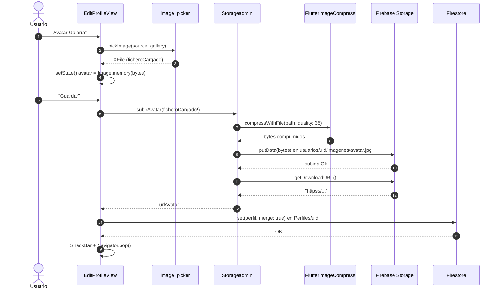
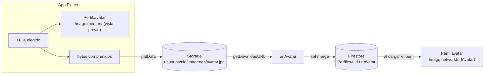

# 🖼 Avatar con Firebase Storage

> [⬅ Índice de guías](README.md) · [🏠 README principal](../README.md)


## 🎯 Qué vas a aprender

- Cómo elegir una foto con la **cámara** o la **galería** usando `image_picker`.
- Por qué se **comprime** la imagen antes de subirla y cómo lo hace `flutter_image_compress`.
- Qué es Firebase **Storage**, qué es una **ruta** dentro del *bucket* y qué es una **URL de descarga**.
- Por qué la imagen va a Storage pero su **URL** va a Firestore.
- Los fallos reales que tiene el flujo actual y cómo arreglarlos.

## 🧠 Conceptos clave

| Término | Qué es |
|---|---|
| [Storage](13-glosario.md#storage) | "Disco duro en la nube" de Firebase para **ficheros** (fotos, vídeos, PDFs). Firestore guarda **datos**; Storage guarda **archivos**. |
| Bucket | El "contenedor" raíz de tu proyecto en Storage. Dentro, los ficheros se organizan con rutas tipo carpeta. |
| `XFile` | Objeto de `image_picker` que representa el fichero elegido (ruta, tamaño, bytes). |
| [Compresión](13-glosario.md#compresion) | Reducir el peso de la imagen (bajando calidad JPEG) para subir menos datos. |
| URL de descarga | Enlace `https://…` con un *token* que permite ver el fichero. Es lo que guardamos en Firestore. |
| [Future y await](13-glosario.md#future-y-await) | Subir y pedir la URL tarda: se espera con `await`. |
| `set(..., merge: true)` | Escritura en Firestore que solo cambia los campos enviados y conserva los demás. |
| [Permiso](13-glosario.md#permiso) | Autorización que el sistema pide al usuario (cámara, fotos…). |

> 💡 **Analogía**: Storage es un **trastero** y Firestore es tu **agenda**. La foto (pesada) la guardas en el trastero; en la agenda solo apuntas "la foto está en el trastero, pasillo `usuarios/{uid}/imagenes`, caja `avatar.jpg`" (la URL).

## 📁 Archivos implicados

| Archivo | Papel |
|---|---|
| [`lib/views/EditProfileView.dart`](../lib/views/EditProfileView.dart) | Botones *Avatar Cámara* / *Avatar Galería*, vista previa y `clickGuardar()`. |
| [`lib/Admins/StorageAdmin.dart`](../lib/Admins/StorageAdmin.dart) | `subirAvatar(XFile)`: comprime, sube y devuelve la URL. |
| [`lib/FbObjects/Perfil.dart`](../lib/FbObjects/Perfil.dart) | Campos `avatar` (widget `Image`) y `urlAvatar` (texto en Firestore). |
| [`lib/DataHolder.dart`](../lib/DataHolder.dart) | Guarda la instancia `storageadmin` y el `perfilUsuario`. |
| [`storage.rules`](../storage.rules) | Reglas de seguridad de Storage. |
| [`firebase.json`](../firebase.json) | Enlaza `storage.rules` y declara el emulador de Storage (puerto 9199). |

## 🗺 Diagramas

### Flujo completo al guardar



### Dónde vive cada cosa



## 👣 Paso a paso

### 1. Elegir la foto (`image_picker`)

```dart
// lib/views/EditProfileView.dart:210-228
ficheroCargado = await imagePicker.pickImage(source: ImageSource.gallery);
if(ficheroCargado==null) return;              // el usuario canceló
final bytes = await ficheroCargado?.readAsBytes();
if(!mounted) return;
setState(() {
  Dataholder.instance.perfilUsuario.avatar=Image.memory(bytes!, fit: BoxFit.cover);
});
```

La versión con cámara (`elegirAvatarCamara`, líneas 190-206) es igual con `ImageSource.camera`. Se usa `Image.memory` (bytes en RAM) y no `Image.file`, porque `Image.file` necesita `dart:io`, que no existe en web.

> 🔑 Fíjate en que **todavía no se ha subido nada**: solo hay una vista previa en memoria y el `XFile` guardado en `ficheroCargado`.

### 2. Pulsar Guardar

```dart
// lib/views/EditProfileView.dart:110-114
Perfil perfil=Dataholder.instance.perfilUsuario;
if(perfil.avatar!=null){
  perfil.urlAvatar=await Dataholder.instance.storageadmin.subirAvatar(ficheroCargado!);
}
```

> ⚠️ La condición mira `perfil.avatar` y no `ficheroCargado`. Lee la sección de fallos: esto rompe la app en un caso muy común.

### 3. Construir la ruta en Storage

```dart
// lib/Admins/StorageAdmin.dart:27-31
final storageRef = FirebaseStorage.instance.ref();
String ruta="usuarios/"+Dataholder.instance.perfilUsuario.uid!+"/imagenes/avatar.jpg";
final rutaImagen = storageRef.child(ruta);
```

Cada usuario tiene "su carpeta" `usuarios/{uid}/`. Como el nombre siempre es `avatar.jpg`, **cada subida sobrescribe la anterior**: no se acumulan fotos viejas.

### 4. Comprimir

```dart
// lib/Admins/StorageAdmin.dart:36-42
final result = await FlutterImageCompress.compressWithFile(
  f.path,
  minWidth: 2300,
  minHeight: 1500,
  quality: 35,
  rotate: 0,
);
```

- `quality: 35` → JPEG al 35 % de calidad: una foto de móvil de varios MB suele quedar en unos cientos de KB.
- `minWidth`/`minHeight` → la librería reduce la imagen hasta acercarse a ese tamaño, pero no la amplía si es más pequeña.
- El código imprime el tamaño antes y después (`TAMAÑO ANTES DE COMPRIMIR …`): mira la consola para comprobarlo.

> 💡 Para un avatar que se ve a 100 px, `minWidth: 400` sería más que suficiente. ¡Es un buen ejercicio!

### 5. Subir y pedir la URL

```dart
// lib/Admins/StorageAdmin.dart:48-56
try {
  await rutaImagen.putData(result!);
  rutaURL=await rutaImagen.getDownloadURL();
  print("RUTA DESCARGA: "+rutaURL);
} on firebase_core.FirebaseException catch (e) {
  print(e);
}
```

`putData` sube **bytes** (por eso comprimimos primero a bytes). Existe también `putFile(File)`, que está comentado en las líneas 58-67. El alias `firebase_core` en realidad apunta a `cloud_firestore`, que **reexporta** `FirebaseException` de `firebase_core`: es la misma clase, así que sí captura errores de Storage.

### 6. Guardar la URL en Firestore

```dart
// lib/views/EditProfileView.dart:126
await db.collection("Perfiles").doc(uid).set(perfil.toFirestore(), SetOptions(merge: true));
```

`toFirestore()` incluye `urlAvatar` si no es `null` (`lib/FbObjects/Perfil.dart:96`). Con `merge: true` no se borran otros campos como `sTokenMovil` o `gpsPosition`.

### 7. Ver el avatar al volver a abrir la app

```dart
// lib/FbObjects/Perfil.dart:53-58
Perfil({required this.uid, ..., this.urlAvatar, ...}){
  if (urlAvatar != null && urlAvatar!.isNotEmpty) {
    avatar=Image.network(urlAvatar!);
  }
}
```

Cuando `Perfil.fromFirestore` reconstruye el perfil, el constructor crea un `Image.network` que descarga la foto desde la URL.

## ⚙️ Configuración necesaria

### pubspec.yaml

```yaml
firebase_storage: ^13.6.0
image_picker: ^1.2.3
flutter_image_compress: ^2.5.1
```

### Consola de Firebase

- **Storage → Comenzar** para crear el *bucket* (si no existe).
- Reglas: el repo despliega [`storage.rules`](../storage.rules), que hoy permite **leer y escribir cualquier fichero a cualquiera hasta el 20/02/2028**. Válido para clase, **no** para producción.

Unas reglas razonables para este caso serían (ejemplo, **no** están aplicadas):

```
match /usuarios/{uid}/{todo=**} {
  allow read: if request.auth != null;
  allow write: if request.auth != null && request.auth.uid == uid
               && request.resource.size < 2 * 1024 * 1024;
}
```

### Permisos por plataforma

| Plataforma | Qué hace falta | Estado |
|---|---|---|
| Android | Nada extra para `image_picker` (usa el selector del sistema). | ✅ |
| iOS | `NSCameraUsageDescription` en `ios/Runner/Info.plist`. | ✅ presente |
| iOS | `NSPhotoLibraryUsageDescription` (lo pide la documentación de `image_picker`). | ❌ falta |
| Web | La compresión con `compressWithFile` no funciona (no hay ruta de fichero real). | ❌ |

### Emulador (opcional)

`firebase.json` declara el emulador de Storage en el puerto 9199, pero la línea `useStorageEmulator` está **comentada** en `StorageAdmin.dart:15`, así que la app usa el Storage real.

## 🧪 Cómo probarlo

1. Abre Home → menú ⋮ → **Perfil** (`EditProfileView`).
2. Pulsa **Avatar Galería**, elige una foto: la cabecera debe mostrarla al momento.
3. Pulsa **Guardar**. En la consola de `flutter run` verás `TAMAÑO ANTES…`, `TAMAÑO DESPUES…` y `RUTA DESCARGA: https://…`.
4. Consola de Firebase → **Storage** → carpeta `usuarios/<tu uid>/imagenes/` → `avatar.jpg`. Ábrelo.
5. Consola → **Firestore** → `Perfiles/<tu uid>` → campo `urlAvatar`.
6. Cierra la app del todo y ábrela: el avatar debe cargarse desde la URL.
7. Prueba el fallo: entra otra vez en Editar perfil y pulsa **Guardar** **sin** elegir foto (ver abajo).

## 🐞 Fallos conocidos y limitaciones

| Qué pasa | Por qué | Cómo se arreglaría |
|---|---|---|
| Si ya tenías avatar y guardas **sin elegir foto nueva**, la app lanza `Null check operator used on a null value` y el botón se queda "guardando". | `clickGuardar` comprueba `perfil.avatar!=null` (que existe por el `Image.network`) y después fuerza `ficheroCargado!`, que es `null`. La excepción ocurre antes del `try`, así que nunca se ejecuta `bGuardando=false`. | Cambiar la condición a `if(ficheroCargado!=null)` y meter la subida dentro del `try`. |
| Si la subida falla, **se pierde** la URL del avatar anterior. | `subirAvatar` devuelve `""` en caso de error y se asigna igualmente a `perfil.urlAvatar`, que luego se guarda en Firestore. | Devolver `null` (o lanzar) y solo asignar si la URL no está vacía. |
| Si falla la compresión, la app lanza una excepción no controlada. | La compresión está **fuera** del `try` y se fuerza `result!`. | Mover la compresión al `try` y comprobar `result == null`. |
| Si eliges foto y pulsas **Cancelar**, al volver a abrir Editar perfil sigue apareciendo esa foto aunque nunca se subió. | La foto se asigna a `Dataholder.instance.perfilUsuario.avatar` en el momento de elegirla, no al guardar. | Guardar la vista previa en una variable del `State` y copiarla al perfil solo al guardar. |
| No funciona en web. | `compressWithFile(f.path)` necesita un fichero en disco. | En web usar `compressWithList(await f.readAsBytes())` o subir sin comprimir. |
| La foto pesa más de lo necesario. | `minWidth: 2300` / `minHeight: 1500` para un icono pequeño. | Reducir a ~400 px. |
| iOS: abrir la galería puede fallar o ser rechazado en la App Store. | Falta `NSPhotoLibraryUsageDescription`. | Añadir la clave al `Info.plist`. |
| Cualquiera puede leer o sobrescribir el avatar de otro. | `storage.rules` abiertas hasta 2028. | Reglas por `uid` (ejemplo arriba). |
| El avatar nuevo puede tardar en verse en otros dispositivos. | `Image.network` puede cachear la imagen. | Añadir un parámetro de versión a la URL o usar un nombre de fichero con fecha. |

## 🛠 Ejercicios

- [ ] Cambia la condición de `clickGuardar` a `ficheroCargado != null` y comprueba que ya no se rompe.
- [ ] Reduce `minWidth`/`minHeight` a 400 y compara los tamaños que imprime la consola.
- [ ] Muestra un `CircularProgressIndicator` sobre el avatar mientras sube.
- [ ] Haz que `subirAvatar` devuelva `String?` y no sobrescriba `urlAvatar` si falla.
- [ ] Escribe unas `storage.rules` que solo dejen escribir en `usuarios/{uid}` al propio usuario y prueba que otro usuario no puede.
- [ ] (Difícil) Haz que funcione en web usando `readAsBytes()` + `compressWithList` según `kIsWeb`.

## ❓ Autoevaluación

1. ¿Por qué la foto se guarda en Storage y no directamente en un campo de Firestore?
   <details><summary>Ver respuesta</summary>Firestore está pensado para datos pequeños y estructurados (un documento tiene un límite de 1 MiB y cada lectura cuesta). Storage está pensado para ficheros. En Firestore solo guardamos la URL, que ocupa unos pocos bytes.</details>

2. ¿Qué diferencia hay entre `Perfil.avatar` y `Perfil.urlAvatar`?
   <details><summary>Ver respuesta</summary>`avatar` es un widget `Image` que vive solo en memoria (vista previa o `Image.network`). `urlAvatar` es un `String` que se guarda en Firestore y sirve para reconstruir la imagen en el futuro.</details>

3. ¿Qué pasa si dos alumnos suben su avatar? ¿Se pisan?
   <details><summary>Ver respuesta</summary>No, porque la ruta incluye el `uid`: `usuarios/{uid}/imagenes/avatar.jpg`. Lo que sí ocurre es que cada alumno sobrescribe **su propio** avatar anterior.</details>

4. ¿Por qué se usa `set(..., SetOptions(merge: true))` al guardar el perfil?
   <details><summary>Ver respuesta</summary>Para cambiar solo los campos enviados (nombre, edad, altura, `urlAvatar`) sin borrar los que no conoce esta pantalla, y para crear el documento si no existiera (`update()` fallaría).</details>

5. Explica con tus palabras por qué la app se rompe al pulsar Guardar sin elegir foto si ya tenías avatar.
   <details><summary>Ver respuesta</summary>Porque la condición pregunta si el perfil **tiene** imagen (`perfil.avatar`, que existe desde que se cargó de la URL), no si **has elegido** una nueva. Entra en el `if` y fuerza `ficheroCargado!`, que es `null`.</details>
