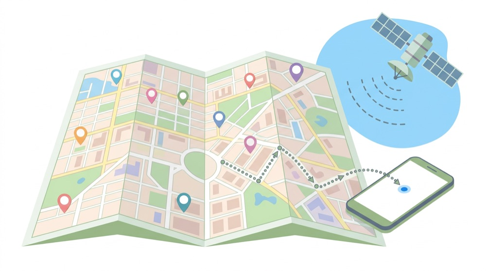
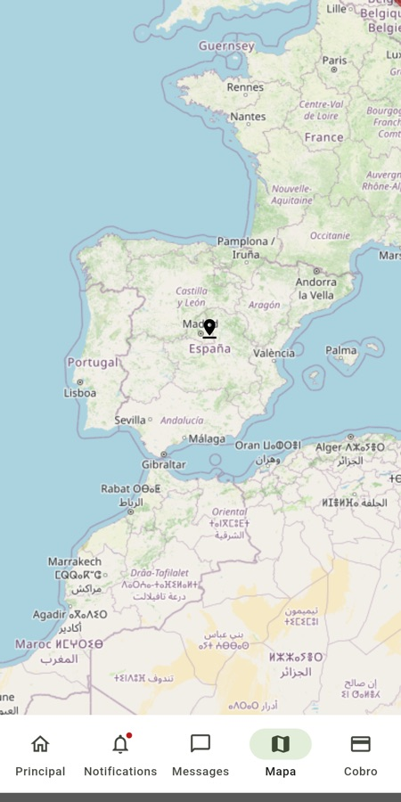
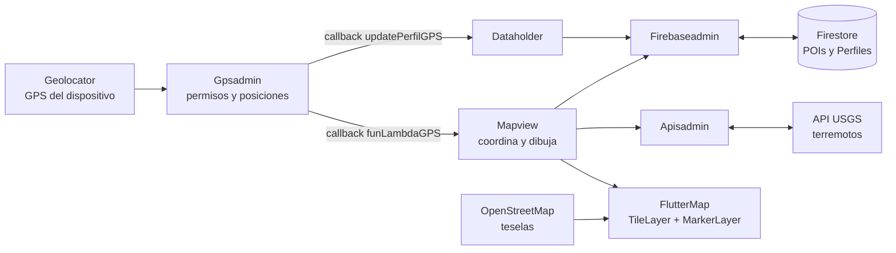
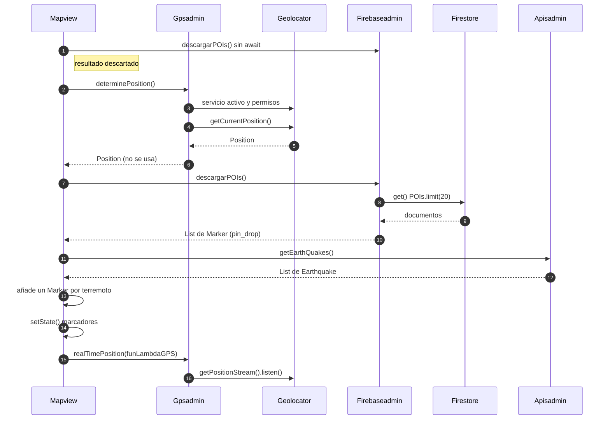
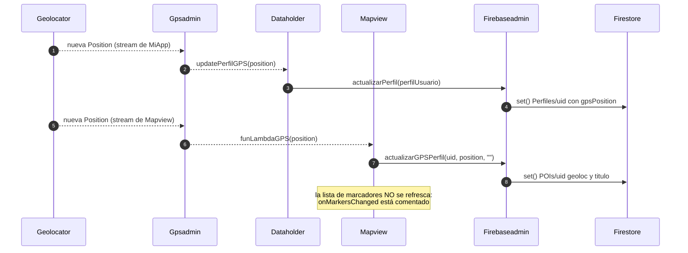
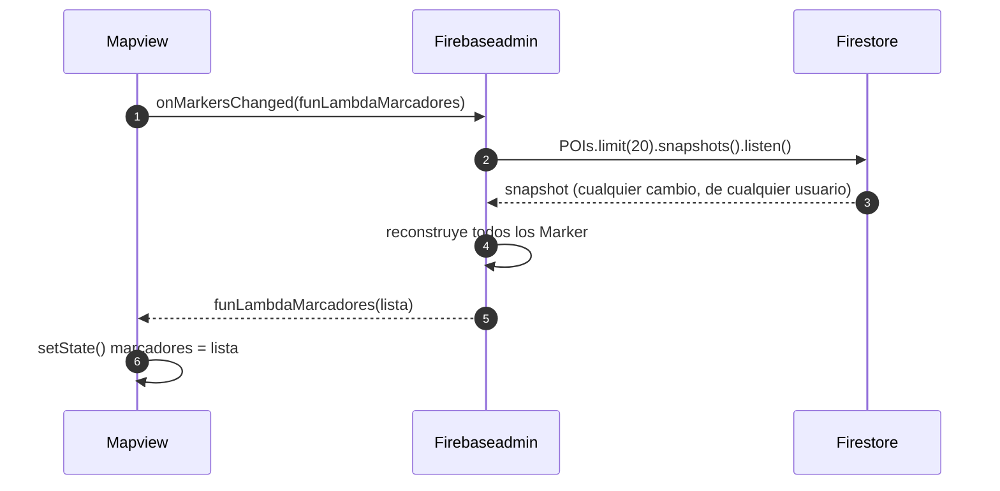

# 🗺 Mapa, GPS y callbacks

> [⬅ Índice de guías](README.md) · [🏠 README principal](../README.md)



**📸 Así se ve en Android:**

| Mapa |
|:---:|
|  |

## 🎯 Qué vas a aprender

- Cómo pedir **permisos de ubicación** y leer la posición con `geolocator`.
- La diferencia entre una posición **puntual** (`Future`) y una posición **en tiempo real** (`Stream`).
- Qué es un **callback** (o "lambda") y por qué los *Admins* avisan a la vista con funciones.
- Cómo pintar un mapa con `flutter_map` + teselas de **OpenStreetMap** (y qué exige su política de uso).
- De dónde salen los **marcadores**: POIs de Firestore + terremotos de una API.
- Cómo `initGPSUpdate()` mantiene `Perfiles/{uid}.gpsPosition` al día, el dato que usan las notificaciones por radio.

## 🧠 Conceptos clave

| Término | Qué es |
|---|---|
| [Permiso](13-glosario.md#permiso) | Autorización del usuario para usar el GPS. Se declara en el proyecto **y** se pide en tiempo de ejecución. |
| [Future y await](13-glosario.md#future-y-await) | Un único valor que llegará más tarde (una foto de tu posición). |
| [Stream](13-glosario.md#stream) | Una **serie** de valores que van llegando (un vídeo de tu posición). Se escucha con `listen`. |
| [Callback](13-glosario.md#callback) | Función que pasas como parámetro para que otro la llame cuando ocurra algo. En clase lo llamamos "lambda". |
| [Listener](13-glosario.md#listener) | Código suscrito a un `Stream` (GPS o Firestore) que se ejecuta con cada evento. |
| POI | *Point Of Interest*: un punto del mapa. Aquí, documentos de la colección `POIs`. |
| `GeoPoint` | Tipo de Firestore para guardar latitud y longitud juntas. |
| `LatLng` | Tipo de `latlong2` que usa `flutter_map` para coordenadas. |
| Tesela (*tile*) | Cada cuadradito de imagen de 256 px que forma el mapa. |

> 💡 **Analogía**: `determinePosition()` es preguntar "¿dónde estás?" por WhatsApp: recibes **una** respuesta. `realTimePosition()` es compartir la **ubicación en tiempo real**: te llegan actualizaciones mientras alguien se mueve, hasta que alguien la desactive.

## 📁 Archivos implicados

| Archivo | Papel |
|---|---|
| [`lib/Admins/GPSAdmin.dart`](../lib/Admins/GPSAdmin.dart) | `determinePosition()` (permisos + posición puntual) y `realTimePosition(callback)` (Stream). |
| [`lib/views/MapView.dart`](../lib/views/MapView.dart) | Pinta el mapa, junta marcadores, define los callbacks. |
| [`lib/Admins/FirebaseAdmin.dart`](../lib/Admins/FirebaseAdmin.dart) | `descargarPOIs()`, `onMarkersChanged()`, `actualizarGPSPerfil()`, `actualizarPerfil()`. |
| [`lib/DataHolder.dart`](../lib/DataHolder.dart) | `initGPSUpdate()` y `updatePerfilGPS()` → `Perfiles/{uid}.gpsPosition`. |
| [`lib/MiApp.dart`](../lib/MiApp.dart) | Llama a `initGPSUpdate()` en cada `build()`. |
| [`lib/Admins/ApisAdmin.dart`](../lib/Admins/ApisAdmin.dart), [`lib/APIObjects/EarthQuake.dart`](../lib/APIObjects/EarthQuake.dart) | Capa de terremotos (ver [07-api-http-terremotos.md](07-api-http-terremotos.md)). |
| [`android/app/src/main/AndroidManifest.xml`](../android/app/src/main/AndroidManifest.xml) | Permisos de ubicación. |

## 🗺 Diagramas

### Quién hace cada trabajo



### Al abrir el mapa (`initState` → `descargarDatos`)



### Cada nueva posición: dos escuchas distintas



### Opción en tiempo real (comentada en el código)



## 👣 Paso a paso

### 1. Permisos y posición puntual: `determinePosition()`

```dart
// lib/Admins/GPSAdmin.dart:16-45
serviceEnabled = await Geolocator.isLocationServiceEnabled();
if (!serviceEnabled) return Future.error('Location services are disabled.');

permission = await Geolocator.checkPermission();
if (permission == LocationPermission.denied) {
  permission = await Geolocator.requestPermission();
  if (permission == LocationPermission.denied) return Future.error('Location permissions are denied');
}
if (permission == LocationPermission.deniedForever) return Future.error('...');

return await Geolocator.getCurrentPosition();
```

Tres comprobaciones en orden: ¿está el GPS encendido? ¿tengo permiso? (si no, lo **pido** y sale el diálogo del sistema) ¿lo ha denegado para siempre? Solo entonces se lee la posición.

> 🔑 `deniedForever` significa que el usuario marcó "no volver a preguntar". La app ya no puede mostrar el diálogo: habría que mandarle a Ajustes con `Geolocator.openAppSettings()`.

### 2. Posición en tiempo real: `realTimePosition(callback)`

```dart
// lib/Admins/GPSAdmin.dart:48-58
void realTimePosition(Function(Position position) funcionLambda){
  final LocationSettings locationSettings = LocationSettings(
    accuracy: LocationAccuracy.bestForNavigation,
    distanceFilter: 2,
  );
  Geolocator.getPositionStream(locationSettings: locationSettings).listen(
      (Position? position) {
        funcionLambda(position!);
      });
}
```

- `getPositionStream` devuelve un **Stream**: no un valor, sino un "grifo" de posiciones.
- `distanceFilter: 2` → solo emite cuando te has movido al menos 2 metros.
- `funcionLambda` es el **callback**: `Gpsadmin` no sabe quién le llama; solo ejecuta la función que le dieron. Así sirve igual para el mapa que para el `Dataholder`.

> ⚠️ Este método **no pide permisos** y **no devuelve** la suscripción (`StreamSubscription`), así que nadie puede cancelarla.

### 3. `initGPSUpdate()`: la posición del usuario en su perfil

```dart
// lib/MiApp.dart:184-185
Dataholder.instance.initDeviceadmin(context);
Dataholder.instance.initGPSUpdate();
```

```dart
// lib/DataHolder.dart:81-83 y 99-102
void initGPSUpdate(){
  gpsadmin.realTimePosition(updatePerfilGPS);
}
void updatePerfilGPS(Position position){
  perfilUsuario.gpsPosition=GeoPoint(position.latitude, position.longitude);
  firebaseadmin.actualizarPerfil(perfilUsuario);
}
```

Cada vez que te mueves 2 m, el perfil se reescribe en `Perfiles/{uid}` con el campo `gpsPosition`. **Este campo es el que usan las Cloud Functions** (`mensajeCreado` y `enviarPushEnRadio`) para saber qué usuarios están dentro de un radio de X km y mandarles una notificación. Lo verás en [08-cloud-functions-python.md](08-cloud-functions-python.md) y [09-notificaciones-push-fcm.md](09-notificaciones-push-fcm.md).

### 4. `initState` del mapa

```dart
// lib/views/MapView.dart:23-31
void initState() {
  super.initState();
  Dataholder.instance.iBotBarIndex=3;
  Dataholder.instance.firebaseadmin.descargarPOIs();   // resultado tirado
  descargarDatos();
}
```

`initState` no puede ser `async`, por eso delega en `descargarDatos()`.

### 5. Juntar marcadores: POIs + terremotos

```dart
// lib/views/MapView.dart:34-56
Position position=await Dataholder.instance.gpsadmin.determinePosition();
List<Marker> mtemp=await Dataholder.instance.firebaseadmin.descargarPOIs();
List<Earthquake> terremotos=await Dataholder.instance.apisadmin.getEarthQuakes();
for(Earthquake terremoto in terremotos){
  terremoto.onDetailsViewed=terremotoPresionado;
  Marker marker=Marker(
      point: terremoto.coordenada,
      child: IconButton(onPressed: terremoto.onMarkerPressed, icon: Icon(Icons.crisis_alert)),
  );
  mtemp.add(marker);
}
setState(()  { marcadores=mtemp; });
//Dataholder.instance.firebaseadmin.onMarkersChanged(funLambdaMarcadores);
Dataholder.instance.gpsadmin.realTimePosition(funLambdaGPS);
```

Los POIs vienen de una lectura **puntual** de Firestore:

```dart
// lib/Admins/FirebaseAdmin.dart:65-75
final docRef=db.collection("POIs").limit(20);
QuerySnapshot<Map<String, dynamic>> query=await docRef.get();
for (var docSnapshot in query.docs) {
  GeoPoint geoPoint = docSnapshot.data()["geoloc"];
  marcadores.add(Marker(point: LatLng(geoPoint.latitude, geoPoint.longitude),
                        child: Icon(Icons.pin_drop)));
}
```

Los terremotos (icono `crisis_alert`) se explican en [07-api-http-terremotos.md](07-api-http-terremotos.md). Al pulsar uno, su callback `onDetailsViewed` llama a `terremotoPresionado`, que muestra u oculta un panel naranja (`MapView.dart:60-66` y `83-98`).

> 🔑 **Doble callback**: la vista le da al terremoto una función (`terremotoPresionado`) y el `IconButton` recibe otra (`terremoto.onMarkerPressed`). Cuando pulsas, el terremoto se llama a sí mismo y se pasa como argumento: `onDetailsViewed!(this)`.

### 6. Cada usuario que abre el mapa se convierte en POI

```dart
// lib/views/MapView.dart:75-81
void funLambdaGPS(Position position){
  Dataholder.instance.firebaseadmin.actualizarGPSPerfil(
      Dataholder.instance.perfilUsuario.uid, position, "");
}
```

```dart
// lib/Admins/FirebaseAdmin.dart:102-110
GeoPoint point=GeoPoint(position.latitude,position.longitude);
final mensajes = db.collection("POIs").doc(uid);
await mensajes.set({"geoloc":point, "titulo":titulo});
```

El id del documento es tu `uid`, así que cada usuario tiene **un** POI que se va moviendo con él. Cualquiera que abra el mapa verá tu posición (si estás entre los 20 primeros).

### 7. La escucha en tiempo real (desactivada)

```dart
// lib/Admins/FirebaseAdmin.dart:79-95
void onMarkersChanged(Function(List<Marker> marcadores) funcionLambda){
  final docRef=db.collection("POIs").limit(20);
  docRef.snapshots().listen((event) {
    marcadores.clear();
    for (var docSnapshot in event.docs) { ... marcadores.add(marker); }
    funcionLambda(marcadores);
  }, onError: (error) => print("Listen failed: $error"));
}
```

Si descomentas la línea 55 de `MapView.dart`, cada cambio en `POIs` (tuyo o de otro usuario) llamará a `funLambdaMarcadores`, que hace `setState`. **Ojo**: esa lista solo contiene POIs, así que **los terremotos desaparecerían** al llegar el primer evento. Es uno de los ejercicios.

### 8. Pintar el mapa

```dart
// lib/views/MapView.dart:112-128
FlutterMap(
  options: const MapOptions(
    initialCenter: LatLng(40.4168, -3.7038), // Madrid
    initialZoom: 5,
  ),
  children: [
    TileLayer(
      urlTemplate: 'https://tile.openstreetmap.org/{z}/{x}/{y}.png',
      userAgentPackageName: 'com.newton.dam2_2627_a',
    ),
    /*RichAttributionWidget(...)*/
    MarkerLayer(markers: marcadores),
  ],
),
```

`FlutterMap` funciona por **capas**, como un sándwich: abajo las teselas, encima los marcadores. `{z}/{x}/{y}` se sustituye por el zoom y la posición de cada tesela.

> ⚠️ **Política de OpenStreetMap**: los servidores `tile.openstreetmap.org` son gratuitos pero exigen (1) **mostrar la atribución** "© OpenStreetMap contributors" visible en el mapa, (2) un *User-Agent* que identifique la app (eso hace `userAgentPackageName`) y (3) un uso moderado (nada de descargas masivas ni apps con mucho tráfico). Aquí la atribución está **comentada**: hay que activarla.

## ⚙️ Configuración necesaria

### pubspec.yaml

```yaml
flutter_map: ^8.3.2
latlong2: ^0.10.1
geolocator: ^14.1.1
```

### Android — `android/app/src/main/AndroidManifest.xml`

```xml
<uses-permission android:name="android.permission.INTERNET"/>
<uses-permission android:name="android.permission.ACCESS_FINE_LOCATION"/>
<uses-permission android:name="android.permission.ACCESS_COARSE_LOCATION"/>
```

✅ Presentes. `INTERNET` es necesario para las teselas y la API.

### iOS — `ios/Runner/Info.plist`

```xml
<key>NSLocationWhenInUseUsageDescription</key>
<string>La app usa tu ubicación para mostrarte en el mapa.</string>
```

❌ **Falta**. Sin esta clave, iOS no muestra el diálogo de permiso y la ubicación no funciona.

### macOS

El *sandbox* necesita `com.apple.security.network.client` (para descargar teselas) y `com.apple.security.personal-information.location` en los `.entitlements`. Hoy no están.

### Firestore

- Colección `POIs/{uid}`: `geoloc` (`GeoPoint`), `titulo` (`String`).
- Campo `Perfiles/{uid}.gpsPosition` (`GeoPoint`).
- Detalle del modelo en [03-firestore-modelo-datos.md](03-firestore-modelo-datos.md).

## 🧪 Cómo probarlo

1. Ejecuta en un emulador Android. En **Extended controls (⋯) → Location** fija un punto, por ejemplo la Puerta del Sol.
2. Inicia sesión y abre la pestaña **Mapa** de la barra inferior. Acepta el permiso.
3. Deberías ver iconos `pin_drop` (POIs) y `crisis_alert` (terremotos). Pulsa un terremoto: aparece el panel naranja; púlsalo otra vez para ocultarlo.
4. En la consola de Firestore abre `POIs/<tu uid>` y `Perfiles/<tu uid>`.
5. En el emulador, usa **Routes** o cambia el punto varias veces: verás cambiar `geoloc` y `gpsPosition` en la consola.
6. Fíjate en que el mapa **no** mueve tu marcador hasta que vuelves a abrir la pantalla (no hay listener activo).
7. Deniega el permiso (Ajustes → Apps → Permisos) y reabre el mapa: no aparece ningún marcador y en la consola verás el error.

## 🐞 Fallos conocidos y limitaciones

| Qué pasa | Por qué | Cómo se arreglaría |
|---|---|---|
| Se abren **muchos** streams de GPS y se escribe en Firestore cada vez más. | `initGPSUpdate()` está en `MiApp.build()`, que se ejecuta en cada *rebuild*, y `Mapview` abre otro stream cada vez que entras. Ninguno se cancela. | Guardar el `StreamSubscription`, llamarlo una sola vez (por ejemplo tras el login) y cancelarlo en `dispose()` / logout. |
| Error `LateInitializationError` o `Null check` al moverse antes de iniciar sesión. | `updatePerfilGPS` usa `perfilUsuario` (`late`) y `actualizarPerfil` usa `currentUser!`. | Comprobar que hay usuario y perfil antes de escribir. |
| El stream de `MiApp` falla si aún no hay permiso. | `realTimePosition` no pide permiso ni tiene `onError`. | Llamar antes a `determinePosition()` o añadir `onError`. |
| Si el GPS falla, **no aparece nada** (ni POIs ni terremotos) y no hay aviso. | `determinePosition()` lanza un error y `descargarDatos()` se corta en la primera línea. | `try/catch` con un `SnackBar`; cargar POIs y terremotos aunque no haya GPS. |
| El mapa no se centra en el usuario. | La `Position` obtenida no se usa; centro fijo en Madrid. | Usar un `MapController` y `move(LatLng(...), 15)`. |
| La primera llamada a `descargarPOIs()` no sirve para nada. | Su resultado se descarta en `initState`. | Borrar esa línea. |
| Los marcadores no se actualizan en tiempo real. | `onMarkersChanged(...)` está **comentado** en `MapView.dart:55`. | Descomentar y combinar POIs + terremotos en la lista. |
| Cualquier usuario que abre el mapa publica su ubicación. | `funLambdaGPS` escribe `POIs/{uid}` sin preguntar. | Pedir consentimiento o separar "mi posición" de "puntos de interés". |
| Solo se ven 20 POIs, sin orden. | `limit(20)` sin `orderBy`. | Filtrar por zona (geohash) o paginar. |
| `setState() called after dispose()`. | Los callbacks llegan aunque hayas salido del mapa; no se comprueba `mounted`. | `if (!mounted) return;` y cancelar suscripciones. |
| Muchas escrituras = coste y batería. | `bestForNavigation` + `distanceFilter: 2` + dos escrituras por evento. | `LocationAccuracy.high` y `distanceFilter: 50` para este uso. |
| Incumple la política de OSM. | `RichAttributionWidget` comentado. | Descomentarlo. |
| iOS no puede pedir ubicación. | Falta `NSLocationWhenInUseUsageDescription`. | Añadir la clave. |

## 🛠 Ejercicios

- [ ] Descomenta el `RichAttributionWidget` y comprueba que aparece "© OpenStreetMap contributors".
- [ ] Borra la llamada inútil a `descargarPOIs()` de `initState`.
- [ ] Usa la `Position` de `determinePosition()` para centrar el mapa con un `MapController`.
- [ ] Muestra el `titulo` del POI con un `Tooltip` o un `Text` bajo el icono.
- [ ] Envuelve `descargarDatos()` en `try/catch` y muestra un `SnackBar` si no hay permiso.
- [ ] Haz que `realTimePosition` devuelva el `StreamSubscription` y cancélalo en `dispose()` de `Mapview`.
- [ ] Activa `onMarkersChanged` y haz que **no** se pierdan los marcadores de terremotos (pista: guarda las dos listas por separado y únelas en `build`).
- [ ] (Difícil) Mueve `initGPSUpdate()` fuera de `MiApp.build()` para que se ejecute una sola vez tras el login y se cancele en el logout.

## ❓ Autoevaluación

1. ¿Qué diferencia hay entre `determinePosition()` y `realTimePosition()`?
   <details><summary>Ver respuesta</summary>`determinePosition()` devuelve un `Future<Position>`: una sola posición, y además comprueba/pide permisos. `realTimePosition()` se suscribe a un `Stream` de posiciones y llama al callback cada vez que te mueves al menos 2 m; no pide permisos.</details>

2. ¿Por qué `Gpsadmin.realTimePosition` recibe una **función** como parámetro?
   <details><summary>Ver respuesta</summary>Para que `Gpsadmin` no dependa de quién le usa. Cada cliente (`Mapview`, `Dataholder`) le pasa lo que quiere que ocurra con cada posición, y `Gpsadmin` simplemente la llama. Eso es un callback.</details>

3. ¿Qué dos documentos se escriben cuando te mueves con el mapa abierto?
   <details><summary>Ver respuesta</summary>`Perfiles/{uid}` (campo `gpsPosition`, desde `Dataholder.updatePerfilGPS`) y `POIs/{uid}` (campos `geoloc` y `titulo`, desde `Mapview.funLambdaGPS`).</details>

4. ¿Para qué sirve `Perfiles/{uid}.gpsPosition` fuera del mapa?
   <details><summary>Ver respuesta</summary>Las Cloud Functions lo leen para calcular qué usuarios están dentro de un radio (fórmula de Haversine) y mandarles una notificación push.</details>

5. Si descomentas `onMarkersChanged`, ¿qué pasa con los terremotos y por qué?
   <details><summary>Ver respuesta</summary>Desaparecen al primer evento de Firestore, porque `funLambdaMarcadores` sustituye la lista entera por una que solo contiene POIs.</details>

6. ¿Qué tres cosas pide la política de teselas de OpenStreetMap?
   <details><summary>Ver respuesta</summary>Atribución visible ("© OpenStreetMap contributors"), un User-Agent que identifique la app y un uso moderado (sin descargas masivas ni tráfico alto).</details>
