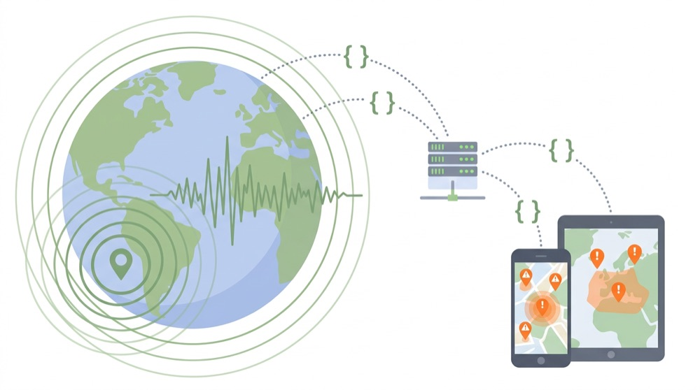
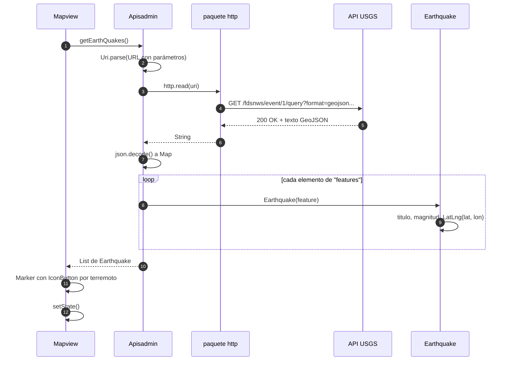
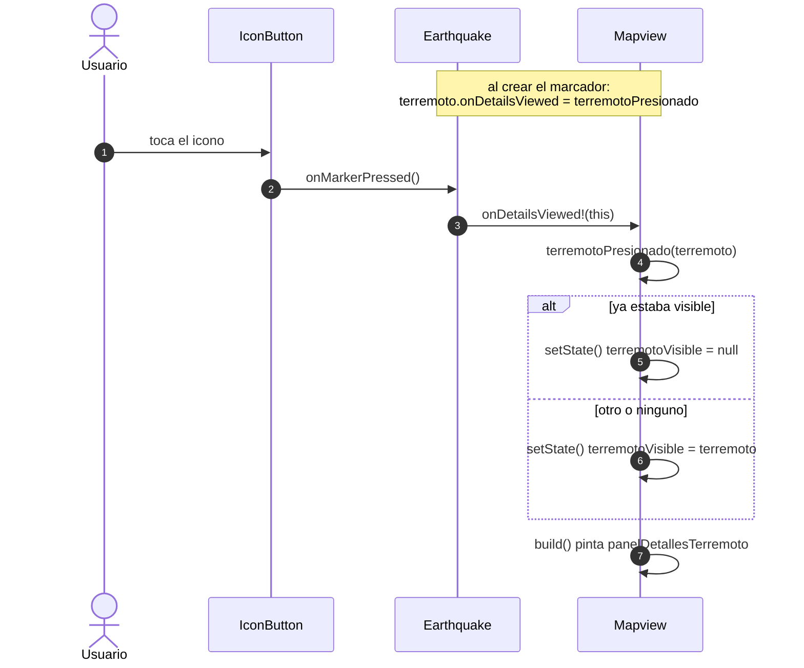
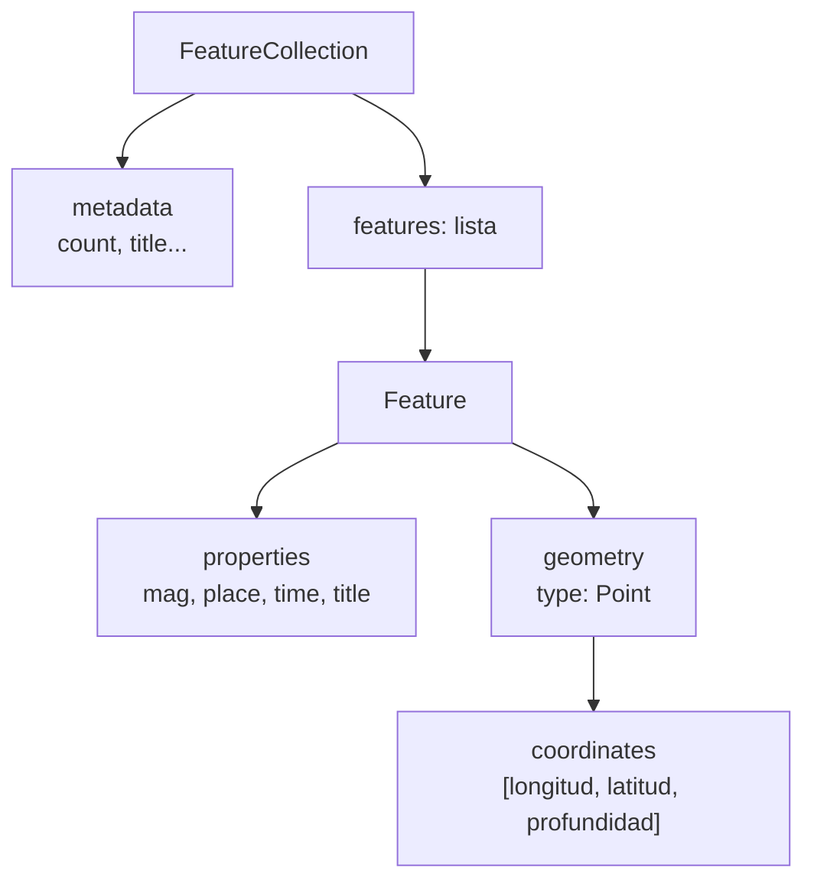

# 🌋 API HTTP: terremotos en el mapa

> [⬅ Índice de guías](README.md) · [🏠 README principal](../README.md)



## 🎯 Qué vas a aprender

- Qué es una **API HTTP**, qué significa **REST** y qué es **JSON** / **GeoJSON**.
- Cómo leer una URL de API parámetro a parámetro (la del servicio de terremotos USGS).
- El camino completo: `http.read` → `json.decode` → objetos `Earthquake` → marcadores en el mapa.
- La trampa clásica del GeoJSON: **longitud primero, latitud después**.
- Cómo un marcador avisa a la vista con un **callback** para abrir el panel de detalle.
- Los fallos del código actual y cómo hacerlo robusto.

## 🧠 Conceptos clave

| Término | Qué es |
|---|---|
| [HTTP](13-glosario.md#http) | El protocolo de la web: el cliente pide (*request*) y el servidor responde (*response*) con un código (200 OK, 404, 500…). |
| [API REST](13-glosario.md#api-rest) | Un servicio web al que se le piden **datos** (no páginas) con URLs y verbos HTTP (`GET`, `POST`…). |
| [JSON](13-glosario.md#json) | Formato de texto para datos: objetos `{ }`, listas `[ ]`, textos, números, `true/false`, `null`. |
| [GeoJSON](13-glosario.md#geojson) | JSON con reglas para datos geográficos: `FeatureCollection`, `Feature`, `geometry`, `properties`. |
| Parámetros de consulta | Lo que va tras el `?` de la URL: `clave=valor` separados por `&`. |
| [Future y await](13-glosario.md#future-y-await) | La respuesta de la red tarda: se espera con `await`. |
| [Callback](13-glosario.md#callback) | Función que el terremoto guarda para avisar a la vista cuando lo pulsan. |
| `Map<String, dynamic>` | Lo que devuelve `json.decode` para un objeto JSON: claves `String`, valores de cualquier tipo. |

> 💡 **Analogía**: una API es la **ventanilla** de una oficina. No entras al archivo: rellenas un formulario (la URL con sus parámetros), lo entregas (petición HTTP) y te devuelven un papel con un formato fijo (JSON). Si el formulario está mal, te devuelven un error (400).

## 📁 Archivos implicados

| Archivo | Papel |
|---|---|
| [`lib/Admins/ApisAdmin.dart`](../lib/Admins/ApisAdmin.dart) | `getEarthQuakes()`: construye la URL, descarga y decodifica. |
| [`lib/APIObjects/EarthQuake.dart`](../lib/APIObjects/EarthQuake.dart) | Clase `Earthquake`: convierte un `Feature` en objeto Dart. |
| [`lib/views/MapView.dart`](../lib/views/MapView.dart) | Crea un marcador por terremoto y muestra el panel de detalle. |
| [`lib/DataHolder.dart`](../lib/DataHolder.dart) | Guarda la instancia `apisadmin`. |
| [`pubspec.yaml`](../pubspec.yaml) / [`pubspec.lock`](../pubspec.lock) | Dependencias (ver el fallo de `http`). |

## 🗺 Diagramas

### Del servidor al mapa



### Pulsar un terremoto (callbacks)



### Estructura de un GeoJSON de USGS



## 👣 Paso a paso

### 1. La URL, parámetro a parámetro

```dart
// lib/Admins/ApisAdmin.dart:12-17
final httpPackageUrl = Uri.parse('https://earthquake.usgs.gov/'
    'fdsnws/event/1/query?'
    'format=geojson&'
    'starttime=2026-10-12&'
    'endtime=2026-10-20&'
    'minmagnitude=3');
```

> 💡 En Dart, varios textos seguidos sin `+` se **pegan** solos: es una forma de partir una URL larga en líneas.

| Trozo | Significado |
|---|---|
| `https://` | Protocolo seguro. |
| `earthquake.usgs.gov` | Servidor del Servicio Geológico de EE. UU. (USGS). API pública y gratuita, sin clave. |
| `/fdsnws/event/1/query` | *Endpoint*: "consultar eventos sísmicos", versión 1 del estándar FDSN. |
| `?` | Empiezan los parámetros. |
| `format=geojson` | Quiero la respuesta en GeoJSON (otros valores: `csv`, `xml`, `text`…). |
| `starttime=2026-10-12` | Desde esta fecha (formato ISO 8601 `AAAA-MM-DD`, en UTC). |
| `endtime=2026-10-20` | Hasta esta fecha. |
| `minmagnitude=3` | Solo terremotos de magnitud **3 o más** (los pequeños son miles al día). |

Otros parámetros útiles de esta API para los ejercicios: `latitude`, `longitude` y `maxradiuskm` (búsqueda en círculo), `minlatitude`/`maxlatitude`/`minlongitude`/`maxlongitude` (rectángulo), `limit` (máximo de resultados) y `orderby` (`time`, `magnitude`…).

> 🔑 Prueba la URL en el navegador: verás el JSON crudo. Es la mejor forma de entender una API antes de programar.

### 2. Descargar: `http.read`

```dart
// lib/Admins/ApisAdmin.dart:19
String httpPackageInfo = await http.read(httpPackageUrl);
```

`http.read` hace un `GET` y devuelve el **cuerpo** de la respuesta como `String`. Si el código no es 2xx, lanza una `ClientException`. (Con `http.get` tendrías un `Response` con `statusCode` y `body` para comprobarlo tú.)

### 3. Decodificar: `json.decode`

```dart
// lib/Admins/ApisAdmin.dart:20-24
final httpPackageJson = json.decode(httpPackageInfo) as Map<String, dynamic>;
List<Earthquake> terremotos=[];
for(Map<String,dynamic> d in httpPackageJson["features"]){
  terremotos.add(new Earthquake(d));
}
```

`json.decode` (de `dart:convert`) convierte el texto en `Map`/`List` de Dart. `["features"]` es la lista de terremotos.

Un `Feature` **recortado** de ejemplo (valores ilustrativos):

```json
{
  "type": "Feature",
  "properties": {
    "mag": 4.6,
    "place": "45 km SW de Ejemplo, Chile",
    "time": 1760900000000,
    "title": "M 4.6 - 45 km SW de Ejemplo, Chile"
  },
  "geometry": {
    "type": "Point",
    "coordinates": [-71.25, -30.10, 35.0]
  },
  "id": "us7000abcd"
}
```

### 4. Convertir a objeto: `Earthquake`

```dart
// lib/APIObjects/EarthQuake.dart:11-19
Earthquake(Map<String,dynamic> datos){
  this.titulo=datos["properties"]["title"];
  this.magnitud=double.parse(datos["properties"]["mag"].toString());
  this.coordenada=LatLng(
      double.parse(datos["geometry"]["coordinates"][1].toString()),   // latitud
      double.parse(datos["geometry"]["coordinates"][0].toString())    // longitud
  );
}
```

> ⚠️ **La trampa del orden**: GeoJSON guarda `[longitud, latitud, profundidad]` (como X, Y, Z), pero `LatLng` espera `(latitud, longitud)`. Por eso se usa `[1]` y luego `[0]`. Si los cambias, un terremoto de Chile aparecerá en mitad del océano… o fuera del mapa (latitud > 90).

`.toString()` + `double.parse` se usa porque `mag` puede llegar como `int` (`5`) o como `double` (`4.6`). Una alternativa más limpia: `(datos["properties"]["mag"] as num).toDouble()`.

### 5. Marcadores con callback

```dart
// lib/views/MapView.dart:41-50
for(Earthquake terremoto in terremotos){
  terremoto.onDetailsViewed=terremotoPresionado;
  Marker marker=Marker(
      point: terremoto.coordenada,
      child: IconButton(onPressed: terremoto.onMarkerPressed, icon: Icon(Icons.crisis_alert)),
  );
  mtemp.add(marker);
}
```

```dart
// lib/APIObjects/EarthQuake.dart:9 y 21-24
Function(Earthquake)? onDetailsViewed;
void onMarkerPressed(){
  onDetailsViewed!(this);
}
```

El terremoto no conoce la pantalla: solo sabe que tiene "un número de teléfono" (`onDetailsViewed`) al que llamar cuando lo pulsan. La vista se lo apuntó al crearlo.

### 6. Panel de detalle

```dart
// lib/views/MapView.dart:60-66
void terremotoPresionado(Earthquake terremoto){
  setState(() {
    if(terremotoVisible==terremoto)terremotoVisible=null;
    else terremotoVisible=terremoto;
  });
}
```

```dart
// lib/views/MapView.dart:130
if(terremotoVisible!=null)panelDetallesTerremoto(context),
```

El panel (`MapView.dart:83-98`) es un `Positioned` naranja dentro del `Stack`, encima del mapa, con el título y la magnitud. Pulsar el mismo terremoto lo cierra (efecto interruptor).

## ⚙️ Configuración necesaria

### pubspec.yaml

`ApisAdmin.dart` importa `package:http/http.dart`, pero **`http` no está en `pubspec.yaml`**. Funciona porque otro paquete lo trae como dependencia **transitiva** (en `pubspec.lock` aparece como `dependency: transitive`). Lo correcto es declararlo:

```bash
flutter pub add http
```

### Permisos

| Plataforma | Requisito | Estado |
|---|---|---|
| Android | `android.permission.INTERNET` en `AndroidManifest.xml` | ✅ |
| iOS | Nada (la URL es `https`) | ✅ |
| macOS | `com.apple.security.network.client` en los `.entitlements` | ❌ falta |
| Web | El servidor debe permitir CORS | — probar |

### Clave de API

No hace falta: la API de USGS es pública. En otras APIs, **nunca** pongas claves secretas en el código Flutter (cualquiera puede extraerlas del APK); usa una Cloud Function como intermediaria ([08-cloud-functions-python.md](08-cloud-functions-python.md)).

## 🧪 Cómo probarlo

1. Copia la URL de `ApisAdmin.dart` en el navegador (Firefox muestra el JSON con formato). Busca `"features"` y mira un `coordinates`.
2. Ejecuta la app, inicia sesión y abre el **Mapa**. En la consola verás `EMPIEZO LA DESCARGA`.
3. Aleja el zoom: verás iconos `crisis_alert` repartidos por el mundo (sobre todo en el Cinturón de Fuego del Pacífico).
4. Pulsa uno: panel naranja con título y magnitud. Púlsalo otra vez: se cierra.
5. Cambia `minmagnitude=3` por `minmagnitude=6`, reinicia y observa que aparecen muchos menos.
6. Prueba el fallo de red: activa el modo avión y abre el mapa. No aparece **ningún** marcador (tampoco los POIs).

## 🐞 Fallos conocidos y limitaciones

| Qué pasa | Por qué | Cómo se arreglaría |
|---|---|---|
| `http` no está declarado. | Se usa como dependencia transitiva; si el otro paquete lo quita, el proyecto deja de compilar. | `flutter pub add http`. |
| Siempre salen los mismos terremotos (del 12 al 20/10/2026). | Fechas escritas a mano en la URL. | Calcularlas: `DateTime.now().subtract(Duration(days: 7))` y formatear `AAAA-MM-DD`; o usar `Uri.https(host, path, {'starttime': ...})`. |
| Sin red o con error del servidor, el mapa queda vacío y sin aviso. | No hay `try/catch`; `http.read` lanza una excepción que corta `descargarDatos()` **antes** del `setState`, así que también se pierden los POIs. | `try/catch` en `getEarthQuakes` devolviendo lista vacía + `SnackBar`; usar `http.get` y comprobar `statusCode`. |
| Un terremoto sin magnitud rompe toda la carga. | Si `mag` es `null`, `double.parse("null")` lanza `FormatException`. | `(props["mag"] as num?)?.toDouble() ?? 0.0`, o saltar ese elemento. |
| Un `title` nulo también rompería. | Se asigna directamente a un `String` no nulo. | `props["title"] as String? ?? "Sin título"`. |
| `onDetailsViewed!` puede fallar. | Si alguien crea un marcador sin asignar el callback, `!` lanza un error. | `onDetailsViewed?.call(this);` |
| El panel solo muestra título y magnitud, sin botón de cerrar. | Diseño mínimo. | Añadir fecha (`time`), profundidad (`coordinates[2]`) y un `IconButton` de cerrar. |
| En macOS no carga nada. | Falta el entitlement `network.client` del sandbox. | Añadirlo a `DebugProfile.entitlements` y `Release.entitlements`. |
| Todos los iconos son iguales. | No se usa la magnitud para el estilo. | Color o tamaño según `magnitud`. |

## 🛠 Ejercicios

- [ ] Ejecuta `flutter pub add http` y comprueba el cambio en `pubspec.yaml`.
- [ ] Cambia las fechas fijas por "los últimos 7 días" calculados con `DateTime.now()`.
- [ ] Construye la URL con `Uri.https('earthquake.usgs.gov', '/fdsnws/event/1/query', {...})` en vez de concatenar textos.
- [ ] Protege `Earthquake` contra `mag` y `title` nulos.
- [ ] Pinta el icono rojo si la magnitud es ≥ 5 y amarillo si es menor.
- [ ] Añade al panel la profundidad y la fecha (`time` son milisegundos desde 1970: `DateTime.fromMillisecondsSinceEpoch`).
- [ ] (Difícil) Pide solo los terremotos en 500 km a tu alrededor usando `latitude`, `longitude` y `maxradiuskm` con la posición de [06-mapa-gps.md](06-mapa-gps.md).

## ❓ Autoevaluación

1. ¿Qué devuelve `http.read` y qué hace después `json.decode`?
   <details><summary>Ver respuesta</summary>`http.read` devuelve el cuerpo de la respuesta como un `String` (texto JSON). `json.decode` convierte ese texto en estructuras de Dart (`Map<String, dynamic>` y `List`).</details>

2. ¿Por qué el código usa `coordinates[1]` para la latitud y `coordinates[0]` para la longitud?
   <details><summary>Ver respuesta</summary>Porque GeoJSON ordena las coordenadas como `[longitud, latitud, profundidad]` (X, Y, Z) y `LatLng` espera primero la latitud.</details>

3. ¿Qué significa `minmagnitude=3` y qué pasaría si lo quitas?
   <details><summary>Ver respuesta</summary>Filtra para recibir solo terremotos de magnitud 3 o superior. Sin él recibirías muchísimos microterremotos: más datos, más tiempo de descarga y un mapa saturado.</details>

4. Si la API devuelve un terremoto con `"mag": null`, ¿qué ocurre en la app?
   <details><summary>Ver respuesta</summary>`double.parse("null")` lanza `FormatException`; como no hay `try/catch`, se corta toda la carga y el mapa queda sin marcadores (ni terremotos ni POIs).</details>

5. ¿Cómo se entera `Mapview` de que has pulsado un terremoto si `Earthquake` no conoce la vista?
   <details><summary>Ver respuesta</summary>Por un callback: al crear el marcador, la vista asigna `terremoto.onDetailsViewed = terremotoPresionado`. Al pulsar, `onMarkerPressed` llama a esa función pasándose a sí mismo, y la vista hace `setState`.</details>

6. ¿Por qué funciona `import 'package:http/http.dart'` si `http` no está en `pubspec.yaml`, y por qué es un problema?
   <details><summary>Ver respuesta</summary>Porque otro paquete depende de `http` y lo descarga (dependencia transitiva). Es frágil: si ese paquete deja de usarlo o cambia de versión, tu código deja de compilar. Además el analizador avisa (`depend_on_referenced_packages`).</details>
