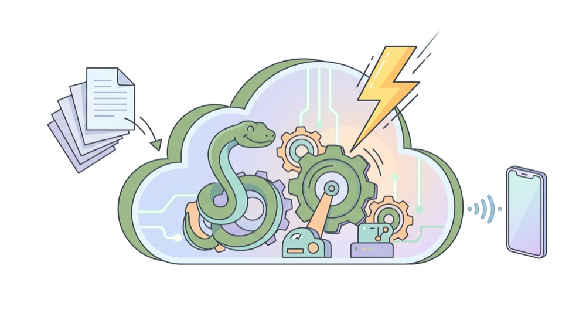
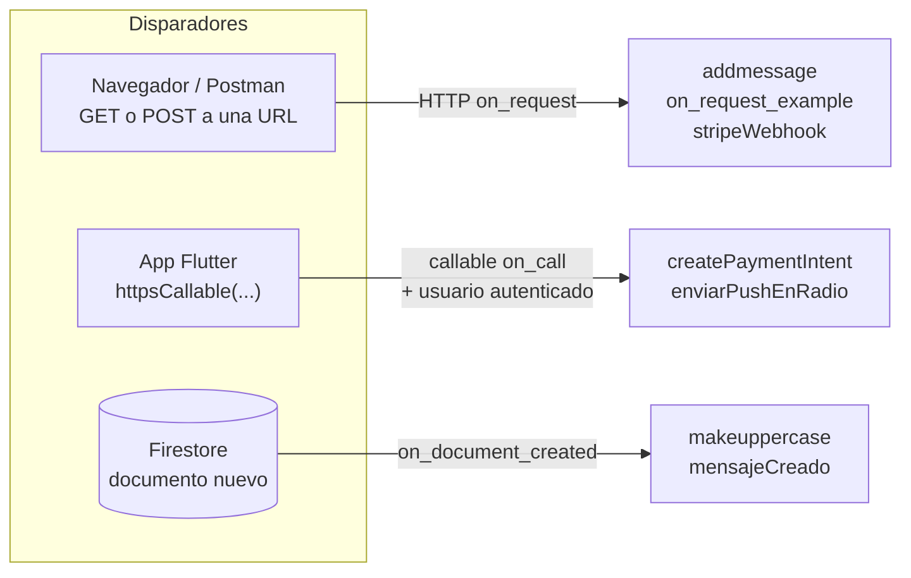
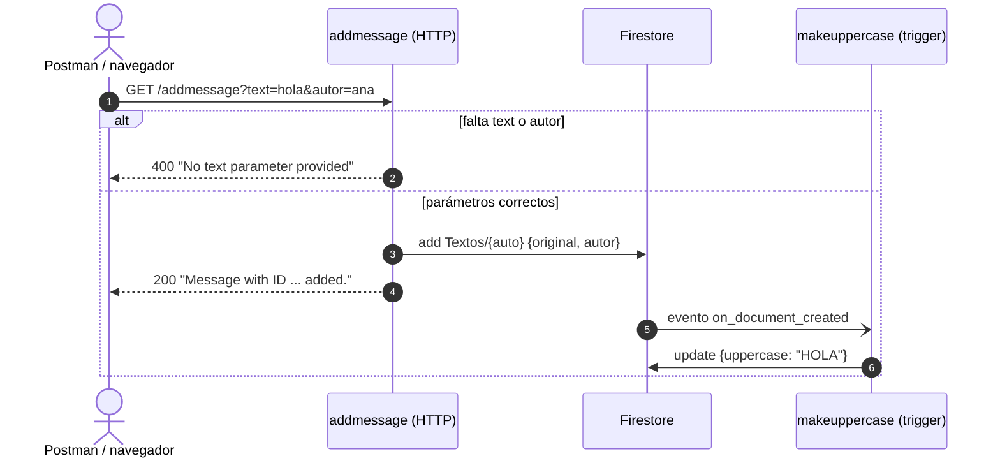
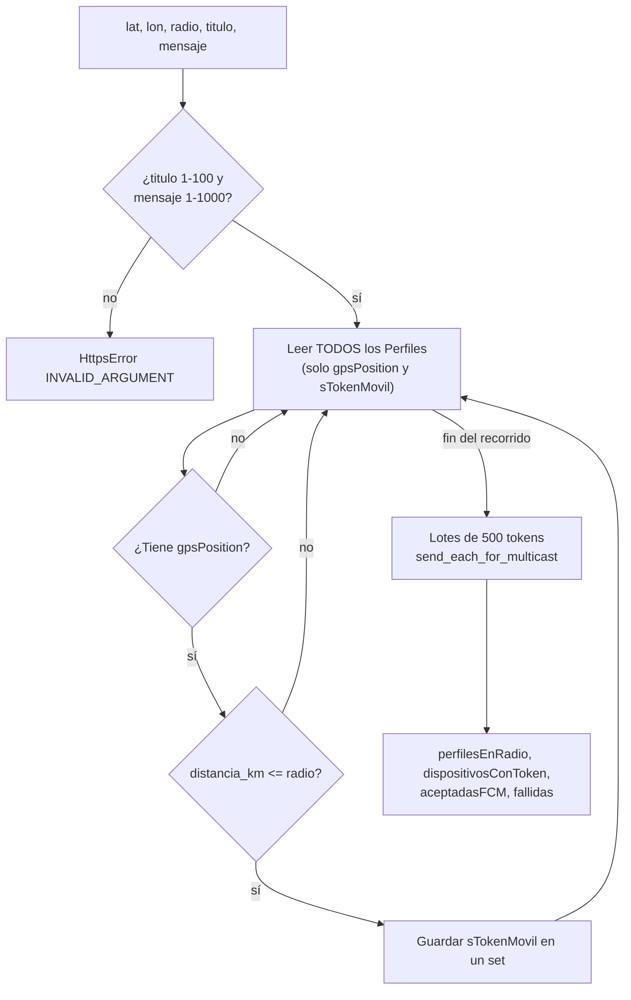

# ☁️ Cloud Functions en Python

> [⬅ Índice de guías](README.md) · [🏠 README principal](../README.md)



Hasta ahora todo el código que has escrito se ejecutaba **en el móvil** del usuario. En esta guía vas a ver
código que se ejecuta **en los servidores de Google**: las *Cloud Functions* de `functions/main.py`. Son las
que crean los pagos de Stripe ([10-pagos-stripe.md](10-pagos-stripe.md)) y las que envían notificaciones push
a los móviles cercanos ([09-notificaciones-push-fcm.md](09-notificaciones-push-fcm.md)).

## 🎯 Qué vas a aprender

- Qué significa *serverless* y por qué hay código que **no puede** vivir en la app.
- Los tres tipos de disparador (*trigger*) que usa el proyecto: HTTP, *callable* y Firestore.
- Qué hace cada una de las 7 funciones de `main.py`.
- Cómo se guardan los secretos (la clave de Stripe) **fuera del código**.
- Cómo arrancar el emulador, desplegar y leer los logs.
- Cómo funciona el envío de push por radio con la fórmula de Haversine.
- Cómo probar una función HTTP y una *callable* desde **Postman**.

## 🧠 Conceptos clave

| Término | Explicación corta |
|---|---|
| [Serverless](13-glosario.md#serverless) | Tú escribes la función; Google pone, arranca y escala el servidor. Pagas por ejecución. |
| [Trigger](13-glosario.md#trigger) | El "evento" que despierta a la función: una petición HTTP, una llamada desde la app o un documento nuevo en Firestore. |
| [Callable](13-glosario.md#callable) | Función HTTP especial que se llama desde la app con `httpsCallable(...)` y que recibe automáticamente quién es el usuario. |
| [Secret Manager](13-glosario.md#secret-manager) | Caja fuerte de Google Cloud donde se guardan claves que el código lee al ejecutarse. |
| [ID token](13-glosario.md#id-token) | "Carné" temporal (1 hora) que Firebase Auth da al usuario logueado; demuestra quién eres ante el servidor. |
| [Haversine](13-glosario.md#haversine) | Fórmula que calcula la distancia entre dos puntos (latitud, longitud) sobre la esfera terrestre. |
| [FCM](13-glosario.md#fcm) | Firebase Cloud Messaging: el servicio que entrega las notificaciones push. |

> 💡 **Analogía.** La app es el cliente de un restaurante; Firestore es la despensa. Hay cosas que el
> cliente puede coger él mismo (un vaso de agua: leer sus mensajes). Pero cobrar con tarjeta o avisar a todos
> los vecinos **lo hace el personal del restaurante** (las Cloud Functions), porque necesita llaves que el
> cliente no debe tener.

## 📁 Archivos implicados

| Archivo | Para qué sirve |
|---|---|
| [`../functions/main.py`](../functions/main.py) | Todo el código de servidor: 7 funciones y 3 funciones auxiliares. |
| [`../functions/requirements.txt`](../functions/requirements.txt) | Paquetes de Python que se instalan al desplegar. |
| [`../firebase.json`](../firebase.json) | Sección `functions` (carpeta, runtime `python312`) y emuladores. |
| [`../lib/Admins/StripeAdmin.dart`](../lib/Admins/StripeAdmin.dart) | Llama a la *callable* `createPaymentIntent`. |
| [`../lib/Admins/FCMAdmin.dart`](../lib/Admins/FCMAdmin.dart) | Llama a la *callable* `enviarPushEnRadio`. |
| [`../lib/views/MessagesView.dart`](../lib/views/MessagesView.dart) | El botón ➕ crea un mensaje, lo que dispara `mensajeCreado`. |

## 🗺 Diagramas

### Las 7 funciones de `main.py`

| Función | Tipo de trigger | Qué la despierta | Qué hace | Líneas |
|---|---|---|---|---|
| `on_request_example` | HTTP `on_request` | Cualquier petición a su URL | Responde `Hello world!` | `main.py:28-30` |
| `addmessage` | HTTP `on_request` | `GET ...?text=...&autor=...` | Crea `Textos/{auto}` con `original` y `autor` (400 si falta algún parámetro) | `main.py:32-50` |
| `makeuppercase` | Firestore `on_document_created` | Documento nuevo en `Textos/{pushId}` | Añade el campo `uppercase` | `main.py:53-71` |
| `createPaymentIntent` | Callable `on_call` (con secreto) | `httpsCallable('createPaymentIntent')` | Valida el importe y crea un `PaymentIntent` en Stripe; devuelve `clientSecret` | `main.py:73-131` |
| `stripeWebhook` | HTTP `on_request` (con secretos) | Stripe hace `POST` cuando cambia un pago | Verifica la firma y actualiza `Transactions.sEstado` | `main.py:134-219` |
| `mensajeCreado` | Firestore `on_document_created` | Documento nuevo en `Perfiles/{perfilID}/Mensajes/{mensajeID}` | Lee la posición del autor y envía push a 10 km | `main.py:262-291` |
| `enviarPushEnRadio` | Callable `on_call` (`us-central1`, 120 s) | `httpsCallable('enviarPushEnRadio')` | Valida `lat`, `lon`, `radioKm` y envía push en ese radio | `main.py:295-320` |

Funciones auxiliares (no son Cloud Functions, son funciones normales de Python): `distancia_km` (Haversine,
`main.py:226-243`), `leer_numero` (validación, `main.py:246-260`) y `pushMensajeRadio` (el envío real,
`main.py:322-433`).

### Los tres tipos de trigger



### Flujo `addmessage` → `Textos` → `makeuppercase`

Este es el ejemplo clásico de Firebase: una función escribe en Firestore y esa escritura **despierta a otra
función**. Fíjate en que nadie llama a `makeuppercase` directamente.



### Push en radio (Haversine)



## 👣 Paso a paso

### 1. Qué es *serverless*

En una app "clásica" tendrías que alquilar un servidor, instalar Python, abrir puertos, mantenerlo encendido
24 horas… Con Cloud Functions solo escribes **funciones**. Google:

- Arranca un contenedor cuando llega un evento (y lo apaga si no hay trabajo).
- Escala solo: si llegan 100 peticiones a la vez, arranca más copias.
- Te cobra por ejecución.

Para que un error no dispare la factura, el proyecto limita las copias simultáneas:

```python
# functions/main.py:20
set_global_options(max_instances=10)
```

> 🔑 **Regla de oro:** todo lo que necesite una **clave secreta** (Stripe) o permisos de administrador
> (leer los perfiles de **todos** los usuarios para mandarles push) va en una Cloud Function, nunca en la app.
> Cualquiera puede descompilar un APK y leer lo que hay dentro.

### 2. Trigger HTTP: `on_request`

Una función HTTP es una URL pública. Recibe un objeto `req` con la petición (parámetros, cabeceras, cuerpo)
y devuelve una `Response`:

```python
# functions/main.py:32-42
@https_fn.on_request()
def addmessage(req: https_fn.Request) -> https_fn.Response:
    original = req.args.get("text")
    autor = req.args.get("autor")
    if original is None:
        return https_fn.Response("No text parameter provided", status=400)
```

`req.args` son los parámetros de la URL (`?text=hola&autor=ana`). Después usa el **Admin SDK** para escribir:

```python
# functions/main.py:44-47
firestore_client = firestore.client()
_, doc_ref = firestore_client.collection("Textos").add({"original": original,"autor":autor})
```

> ⚠️ El Admin SDK **se salta las reglas de seguridad** de Firestore. Por eso el código de servidor debe validar
> él mismo todo lo que recibe.

### 3. Trigger de Firestore: `on_document_created`

```python
# functions/main.py:53-54
@firestore_fn.on_document_created(document="Textos/{pushId}")
def makeuppercase(event: firestore_fn.Event[firestore_fn.DocumentSnapshot | None]) -> None:
```

`{pushId}` es un comodín: la función se ejecuta para **cualquier** documento nuevo de `Textos`, y el id real
llega en `event.params['pushId']`. El documento creado está en `event.data`:

```python
# functions/main.py:69-71
print(f"Uppercasing {event.params['pushId']}: {original}")
upper = original.upper()
event.data.reference.update({"uppercase": upper})
```

> 💡 Este trigger escucha **creaciones** (`on_document_created`). Por eso el `update` que hace al final no lo
> vuelve a despertar: si escuchara `on_document_written`, ¡se llamaría a sí mismo en bucle!

### 4. Trigger *callable*: `on_call`

Una *callable* también es HTTP por debajo, pero Firebase añade dos cosas cómodas:

1. La app la llama con una línea (`httpsCallable('nombre').call({...})`) y Firebase **adjunta el ID token** del
   usuario automáticamente.
2. En Python, `req.auth` ya trae el usuario verificado (o `None`) y `req.data` trae el mapa enviado.

```python
# functions/main.py:73-80
@https_fn.on_call(secrets=[STRIPE_SECRET_KEY])
def createPaymentIntent(req: https_fn.CallableRequest) -> dict:

    if req.auth is None:
        raise https_fn.HttpsError(
            code=https_fn.FunctionsErrorCode.UNAUTHENTICATED,
            message="Debes iniciar sesión para pagar.",
        )
```

Lo que **devuelve** la función (un `dict`) le llega a Dart como `response.data`:

```dart
// lib/Admins/StripeAdmin.dart:46-49
final response = await FirebaseFunctions.instance
    .httpsCallable('createPaymentIntent')
    .call<Map<String, dynamic>>({'amount': centimos, 'currency': 'eur'});
final clientSecret = response.data['clientSecret'];
```

Y si la función lanza `HttpsError`, en Dart salta una `FirebaseFunctionsException` con ese `message`
(lo captura `ChargeView.dart:60-64`).

> 💡 **Curiosidad de Android.** Desde Android, un `int` de Dart puede llegar a Python como un objeto
> `{"@type": "...Int64Value", "value": "1250"}`. Por eso `createPaymentIntent` lo "desenvuelve"
> en `main.py:94-104` antes de validar.

### 5. Secretos con Secret Manager

La clave secreta de Stripe **nunca** se escribe en el código ni se sube a GitHub. Se declara como parámetro:

```python
# functions/main.py:22-23
STRIPE_SECRET_KEY = SecretParam("STRIPE_SECRET_KEY")
STRIPE_WEBHOOK_SECRET = SecretParam("STRIPE_WEBHOOK_SECRET")
```

Cada función dice **qué secretos necesita** (`secrets=[...]` en el decorador) y lee el valor solo al ejecutarse:

```python
# functions/main.py:122
stripe.api_key = STRIPE_SECRET_KEY.value
```

El valor se guarda una vez desde la terminal (te lo pedirá de forma oculta):

```bash
firebase functions:secrets:set STRIPE_SECRET_KEY
firebase functions:secrets:set STRIPE_WEBHOOK_SECRET
```

> ⚠️ Si te pasan una clave por chat, por correo o la ves en una captura: considérala **quemada** y genera
> otra en el panel de Stripe.

### 6. `requirements.txt`

```text
# functions/requirements.txt:1-3
firebase_functions~=0.5.0
stripe
logging
```

- `firebase_functions` trae los decoradores (`https_fn`, `firestore_fn`) y, como dependencia, `firebase_admin`.
- `stripe` es la librería oficial de Stripe para Python.
- `logging` **sobra** (ver fallos conocidos).

### 7. La sección `functions` de `firebase.json`

```json
// firebase.json:71-85 (resumido)
"functions": [
  {
    "source": "functions",
    "codebase": "default",
    "disallowLegacyRuntimeConfig": true,
    "ignore": ["venv", ".git", "firebase-debug.log", "firebase-debug.*.log", "*.local"],
    "runtime": "python312"
  }
]
```

- `source`: la carpeta que se sube.
- `runtime: python312`: la versión de Python en el servidor.
- `ignore`: lo que **no** se sube. Fíjate en `*.local`: ahí van los secretos de prueba del emulador.

### 8. `mensajeCreado` y `enviarPushEnRadio`: dos puertas, una misma lógica

Las dos funciones acaban llamando a `pushMensajeRadio(...)`:

```python
# functions/main.py:284-291  (mensajeCreado: radio fijo de 10 km)
resultado = pushMensajeRadio(
    latitud=posicion.latitude,
    longitud=posicion.longitude,
    radio=10,
    titulo=titulo.strip(),
    mensaje=cuerpo.strip(),
    excluir_emisor=False,
)
```

```python
# functions/main.py:310-320  (enviarPushEnRadio: los datos los manda la app)
latitud = leer_numero(datos, "lat", -90, 90)
longitud = leer_numero(datos, "lon", -180, 180)
radio = leer_numero(datos, "radioKm", 0.001, 100)
...
pushMensajeRadio(latitud,longitud,radio,titulo,mensaje,excluir_emisor)
```

### 9. Haversine explicado sin miedo

La Tierra no es plana, así que no basta con Pitágoras sobre latitud y longitud. La fórmula de Haversine
calcula la distancia por la superficie de una esfera:

```text
              Polo Norte
                 *
               / | \
              /  |  \           A = (lat1, lon1)  ← donde se envía el aviso
             /   |   \          B = (lat2, lon2)  ← un móvil
         A  •----+----•  B
             \   |   /          d = distancia por el "arco" (no por dentro de la Tierra)
              \  |  /
               \ | /            R = 6371 km (radio medio de la Tierra)
                 *
```

```text
a = sin²(Δlat / 2) + cos(lat1) · cos(lat2) · sin²(Δlon / 2)
d = 2 · R · atan2(√a, √(1 − a))
```

Así se escribe en el proyecto (los ángulos se pasan antes a radianes):

```python
# functions/main.py:226-243 (resumido)
def distancia_km(lat1, lon1, lat2, lon2):
    radio_tierra = 6371.0088
    lat1 = math.radians(lat1)
    lat2 = math.radians(lat2)
    delta_lat = lat2 - lat1
    delta_lon = math.radians(lon2 - lon1)
    a = (math.sin(delta_lat / 2) ** 2
         + math.cos(lat1) * math.cos(lat2) * math.sin(delta_lon / 2) ** 2)
    a = min(1.0, max(0.0, a))
    return radio_tierra * 2 * math.atan2(math.sqrt(a), math.sqrt(1 - a))
```

> 💡 La línea `a = min(1.0, max(0.0, a))` evita que un pequeño error de redondeo deje `a` en `1.0000000001`
> y `sqrt(1 - a)` falle.

Con la distancia, `pushMensajeRadio` decide quién recibe el aviso:

```python
# functions/main.py:365-379 (resumido)
distancia = distancia_km(latitud, longitud, posicion.latitude, posicion.longitude)
if distancia > radio:
    continue
perfiles_en_radio += 1
token = perfil.get("sTokenMovil")
if isinstance(token, str) and token.strip():
    tokens.add(token.strip())
```

Los tokens se guardan en un `set` (sin duplicados) y se envían en lotes de **500**, que es el máximo de FCM
por llamada multicast (`main.py:386-405`).

## ⚙️ Configuración necesaria

1. **Plan Blaze** en el proyecto de Firebase (las Cloud Functions de 2ª generación lo exigen).
2. **Firebase CLI** instalada y con sesión: `npm install -g firebase-tools` y `firebase login`.
3. **Python 3.12** y un entorno virtual en `functions/venv` (la CLI lo busca ahí):

   ```bash
   cd functions
   python3.12 -m venv venv
   source venv/bin/activate        # en Windows: venv\Scripts\activate
   pip install -r requirements.txt
   ```

4. **Secretos** (solo si vas a probar Stripe):

   ```bash
   firebase functions:secrets:set STRIPE_SECRET_KEY
   firebase functions:secrets:set STRIPE_WEBHOOK_SECRET
   ```

5. Comandos de trabajo:

   | Comando | Para qué |
   |---|---|
   | `firebase emulators:start --only functions,firestore,auth` | Ejecutar las funciones **en tu ordenador** (sin coste, sin desplegar). La interfaz web del emulador te enseña Firestore y los logs. |
   | `firebase deploy --only functions` | Subir **todas** las funciones a Google. |
   | `firebase deploy --only functions:addmessage` | Subir solo una función (más rápido). |
   | `firebase functions:log` | Ver los `print(...)` y `logging...` de las funciones desplegadas. |

> 🔑 En el emulador los secretos no se leen de Secret Manager: crea `functions/.secret.local` con líneas
> `STRIPE_SECRET_KEY=...`. El patrón `*.local` está en `ignore` de `firebase.json` y en `functions/.gitignore`,
> así que ni se despliega ni se sube a Git.

> ⚠️ En el emulador las funciones push (`messaging`) y Stripe sí hacen llamadas **reales** a internet. El
> emulador solo simula Firebase, no a terceros.

## 🧪 Cómo probarlo

### Probar con Postman

En el repositorio no hay una colección de Postman: créala tú. Sustituye siempre los marcadores
`<PROYECTO>` (id de tu proyecto) e `<ID_TOKEN>` por tus valores, y **no publiques nunca** esos valores.

> 💡 La URL exacta de cada función te la imprime `firebase deploy` al terminar. Con el emulador, la forma es
> `http://127.0.0.1:5001/<PROYECTO>/us-central1/<funcion>`.

#### A) Función HTTP (`addmessage`) con GET

| Campo | Valor |
|---|---|
| Método | `GET` |
| URL | `https://us-central1-<PROYECTO>.cloudfunctions.net/addmessage` |
| Params | `text` = `hola mundo`, `autor` = `ana` |

Respuesta esperada (200):

```text
Message with ID 8fK2... added.
```

Abre Firestore: en `Textos` aparece el documento con `original`, `autor` y, unos segundos después,
`uppercase: "HOLA MUNDO"` (lo escribe `makeuppercase`). Prueba también a quitar `autor`: debe devolver 400.

#### B) Función *callable* (`enviarPushEnRadio`) con POST

Una *callable* sigue un protocolo fijo: **siempre POST**, cuerpo JSON con la clave `data`, y respuesta con la
clave `result` (o `error`).

| Campo | Valor |
|---|---|
| Método | `POST` |
| URL | `https://us-central1-<PROYECTO>.cloudfunctions.net/enviarPushEnRadio` |
| Header | `Authorization: Bearer <ID_TOKEN>` |
| Header | `Content-Type: application/json` |

Body (raw → JSON):

```json
{
  "data": {
    "lat": 40.4168,
    "lon": -3.7038,
    "radioKm": 10,
    "titulo": "Aviso de prueba",
    "mensaje": "Hola desde Postman",
    "excluirEmisor": false
  }
}
```

Respuesta esperada **cuando se corrija el `return` que falta** (ver fallos):

```json
{ "result": { "perfilesEnRadio": 2, "dispositivosConToken": 2, "aceptadasFCM": 2, "fallidas": 0 } }
```

Hoy la respuesta es `{"result": null}`, aunque las notificaciones sí se envían.

Si falta el token o está caducado:

```json
{ "error": { "message": "Debes iniciar sesión.", "status": "UNAUTHENTICATED" } }
```

> ⚠️ Envía `"excluirEmisor": false`. Si lo omites, vale `True` por defecto y la función revienta con
> `NameError` (ver fallos conocidos): Postman recibirá `INTERNAL`.

Lo mismo vale para `createPaymentIntent` con el cuerpo `{"data": {"amount": 1250, "currency": "eur"}}`; la
respuesta será `{"result": {"clientSecret": "pi_..._secret_..."}}`.

#### ¿De dónde saco el `<ID_TOKEN>`?

Es el carné del usuario que tiene la sesión iniciada en la app. Añade **temporalmente** esto en algún botón
(por ejemplo, tras el login) y copia lo que salga en la consola:

```dart
final idToken = await FirebaseAuth.instance.currentUser!.getIdToken();
debugPrint('ID TOKEN: $idToken');
```

> 🔑 El ID token caduca a la hora. Si Postman empieza a devolver `UNAUTHENTICATED`, genera otro. Y bórralo de
> la consola/código después: con él cualquiera puede hacerse pasar por ti durante esa hora.

#### Ver los logs

```bash
firebase functions:log
```

Busca `Uppercasing ...` (de `makeuppercase`) o los avisos `Error individual de FCM: ...`.

## 🐞 Fallos conocidos y limitaciones

| Qué pasa | Por qué | Cómo se arreglaría |
|---|---|---|
| `enviarPushEnRadio` revienta con `NameError: name 'req' is not defined` cuando `excluirEmisor` es `true` (su valor por defecto). | `pushMensajeRadio` usa `req.auth.uid` (`main.py:356`), pero `req` es una variable de `enviarPushEnRadio`, no existe dentro de `pushMensajeRadio`. | Añadir un parámetro `uid_emisor` a `pushMensajeRadio` y pasar `req.auth.uid` desde la callable (y `perfilID` desde `mensajeCreado`). |
| La app recibe `null` y `Map.from(resultado.data as Map)` (`FCMAdmin.dart:92`) lanza un error de tipo. | A `enviarPushEnRadio` le falta el `return` (`main.py:320`). | `return pushMensajeRadio(...)`. |
| `mensajeCreado` falla con `AttributeError` si el autor no tiene `gpsPosition` o el mensaje no tiene `titulo`/`cuerpo`. | `posicion.latitude` y `titulo.strip()` sobre `None` (`main.py:282-289`). | Comprobar `if posicion is None or not titulo: return` antes de llamar. |
| `pip install -r requirements.txt` puede fallar. | `logging` es parte de la librería estándar de Python; el paquete `logging` de PyPI es antiguo (Python 2). | Borrar la línea `logging` de `requirements.txt`. |
| Cada push recorre **todos** los perfiles. | `db.collection("Perfiles").select([...]).stream()` sin filtro (`main.py:346-350`): con 100 000 usuarios son 100 000 lecturas por mensaje. | Guardar un *geohash* en el perfil y consultar solo las celdas cercanas (consultas geográficas de Firestore). |
| Doble push al pulsar ➕ en mensajes. | La app llama a la callable **y** escribe un mensaje que dispara `mensajeCreado`. | Ver [09-notificaciones-push-fcm.md](09-notificaciones-push-fcm.md#-fallos-conocidos-y-limitaciones). |
| Los comentarios de `mensajeCreado` hablan de `"original"`. | Se copió el esqueleto de `makeuppercase`. | Limpiar comentarios. |

## 🛠 Ejercicios

- [ ] Llama a `on_request_example` desde el navegador y desde Postman.
- [ ] Prueba `addmessage` sin `autor` y comprueba el código 400. Cambia el mensaje de error a español.
- [ ] Borra `logging` de `requirements.txt` y vuelve a instalar.
- [ ] Añade el `return` que falta en `enviarPushEnRadio` y comprueba en Postman que llega `result` con los contadores.
- [ ] Arregla el `NameError` pasando el uid del emisor a `pushMensajeRadio`.
- [ ] Haz que `mensajeCreado` ignore mensajes sin posición o sin título en lugar de fallar.
- [ ] Crea una función `on_document_deleted` que escriba un log cuando se borre un `Textos`.
- [ ] (Difícil) Sustituye el recorrido completo de `Perfiles` por una consulta con geohash.

## ❓ Autoevaluación

1. ¿Por qué `createPaymentIntent` tiene que ser una Cloud Function y no código Dart en la app?
   <details><summary>Ver respuesta</summary>Porque necesita la clave **secreta** de Stripe. Todo lo que va dentro de la app se puede extraer del APK; en el servidor la clave está protegida en Secret Manager.</details>

2. ¿Qué diferencia hay entre `addmessage` y `makeuppercase` a la hora de ejecutarse?
   <details><summary>Ver respuesta</summary>`addmessage` es HTTP: se ejecuta cuando alguien hace una petición a su URL. `makeuppercase` es un trigger de Firestore: nadie la llama, se ejecuta sola cuando aparece un documento nuevo en `Textos`.</details>

3. En Postman, ¿qué forma tiene el cuerpo de una llamada *callable* y qué cabecera es imprescindible?
   <details><summary>Ver respuesta</summary>Un JSON `{"data": {...}}` enviado por `POST`, con la cabecera `Authorization: Bearer <ID_TOKEN>` (y `Content-Type: application/json`). La respuesta llega dentro de `{"result": ...}`.</details>

4. ¿Por qué falla `enviarPushEnRadio` si no envías `excluirEmisor`?
   <details><summary>Ver respuesta</summary>Su valor por defecto es `True` y entonces `pushMensajeRadio` ejecuta `req.auth.uid`, pero `req` no existe dentro de esa función: `NameError`.</details>

5. ¿Para qué sirve `max_instances=10`?
   <details><summary>Ver respuesta</summary>Limita el número de copias simultáneas de cada función. Si hay un bucle o un ataque, el coste queda acotado (a cambio, las peticiones de más esperan).</details>

6. ¿Dónde se pone la clave de Stripe para probar en el emulador y por qué no se sube?
   <details><summary>Ver respuesta</summary>En `functions/.secret.local`. El patrón `*.local` está en la lista `ignore` de `firebase.json` (no se despliega) y en `functions/.gitignore` (no se sube a Git): es un secreto y no puede acabar en GitHub.</details>
