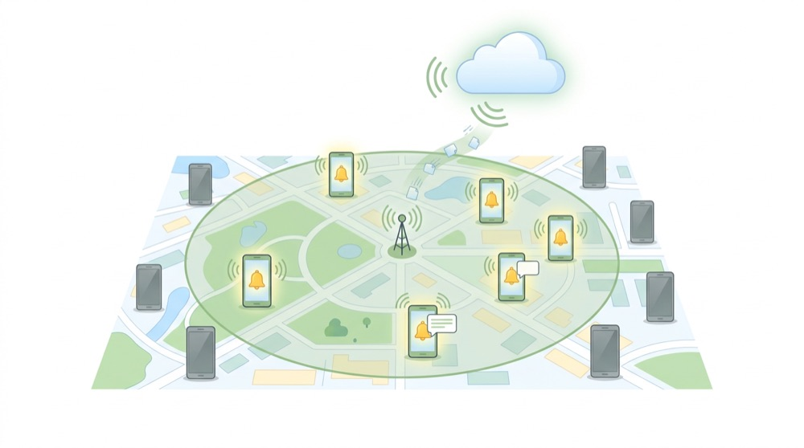
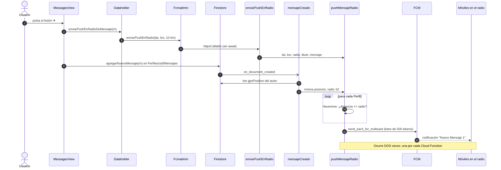
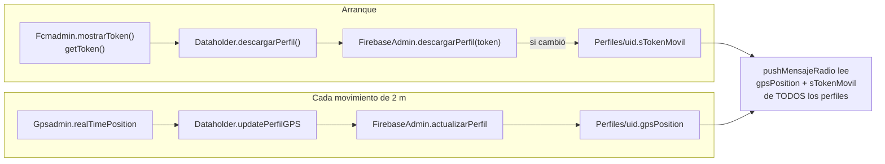
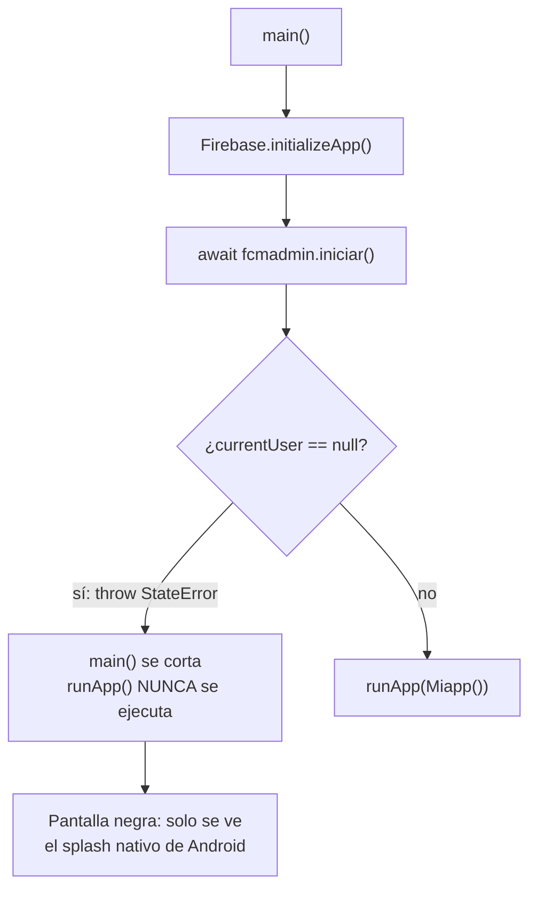

# 🔔 Notificaciones push con FCM

> [⬅ Índice de guías](README.md) · [🏠 README principal](../README.md)



Una notificación *push* es un mensaje que **el servidor** manda a tu móvil aunque la app esté cerrada. En
este proyecto se usan para el "aviso de cercanía": cuando alguien crea un mensaje, les llega una notificación
a todos los móviles que estén a menos de 10 km. Para ello se combinan tres piezas: el GPS
([06-mapa-gps.md](06-mapa-gps.md)), Firestore ([03-firestore-modelo-datos.md](03-firestore-modelo-datos.md))
y las Cloud Functions ([08-cloud-functions-python.md](08-cloud-functions-python.md)).

## 🎯 Qué vas a aprender

- Qué es Firebase Cloud Messaging (FCM) y qué es el **token de dispositivo**.
- Qué método de `Fcmadmin` atiende la notificación según el estado de la app (primer plano, segundo plano, terminada).
- Cómo se guardan el token (`sTokenMovil`) y la posición (`gpsPosition`) en el perfil.
- El recorrido completo de un "push en radio", de un botón hasta los móviles cercanos.
- Por qué hoy llegan **dos** notificaciones por mensaje.
- Un caso real: cómo un `throw` antes de `runApp` dejó la app en **pantalla negra**.

## 🧠 Conceptos clave

| Término | Explicación corta |
|---|---|
| [FCM](13-glosario.md#fcm) | Servicio gratuito de Google que entrega mensajes push a Android, iOS y web. |
| [Token de dispositivo](13-glosario.md#token-de-dispositivo) | "Dirección postal" de **esta instalación** de la app. Sin token, FCM no sabe a qué móvil entregar. |
| [Callable](13-glosario.md#callable) | Cloud Function que la app llama con `httpsCallable(...)`. |
| [Trigger](13-glosario.md#trigger) | Evento que despierta una Cloud Function (aquí: un mensaje nuevo en Firestore). |
| [APNs](13-glosario.md#apns) | Servicio push de Apple. En iOS, FCM entrega a través de APNs. |
| [VAPID](13-glosario.md#vapid) | Par de claves que identifica a tu web ante el servicio push del navegador. |
| [Service worker](13-glosario.md#service-worker) | Script que el navegador mantiene vivo en segundo plano para recibir push en la web. |

> 💡 **Analogía.** FCM es Correos. El token es la dirección de tu buzón. La Cloud Function es quien escribe
> la carta. Si tu dirección no está apuntada en tu perfil (`sTokenMovil`), nadie puede escribirte.

## 📁 Archivos implicados

| Archivo | Para qué sirve |
|---|---|
| [`../lib/Admins/FCMAdmin.dart`](../lib/Admins/FCMAdmin.dart) | Permisos, escuchas de mensajes, token y llamada a la callable `enviarPushEnRadio`. |
| [`../lib/main.dart`](../lib/main.dart) | Inicia FCM antes de `runApp` y comprueba la notificación inicial después. |
| [`../lib/DataHolder.dart`](../lib/DataHolder.dart) | Guarda el token en el perfil, actualiza `gpsPosition` y lanza el push en radio. |
| [`../lib/Admins/FirebaseAdmin.dart`](../lib/Admins/FirebaseAdmin.dart) | `descargarPerfil(token)` escribe `sTokenMovil`; `actualizarPerfil` guarda la posición. |
| [`../lib/views/MessagesView.dart`](../lib/views/MessagesView.dart) | Botón ➕ que dispara el push y callback `pushNotificationRebicido`. |
| [`../functions/main.py`](../functions/main.py) | `mensajeCreado`, `enviarPushEnRadio` y `pushMensajeRadio`. |

## 🗺 Diagramas

### Estados de la app y quién atiende la notificación

| Estado de la app | ¿Qué ve el usuario? | Método que se ejecuta en Dart | Archivo |
|---|---|---|---|
| **Primer plano** (abierta y visible) | **Nada**: Android no pinta la notificación si la app está delante. | `FirebaseMessaging.onMessage` → `_mostrarMensajeEnPrimerPlano` (solo hace `print`) → `onPushReceived` | `FCMAdmin.dart:29`, `37-47` |
| **Segundo plano** (abierta pero no visible) | Notificación del sistema en la barra. | Al llegar: `firebaseMessagingBackgroundHandler` (solo `debugPrint`). Al tocarla: `onMessageOpenedApp` → `onPushReceived` | `FCMAdmin.dart:8-11`, `21`, `31-34` |
| **Terminada** (cerrada del todo) | Notificación del sistema en la barra. | Al llegar también puede ejecutarse `firebaseMessagingBackgroundHandler`. Al tocarla se abre la app y `comprobarNotificacionInicial()` → `getInitialMessage()` → `onPushReceived` | `FCMAdmin.dart:50-60`, `main.dart:51` |

> ⚠️ `onPushReceived` solo se asigna en `MessagesView.initState` (`MessagesView.dart:62`). Si todavía no
> has abierto la pantalla de mensajes, el callback es `null` y la notificación no se refleja en ninguna lista.

### Recorrido completo: "push en radio"



### De dónde salen el token y la posición



## 👣 Paso a paso

### 1. Arrancar FCM (antes de `runApp`)

```dart
// lib/main.dart:44-52
await Dataholder.instance.nfcadmin.iniciar();

await Dataholder.instance.fcmadmin.iniciar();

runApp(Miapp());

await Dataholder.instance.fcmadmin.comprobarNotificacionInicial();
await Dataholder.instance.fcmadmin.mostrarToken();
```

`iniciar()` registra el manejador de segundo plano, pide permiso y se suscribe a los eventos:

```dart
// lib/Admins/FCMAdmin.dart:19-34
Future<void> iniciar() async {
  FirebaseMessaging.onBackgroundMessage(firebaseMessagingBackgroundHandler,);

  await _messaging.requestPermission(alert: true, badge: true, sound: true);

  FirebaseMessaging.onMessage.listen(_mostrarMensajeEnPrimerPlano);

  FirebaseMessaging.onMessageOpenedApp.listen((message) {
    debugPrint('Notificación abierta: ${message.messageId}');
    onPushReceived?.call(message);
  });
}
```

### 2. El manejador de segundo plano

```dart
// lib/Admins/FCMAdmin.dart:8-11
@pragma('vm:entry-point')
Future<void> firebaseMessagingBackgroundHandler(RemoteMessage message) async {
  debugPrint('Mensaje recibido en segundo plano: ${message.messageId}');
}
```

> 🔑 Tiene que ser una función **de nivel superior** (fuera de cualquier clase). Android la ejecuta en un
> "motor" de Dart aparte, sin pantallas. `@pragma('vm:entry-point')` evita que el compilador la elimine
> por creer que nadie la usa.

### 3. El token de dispositivo

```dart
// lib/Admins/FCMAdmin.dart:62-66
Future<String?> mostrarToken() async {
  final token = await _messaging.getToken();
  debugPrint('Token FCM: $token');
  return token;
}
```

Al cargar el perfil, el token se guarda en Firestore **solo si ha cambiado**:

```dart
// lib/DataHolder.dart:85-87
Future<Perfil> descargarPerfil() async {
  String? sTokenMovil= await fcmadmin.mostrarToken();
  perfilUsuario=await firebaseadmin.descargarPerfil(sTokenMovil);
```

```dart
// lib/Admins/FirebaseAdmin.dart:46-49
if(perfilTemp.sTokenMovil!=sTokenMovil){
  perfilTemp.sTokenMovil=sTokenMovil;
  docRef.set(perfilTemp);
}
```

> 💡 Un usuario con dos móviles solo guarda **un** token (el último que haya cargado el perfil). El
> segundo móvil dejaría de recibir avisos.

### 4. La posición GPS en el perfil

`MiApp.build()` llama a `Dataholder.instance.initGPSUpdate()` (`MiApp.dart:185`), que se suscribe al GPS:

```dart
// lib/DataHolder.dart:81-83 y 99-102
void initGPSUpdate(){
  gpsadmin.realTimePosition(updatePerfilGPS);
}

void updatePerfilGPS(Position position){
  perfilUsuario.gpsPosition=GeoPoint(position.latitude, position.longitude);
  firebaseadmin.actualizarPerfil(perfilUsuario);
}
```

### 5. El botón ➕ lanza el aviso

```dart
// lib/views/MessagesView.dart:199-213
void onPressedFloatingBotton() async{
  Mensaje mensajeNuevo=Mensaje.initCampos("", "Nuevo Mensaje 1",
      "Cuerpo del nuevo mensaje", false, Timestamp.fromDate(DateTime.now()));

  Dataholder.instance.enviarPushEnRadioDeMensaje(mensajeNuevo);   // 1ª vía: callable

  setState(() {
    Dataholder.instance.perfilUsuario.agregarNuevoMensaje(mensajeNuevo); // 2ª vía: trigger
  });
}
```

```dart
// lib/DataHolder.dart:104-112
void enviarPushEnRadioDeMensaje(Mensaje m){
  fcmadmin.enviarPushEnRadio(
      lat: perfilUsuario.gpsPosition!.latitude,
      lon: perfilUsuario.gpsPosition!.longitude,
      radioKm: 10,
      titulo: m.titulo!,
      mensaje: m.cuerpo!,
    excluirEmisor: false
  );
}
```

La parte de servidor (Haversine, lotes de 500 tokens) está explicada en
[08-cloud-functions-python.md](08-cloud-functions-python.md#9-haversine-explicado-sin-miedo).

### 6. Qué hace la app cuando recibe un push

`MessagesView` registra su callback y, al recibir el push, añade un `Mensaje` **solo en memoria**:

```dart
// lib/views/MessagesView.dart:62-75
Dataholder.instance.fcmadmin.onPushReceived=pushNotificationRebicido;
...
void pushNotificationRebicido(RemoteMessage message){
  Dataholder.instance.perfilUsuario.mensajes.add(
      Mensaje.initCampos("uid", message.notification?.title,
          message.notification?.body, true, Timestamp.now()));
  setState(() { iNumeroMensajes++; });
}
```

### 7. Caso real: la pantalla negra

En una versión anterior, `Fcmadmin.iniciar()` empezaba así:

```dart
// Versión anterior (ya eliminada) de FCMAdmin.iniciar()
final user = FirebaseAuth.instance.currentUser;
if (user == null) {
  throw StateError('Primero inicia sesión');
}
```

Y `main()` hacía `await Dataholder.instance.fcmadmin.iniciar();` **antes** de `runApp(...)`.

¿Qué pasaba al abrir la app sin sesión (por ejemplo, cuando la abría un tag NFC, ver [11-nfc.md](11-nfc.md))?



> 🔑 **Lección:** el código que se espera (`await`) antes de `runApp` **nunca debe lanzar excepciones**. Si
> algo puede fallar ahí, captúralo con `try/catch` o muévelo a después de `runApp`. Además, pedir sesión
> para registrar FCM no tiene sentido: el token identifica al **dispositivo**, no al usuario.

## ⚙️ Configuración necesaria

1. **Android**: basta con `google-services.json` y el paquete `firebase_messaging`. En Android 13+ el
   sistema muestra el diálogo de permiso que pide `requestPermission`.
2. **Cloud Functions desplegadas** (`mensajeCreado`, `enviarPushEnRadio`): ver
   [08-cloud-functions-python.md](08-cloud-functions-python.md) (apartado *Configuración necesaria*).
3. **Permiso de ubicación** concedido: sin `gpsPosition` ni el emisor ni los receptores entran en el radio.
4. **iOS (pendiente en este proyecto)**: hace falta subir una clave APNs (`.p8`) en la consola de Firebase,
   añadir la capacidad *Push Notifications* (entitlement `aps-environment`) y *Background Modes →
   Remote notifications* (`UIBackgroundModes`) en Xcode. Hoy no existe ni el entitlement ni esa clave en
   `Info.plist`, así que en iOS no llegan push.
5. **Web (pendiente en este proyecto)**: `getToken(vapidKey: ...)` con la clave VAPID del proyecto y un
   archivo `web/firebase-messaging-sw.js` (service worker). Ninguno de los dos existe todavía.

## 🧪 Cómo probarlo

### A) Desde la consola de Firebase (sin Cloud Functions)

1. Ejecuta la app en un **móvil o emulador con Google Play** y busca en la consola de `flutter run`:

   ```text
   Token FCM: <TOKEN_DEL_DISPOSITIVO>
   ```

2. En la consola de Firebase → **Messaging** → *Nueva campaña* → *Notificaciones* → escribe título y
   texto → **Enviar mensaje de prueba** → pega el token.
3. Prueba los tres estados:
   - App **delante**: no verás notificación, pero en la consola aparecerá `------->>>>>>!!!!!!!! <título>`.
   - App **en segundo plano** (botón Inicio): aparece en la barra. Al tocarla: `Notificación abierta: ...`.
   - App **cerrada** (quítala de recientes): aparece en la barra. Al tocarla: `App abierta desde una notificación: ...`.

> ⚠️ El token es personal de tu dispositivo: no lo pegues en el chat de clase ni en un *issue*.

### B) Push en radio de punta a punta

1. Dos móviles con sesión iniciada y ubicación permitida, a menos de 10 km.
2. En uno, abre **Mensajes** y pulsa ➕.
3. Los dos móviles (también el emisor, porque `excluirEmisor` es `false`) reciben la notificación… **dos veces**.
4. Revisa `firebase functions:log` para ver cada ejecución.

### C) Con Postman

Puedes llamar a `enviarPushEnRadio` sin la app: ver
[08-cloud-functions-python.md → Probar con Postman](08-cloud-functions-python.md#probar-con-postman).

## 🐞 Fallos conocidos y limitaciones

| Qué pasa | Por qué | Cómo se arreglaría |
|---|---|---|
| **Doble push** por cada mensaje. | `onPressedFloatingBotton` llama a la callable `enviarPushEnRadio` **y** escribe el mensaje en Firestore, lo que dispara `mensajeCreado`. Las dos acaban en `pushMensajeRadio`. | Elegir una sola vía. Lo más limpio: quitar la llamada a `enviarPushEnRadioDeMensaje` y dejar solo el trigger. |
| El emisor recibe su propio aviso. | Ambas vías usan `excluirEmisor=False`. | Arreglar el `NameError` de `pushMensajeRadio` (ver [08](08-cloud-functions-python.md#-fallos-conocidos-y-limitaciones)) y pasar el uid del emisor. |
| En primer plano no se ve nada. | `_mostrarMensajeEnPrimerPlano` solo hace `print`. Android no pinta notificaciones de apps en primer plano. | Mostrar un `SnackBar`/`MaterialBanner` o usar `flutter_local_notifications`. |
| El push recibido no queda guardado. | `pushNotificationRebicido` añade el `Mensaje` solo a la lista en memoria. | Guardarlo en Firestore o, mejor, confiar en el listener de mensajes. |
| Crash si no hay posición. | `perfilUsuario.gpsPosition!` en `DataHolder.dart:106`. | Comprobar `null` y avisar al usuario. |
| Error no controlado en Dart tras cada ➕. | La callable devuelve `null` (falta `return`) y `Map.from(resultado.data as Map)` falla; como no hay `await`, el error sale como excepción no capturada. | Añadir el `return` en Python y `await` + `try/catch` en Dart. |
| El token puede quedar viejo. | No se escucha `onTokenRefresh`; solo se guarda al cargar el perfil. | `FirebaseMessaging.instance.onTokenRefresh.listen(...)` y actualizar `sTokenMovil`. |
| Un token por usuario. | `sTokenMovil` es un `String`. | Guardar una lista o subcolección de tokens. |
| Sin push en web ni iOS. | Faltan VAPID + service worker (web) y APNs + entitlements (iOS). | Ver "Configuración necesaria". |

## 🛠 Ejercicios

- [ ] Envía un mensaje de prueba desde la consola de Firebase a tu móvil en los tres estados.
- [ ] Muestra un `SnackBar` cuando llegue un push en primer plano.
- [ ] Quita la doble llamada para que llegue **una sola** notificación por mensaje.
- [ ] Haz que el título del push sea el que escribe el usuario (añade un diálogo al botón ➕).
- [ ] Escucha `onTokenRefresh` y actualiza `sTokenMovil`.
- [ ] Al tocar una notificación, navega a `/Messagesview` (usa `onMessageOpenedApp` y `getInitialMessage`).
- [ ] (Difícil) Configura el push en web con VAPID y `firebase-messaging-sw.js`.

## ❓ Autoevaluación

1. ¿Qué es el token FCM y dónde lo guarda este proyecto?
   <details><summary>Ver respuesta</summary>Es el identificador de esta instalación de la app ante FCM (la "dirección del buzón"). Se guarda en `Perfiles/{uid}.sTokenMovil` cuando se descarga el perfil, si ha cambiado.</details>

2. La app está abierta y delante. Llega un push. ¿Qué ve el usuario y qué método se ejecuta?
   <details><summary>Ver respuesta</summary>No ve ninguna notificación del sistema. Se ejecuta `onMessage` → `_mostrarMensajeEnPrimerPlano`, que solo imprime en consola y llama a `onPushReceived` si existe.</details>

3. ¿Por qué `firebaseMessagingBackgroundHandler` está fuera de la clase `Fcmadmin`?
   <details><summary>Ver respuesta</summary>Porque Android puede ejecutarlo sin que exista la app visual (en un isolate aparte). Debe ser una función de nivel superior marcada con `@pragma('vm:entry-point')`.</details>

4. ¿Por qué llegan dos notificaciones al pulsar ➕?
   <details><summary>Ver respuesta</summary>Porque se llama a la callable `enviarPushEnRadio` y, además, el mensaje se escribe en Firestore, lo que dispara el trigger `mensajeCreado`. Ambas ejecutan `pushMensajeRadio`.</details>

5. ¿Por qué un `throw` dentro de `fcmadmin.iniciar()` dejaba la pantalla negra?
   <details><summary>Ver respuesta</summary>Porque `main()` lo esperaba con `await` antes de `runApp`. La excepción cortaba `main()` y `runApp` nunca se llegaba a ejecutar: solo se veía el splash nativo.</details>

6. ¿Qué dos cosas faltan para que funcione el push en la web?
   <details><summary>Ver respuesta</summary>La clave VAPID en `getToken(vapidKey: ...)` y el service worker `web/firebase-messaging-sw.js`.</details>
