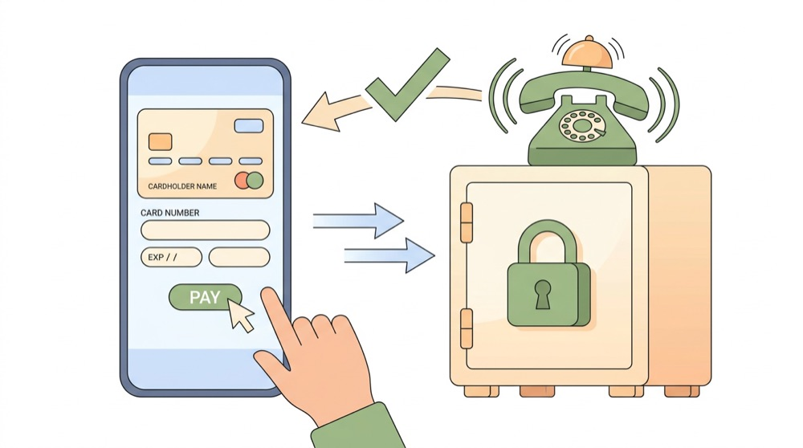
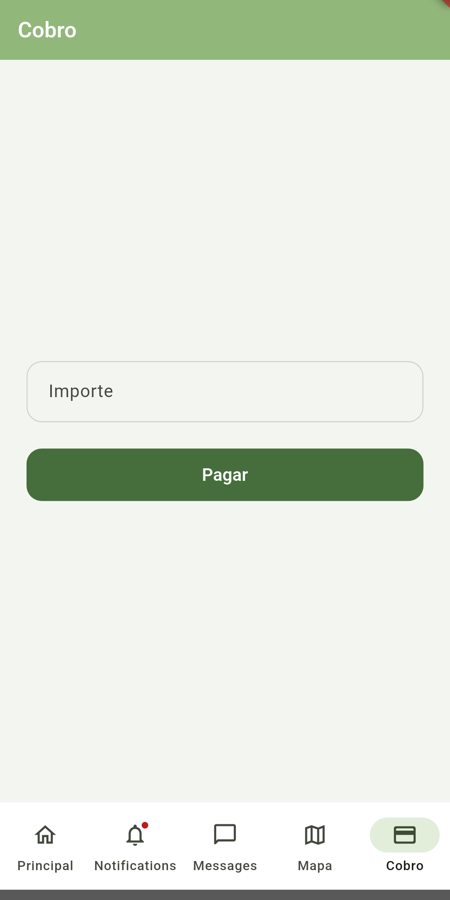
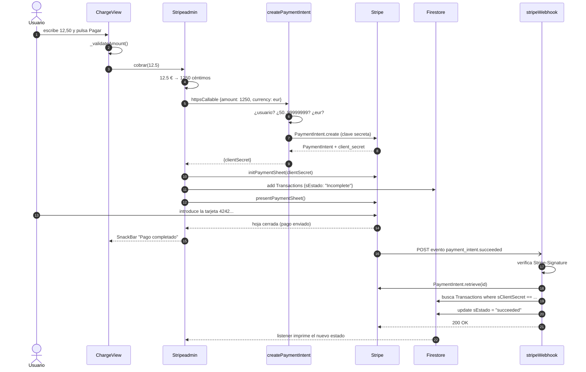
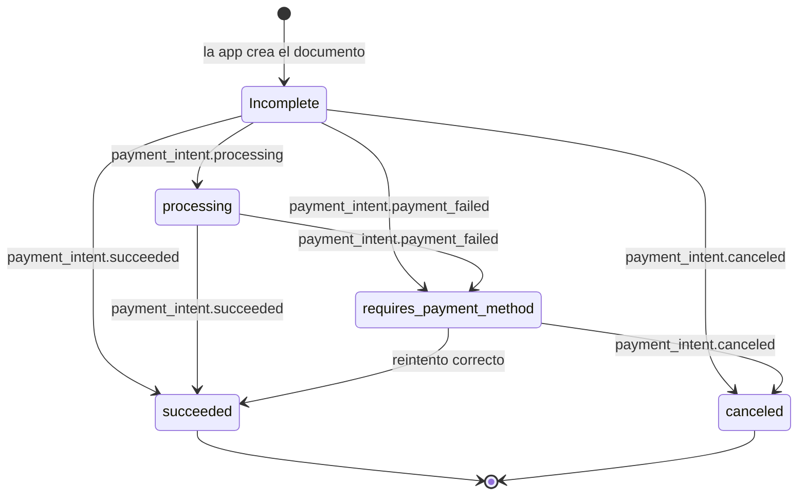

# 💳 Pagos con Stripe

> [⬅ Índice de guías](README.md) · [🏠 README principal](../README.md)



**📸 Así se ve en Android:**

| Cobro |
|:---:|
|  |

La pestaña **Cobro** de la barra inferior permite pagar un importe con tarjeta usando **Stripe** en modo de
pruebas. Es el flujo más completo del proyecto: mezcla una pantalla Flutter, una Cloud Function
([08-cloud-functions-python.md](08-cloud-functions-python.md)), un servicio externo (Stripe), un *webhook* y
Firestore ([03-firestore-modelo-datos.md](03-firestore-modelo-datos.md)).

> ⚠️ Todo lo de esta guía funciona en **modo test**: no se mueve dinero real. Usa siempre tarjetas de prueba.

## 🎯 Qué vas a aprender

- Por qué **nunca** se cobra directamente desde la app (clave publicable frente a clave secreta).
- Qué son un `PaymentIntent`, su `clientSecret`, la `PaymentSheet` y un *webhook*.
- El recorrido completo de un pago, de `ChargeView` hasta `Transactions.sEstado`.
- Los estados por los que pasa una transacción.
- Qué hay que configurar en Android y en el panel de Stripe.
- Cómo probar con la tarjeta `4242 4242 4242 4242`.

## 🧠 Conceptos clave

| Término | Explicación corta |
|---|---|
| [Clave publicable](13-glosario.md#clave-publicable) | Empieza por `pk_`. Puede ir dentro de la app: solo sirve para **mostrar** el formulario de pago. |
| [Clave secreta](13-glosario.md#clave-secreta) | Empieza por `sk_`. Permite crear cobros y reembolsos: **solo** en el servidor (Secret Manager). |
| [PaymentIntent](13-glosario.md#paymentintent) | La "intención de cobro" que crea el servidor en Stripe: importe, moneda y estado. |
| [clientSecret](13-glosario.md#clientsecret) | Llave de un solo uso que deja a la app completar **ese** PaymentIntent concreto (y nada más). |
| [PaymentSheet](13-glosario.md#paymentsheet) | Hoja de pago ya hecha por Stripe que pide la tarjeta al usuario. |
| [Webhook](13-glosario.md#webhook) | URL de **tu** servidor a la que Stripe llama cuando el pago cambia de estado. |
| [Callable](13-glosario.md#callable) | Cloud Function que la app llama con `httpsCallable(...)`. |

> 💡 **Analogía.** Vas a pagar en una tienda. El dependiente (**servidor**) teclea el importe en el datáfono
> y te lo acerca (**PaymentIntent** + **clientSecret**). Tú solo metes la tarjeta (**PaymentSheet**). Tú nunca
> tocas la caja registradora (**clave secreta**). Y cuando el banco confirma, **Stripe llama por teléfono a
> la tienda** para avisar de que el pago ha terminado (**webhook**).

## 📁 Archivos implicados

| Archivo | Para qué sirve |
|---|---|
| [`../lib/views/ChargeView.dart`](../lib/views/ChargeView.dart) | Formulario con el importe y botón **Pagar**. |
| [`../lib/Admins/StripeAdmin.dart`](../lib/Admins/StripeAdmin.dart) | Configura Stripe, pide el PaymentIntent y muestra la PaymentSheet. |
| [`../lib/FbObjects/Transaccion.dart`](../lib/FbObjects/Transaccion.dart) | Modelo del documento `Perfiles/{uid}/Transactions/{id}`. |
| [`../lib/FbObjects/Perfil.dart`](../lib/FbObjects/Perfil.dart) | `agregarNuevaTransaction(...)`. |
| [`../lib/Admins/FirebaseAdmin.dart`](../lib/Admins/FirebaseAdmin.dart) | `addTransaction(...)`: crea el documento y escucha sus cambios. |
| [`../functions/main.py`](../functions/main.py) | `createPaymentIntent` (callable) y `stripeWebhook` (HTTP). |
| [`../android/app/src/main/kotlin/com/newton/dam2_2627_a/MainActivity.kt`](../android/app/src/main/kotlin/com/newton/dam2_2627_a/MainActivity.kt) | Hereda de `FlutterFragmentActivity` (requisito de `flutter_stripe`). |
| [`../android/app/src/main/res/values/styles.xml`](../android/app/src/main/res/values/styles.xml) | Temas `Theme.AppCompat` (requisito de `flutter_stripe`). |

## 🗺 Diagramas

### Recorrido completo de un pago



### Estados de `sEstado`



> 💡 `Incomplete` lo escribe **la app** (`Transaccion.dart:6`). Los demás valores los escribe el **webhook**
> copiando el `status` real del PaymentIntent (`main.py:208-212`). Fíjate: cuando un pago falla, Stripe deja el
> estado en `requires_payment_method` ("necesito otra tarjeta"), no en `failed`.

## 👣 Paso a paso

### 1. ¿Por qué no se cobra desde la app?

Stripe te da dos claves:

| Clave | Prefijo | ¿Dónde vive? | ¿Qué permite? |
|---|---|---|---|
| Publicable | `pk_test_...` / `pk_live_...` | Dentro de la app (`StripeAdmin.dart:13`) | Mostrar la PaymentSheet y enviar la tarjeta a Stripe. |
| Secreta | `sk_test_...` / `sk_live_...` | Secret Manager (`STRIPE_SECRET_KEY`) | Crear cobros **por cualquier importe**, reembolsar, ver clientes… |

Si la clave secreta estuviera en la app, cualquiera podría sacarla del APK y, por ejemplo, decidir que su
compra cuesta 0,01 €. Por eso **el importe lo fija el servidor** y la app solo recibe un `clientSecret` para
ese pago concreto.

> 🔑 La clave publicable no es secreta (está pensada para ir en el cliente), pero aun así **no la copies en
> documentos ni capturas**: cada alumno debe usar la de **su** cuenta de Stripe en modo test.

### 2. Configurar Stripe al arrancar

`Dataholder` crea `Stripeadmin()` y su constructor lanza la configuración:

```dart
// lib/Admins/StripeAdmin.dart:8-17 (resumido)
Stripeadmin() {
  _initialization = initStripeConnection();
}

Future<void> initStripeConnection() async {
  Stripe.publishableKey = "<TU_CLAVE_PUBLICABLE_pk_test>";
  Stripe.merchantIdentifier = 'merchant.flutter.stripe.test';
  Stripe.urlScheme = 'flutterstripe';
  await Stripe.instance.applySettings();
}
```

`merchantIdentifier` (Apple Pay) y `urlScheme` (volver a la app tras una verificación 3-D Secure) son valores
de ejemplo.

### 3. Validar el importe (tres veces)

| Dónde | Código | Reglas | ¿Para qué? |
|---|---|---|---|
| Pantalla | `ChargeView._validateAmount` (`ChargeView.dart:31-46`) | > 0, ≥ 0,50 €, ≤ 999.999,99 €, máx. 2 decimales (acepta coma o punto) | Ayudar al usuario con mensajes claros. |
| Cliente | `Stripeadmin.cobrar` (`StripeAdmin.dart:22-43`) | Finito y > 0, máx. 2 decimales, 50..99 999 999 céntimos | Que nadie llame a `cobrar` con datos malos desde otro sitio. |
| Servidor | `createPaymentIntent` (`main.py:76-120`) | Usuario autenticado, `amount` entero 50..99 999 999, `currency == "eur"` | **La única que cuenta para la seguridad.** |

> ⚠️ Las validaciones de la app se pueden saltar (por ejemplo, llamando a la función con Postman). La del
> servidor no.

Stripe trabaja en la **unidad mínima** de la moneda (céntimos):

```dart
// lib/Admins/StripeAdmin.dart:29
final centimos = (importeEuros * 100).round();
```

### 4. Pedir el PaymentIntent al servidor

```dart
// lib/Admins/StripeAdmin.dart:46-52
final response = await FirebaseFunctions.instance
    .httpsCallable('createPaymentIntent')
    .call<Map<String, dynamic>>({'amount': centimos, 'currency': 'eur'});
final clientSecret = response.data['clientSecret'];
if (clientSecret is! String || clientSecret.isEmpty) {
  throw StateError('El servidor no devolvió un clientSecret válido');
}
```

En el servidor:

```python
# functions/main.py:122-131
stripe.api_key = STRIPE_SECRET_KEY.value

intent = stripe.PaymentIntent.create(
    amount=amount,
    currency="eur",
    automatic_payment_methods={"enabled": True},
    metadata={"profileUid": req.auth.uid},
)

return {"clientSecret": intent.client_secret}
```

> 💡 `metadata={"profileUid": ...}` es una "etiqueta" que viaja con el pago. Gracias a ella el webhook sabrá
> **de qué usuario** es cuando Stripe le avise.

### 5. Guardar la transacción y mostrar la hoja de pago

```dart
// lib/Admins/StripeAdmin.dart:54-64
await Stripe.instance.initPaymentSheet(
  paymentSheetParameters: SetupPaymentSheetParameters(
    paymentIntentClientSecret: clientSecret,
    merchantDisplayName: 'MI APP 1',
  ),
);

await Dataholder.instance.perfilUsuario.agregarNuevaTransaction(clientSecret, "eur", centimos);

await Stripe.instance.presentPaymentSheet();
```

`agregarNuevaTransaction` crea un `Transaccion` con `sEstado: "Incomplete"` y `FirebaseAdmin.addTransaction`
lo guarda y se queda escuchando:

```dart
// lib/Admins/FirebaseAdmin.dart:114-121
final transactions=db.collection("Perfiles/"+fa.currentUser!.uid+"/Transactions");
DocumentReference reference=await transactions.add(transaction.toFirestore());

reference.snapshots().listen(
        (event) {
      print("ESTADO DE LA TRASACCION HA CAMBIADO: "+event.data().toString());
    }
);
```

Documento resultante en `Perfiles/{uid}/Transactions/{id}`:

| Campo | Ejemplo | Quién lo escribe |
|---|---|---|
| `sEstado` | `"Incomplete"` → `"succeeded"` | App, luego webhook |
| `sClientSecret` | `"pi_..._secret_..."` | App |
| `iCents` | `1250` | App, luego webhook |
| `sCurrency` | `"eur"` | App, luego webhook |

### 6. El webhook: Stripe te llama por teléfono

Cuando el pago termina (o falla), Stripe hace un `POST` a `stripeWebhook`. Lo primero es comprobar que **de
verdad** es Stripe y no alguien que se hace pasar por él:

```python
# functions/main.py:139-151
signature = req.headers.get("Stripe-Signature")
if not signature:
    return https_fn.Response("Falta la firma", status=400)

try:
    event = stripe.Webhook.construct_event(
        req.data,
        signature,
        STRIPE_WEBHOOK_SECRET.value,
    )
except (ValueError, stripe.SignatureVerificationError):
    return https_fn.Response("Firma o contenido inválido", status=400)
```

Después:

1. Ignora eventos que no sean de PaymentIntent (`main.py:153-160`).
2. **Vuelve a preguntar a Stripe** el estado actual (`PaymentIntent.retrieve`, `main.py:166-171`), porque los
   eventos pueden llegar repetidos o desordenados.
3. Saca `profileUid` de la `metadata` y busca la transacción por `sClientSecret` (`main.py:185-196`).
4. Si no encuentra **exactamente una**, responde `503`: Stripe reintentará más tarde (`main.py:198-205`).
5. Actualiza `sEstado`, `iCents` y `sCurrency` solo si han cambiado (`main.py:207-217`).

> 💡 Responder `503` a propósito es un truco útil: si el documento todavía no existe (carrera entre la app y
> Stripe), Stripe vuelve a intentarlo durante horas con esperas crecientes.

## ⚙️ Configuración necesaria

1. **Cuenta de Stripe** en modo test. Copia tu clave publicable (`pk_test_...`) en `StripeAdmin.dart:13`.
2. **Clave secreta en Secret Manager** (nunca en el código):

   ```bash
   firebase functions:secrets:set STRIPE_SECRET_KEY      # pega tu sk_test_...
   ```

3. **Desplegar las funciones**: `firebase deploy --only functions` (ver
   [08-cloud-functions-python.md](08-cloud-functions-python.md)).
4. **Registrar el webhook** en el panel de Stripe (*Developers → Webhooks → Add endpoint*):
   - URL: `https://us-central1-<PROYECTO>.cloudfunctions.net/stripeWebhook` (la URL exacta te la da `firebase deploy`).
   - Eventos: `payment_intent.succeeded`, `payment_intent.payment_failed`, `payment_intent.processing`,
     `payment_intent.canceled`.
   - Copia el *Signing secret* (`whsec_...`) y guárdalo:

     ```bash
     firebase functions:secrets:set STRIPE_WEBHOOK_SECRET
     firebase deploy --only functions:stripeWebhook
     ```

5. **Android**:
   - `MainActivity` debe heredar de `FlutterFragmentActivity` (`MainActivity.kt:12`), porque la PaymentSheet
     es un *Fragment* nativo.
   - Los temas `LaunchTheme` y `NormalTheme` deben heredar de `Theme.AppCompat...`
     (`values/styles.xml:4` y `:15`, y lo mismo en `values-night/styles.xml`).
   - Tras cambiar esto hay que **recompilar** (`flutter run` de nuevo); un *hot reload* no basta.

> 🔑 Al cambiar un secreto hay que **volver a desplegar** las funciones que lo usan: cada despliegue fija la
> versión del secreto que leerá.

## 🧪 Cómo probarlo

1. Abre la app en Android con sesión iniciada y pulsa la pestaña **Cobro**.
2. Prueba la validación: `0`, `0,10`, `12,345` deben dar error en el campo.
3. Escribe `12,50` y pulsa **Pagar**. Debe abrirse la PaymentSheet de Stripe.
4. Tarjetas de prueba (fecha: **cualquiera futura**, CVC: **cualquiera de 3 cifras**, código postal: cualquiera):

   | Tarjeta | Resultado |
   |---|---|
   | `4242 4242 4242 4242` | Pago correcto → `succeeded` |
   | `4000 0000 0000 0002` | Rechazada → `requires_payment_method` |
   | `4000 0025 0000 3155` | Pide verificación 3-D Secure |

5. Comprueba:
   - En la app: `SnackBar` "Pago completado".
   - En la consola: `ESTADO DE LA TRASACCION HA CAMBIADO: {sEstado: succeeded, ...}`.
   - En Firestore: `Perfiles/{uid}/Transactions/{id}.sEstado == "succeeded"`.
   - En Stripe → *Payments*: el pago de 12,50 €. En *Webhooks* puedes ver cada intento y la respuesta (200/400/503).
   - Si algo falla: `firebase functions:log`.
6. Repite pulsando la **X** de la PaymentSheet para cancelar y observa el error y el documento.

## 🐞 Fallos conocidos y limitaciones

| Qué pasa | Por qué | Cómo se arreglaría |
|---|---|---|
| Al cancelar la hoja sale "No se pudo completar el pago: StripeException…". | `presentPaymentSheet()` lanza `StripeException` (código `Canceled`) y `ChargeView` lo trata como un error genérico (`ChargeView.dart:65-69`). | Capturar `on StripeException catch (e)` y, si `e.error.code == FailureCode.Canceled`, mostrar "Pago cancelado". |
| Transacciones que se quedan en `Incomplete` para siempre. | El documento se crea **antes** de mostrar la hoja. Si el usuario cancela, Stripe no envía ningún evento final. | Crear el documento desde el servidor en `createPaymentIntent`, o cancelar el PaymentIntent al cerrar la hoja. |
| "Pago completado" no significa cobrado. | La hoja se cierra cuando el pago se **envía**; la confirmación real llega por el webhook. | Mostrar el resultado escuchando `sEstado` en lugar de fiarse del cierre de la hoja. |
| No hay historial de pagos. | `FirebaseAdmin.getTransactions()` está vacío (`FirebaseAdmin.dart:124-126`). | Implementarlo con una consulta a `Transactions` y una lista en `ChargeView`. |
| Un listener por cada pago. | `addTransaction` hace `listen` y nunca lo cancela. | Guardar la `StreamSubscription` y cancelarla al llegar a un estado final. |
| Solo Android/iOS. | `flutter_stripe` no da PaymentSheet en web ni escritorio. | Usar Stripe Checkout (página web de Stripe) en esas plataformas. |
| `sEstado` mezcla estilos (`Incomplete` vs `succeeded`). | `Incomplete` es un valor inventado por la app; el resto son los `status` de Stripe. | Usar como valor inicial `requires_payment_method`, el mismo que usa Stripe. |
| El webhook no funciona "solo". | Hay que registrar la URL en el panel de Stripe y guardar `STRIPE_WEBHOOK_SECRET`. | Ver "Configuración necesaria". |

## 🛠 Ejercicios

- [ ] Paga con `4242 4242 4242 4242` y encuentra el documento en Firestore y el pago en Stripe.
- [ ] Paga con la tarjeta rechazada y comprueba qué valor toma `sEstado`.
- [ ] Muestra "Pago cancelado" (y no un error) cuando el usuario cierra la hoja.
- [ ] Cambia el `SnackBar` para que se muestre cuando `sEstado` pase a `succeeded`.
- [ ] Implementa `getTransactions()` y enseña el historial en `ChargeView`.
- [ ] (Difícil) Mueve la creación del documento `Transactions` al servidor dentro de `createPaymentIntent`.

## ❓ Autoevaluación

1. ¿Qué clave de Stripe puede ir en la app y cuál no? ¿Por qué?
   <details><summary>Ver respuesta</summary>La publicable (`pk_`) sí: solo sirve para mostrar el formulario y enviar la tarjeta. La secreta (`sk_`) no: permite crear cobros y reembolsos, y cualquiera podría extraerla del APK. Vive en Secret Manager.</details>

2. ¿Qué es el `clientSecret` y quién lo genera?
   <details><summary>Ver respuesta</summary>Lo genera Stripe al crear el PaymentIntent (lo pide nuestro servidor con la clave secreta). Permite a la app completar **ese** pago concreto por el importe ya fijado, nada más.</details>

3. ¿Por qué el servidor vuelve a validar el importe si `ChargeView` ya lo hace?
   <details><summary>Ver respuesta</summary>Porque las validaciones del cliente se pueden saltar (otra app, Postman, una versión modificada). La validación del servidor es la única fiable.</details>

4. ¿Cómo sabe el webhook a qué usuario pertenece un pago?
   <details><summary>Ver respuesta</summary>Por la `metadata.profileUid` que `createPaymentIntent` guarda al crear el PaymentIntent. Con ese uid busca en `Perfiles/{uid}/Transactions` el documento con el mismo `sClientSecret`.</details>

5. ¿Para qué sirve la cabecera `Stripe-Signature`?
   <details><summary>Ver respuesta</summary>Para demostrar que la petición viene de Stripe y no se ha modificado. Se comprueba con `STRIPE_WEBHOOK_SECRET`; sin firma válida la función responde 400 y no toca Firestore.</details>

6. ¿Qué dos cambios nativos de Android exige `flutter_stripe`?
   <details><summary>Ver respuesta</summary>Que `MainActivity` herede de `FlutterFragmentActivity` y que los temas de la actividad hereden de `Theme.AppCompat`.</details>
