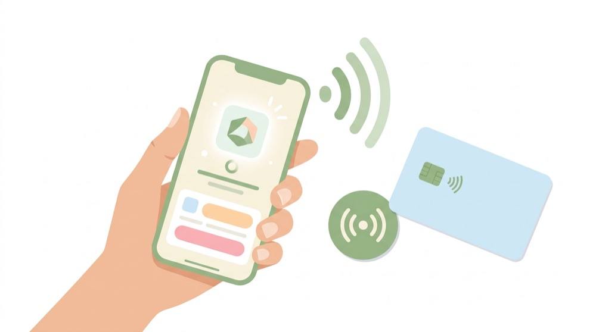
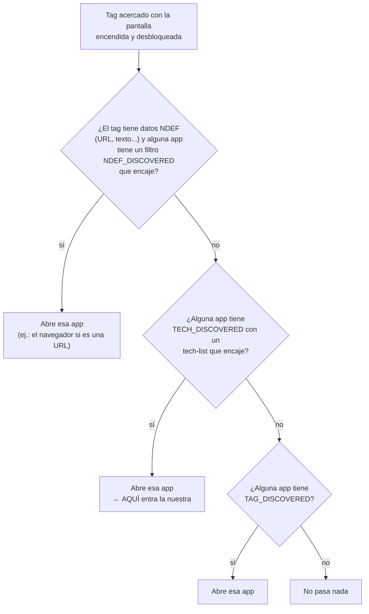
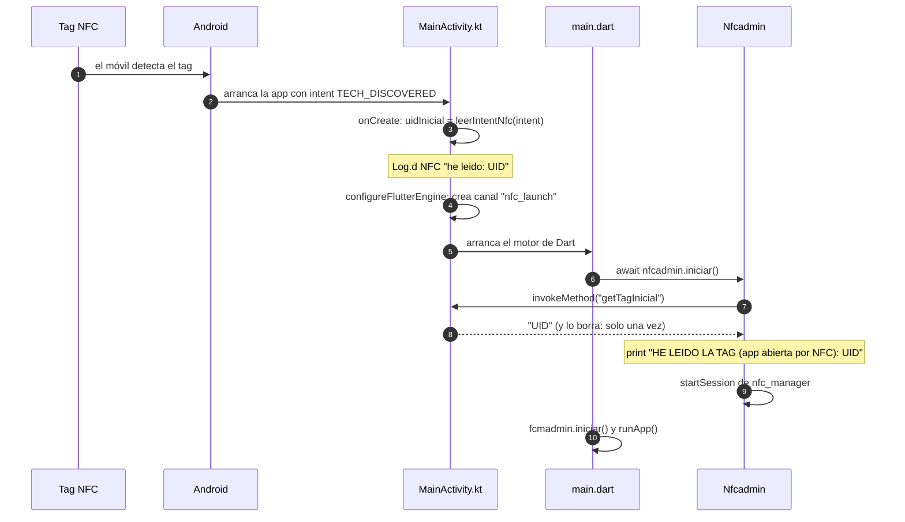
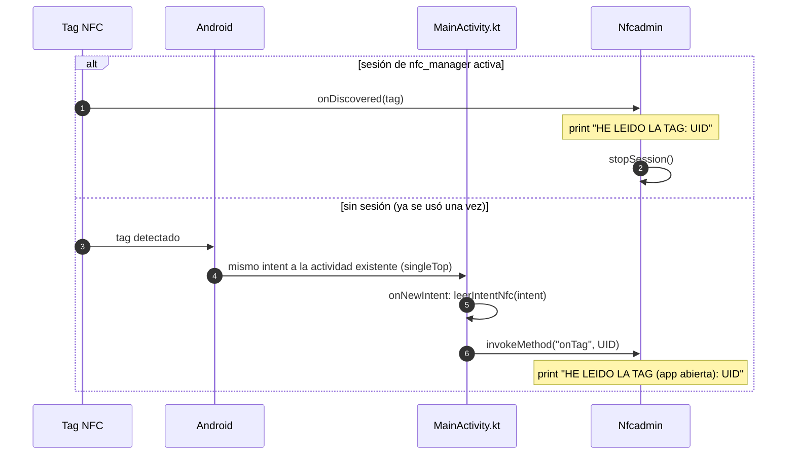

# 📶 Lectura de tags NFC (Android)

> [⬅ Índice de guías](README.md) · [🏠 README principal](../README.md)



En esta guía la app aprende a **leer el número de serie (UID) de una tarjeta o pegatina NFC**. Es la
primera parte del proyecto en la que escribimos código **nativo de Android** (Kotlin y XML) y lo
conectamos con Dart. Hoy la app solo **imprime** el UID en la consola: el objetivo es entender bien el
camino que recorre el dato.

> ⚠️ **Estado:** esta funcionalidad todavía no está confirmada en Git. Se ha **verificado con un intent
> simulado** por `adb` (sin tag real). La **prueba con un tag físico está pendiente**. Solo Android.

## 🎯 Qué vas a aprender

- Qué son NFC, un tag y su UID.
- Las dos formas de leer un tag: que **Android abra la app** o leer **con la app ya abierta**.
- Cómo decide Android qué app abre al acercar un tag (prioridad de *intents*).
- El `AndroidManifest.xml`, el `nfc_tech_filter.xml` y `MainActivity.kt`, línea a línea.
- Cómo se pasa un dato de Kotlin a Dart con un `MethodChannel`, y por qué en el arranque en frío Dart lo
  tiene que **pedir**.
- La historia del fallo que tuvimos (la app no se abría y luego… pantalla negra).

## 🧠 Conceptos clave

| Término | Explicación corta |
|---|---|
| [NFC](13-glosario.md#nfc) | Comunicación de campo cercano: radio de muy corto alcance (unos 4 cm). La usan las tarjetas de transporte y el pago con el móvil. |
| [Tag](13-glosario.md#tag) | Chip NFC sin batería (tarjeta, pegatina, llavero). Se alimenta del campo del móvil al acercarlo. |
| [UID](13-glosario.md#uid) | Número de serie del chip, en bytes. Lo mostramos en hexadecimal: `04A2B3C4D5E680`. |
| [NDEF](13-glosario.md#ndef) | Formato estándar para guardar datos **dentro** del tag (una URL, un texto…). |
| [Intent](13-glosario.md#intent) | "Mensaje" de Android que dice *qué ha pasado* y deja que una app lo atienda. |
| [Intent filter](13-glosario.md#intent-filter) | Lo que una actividad declara en el manifiesto: "yo sé atender este tipo de intent". |
| [MethodChannel](13-glosario.md#methodchannel) | "Tubería" con nombre para llamar a métodos entre Dart y el código nativo. |
| [singleTop](13-glosario.md#singletop) | Modo de lanzamiento: si la actividad ya está delante, se **reutiliza** en vez de crear otra. |

> 💡 **Analogía.** El tag es un sobre con un número de serie impreso. Android es el conserje del edificio:
> cuando llega un sobre, mira la lista de vecinos (los *intent filters*) y se lo entrega a quien dijo
> "yo recojo sobres de este tipo".

## 📁 Archivos implicados

| Archivo | Para qué sirve |
|---|---|
| [`../android/app/src/main/AndroidManifest.xml`](../android/app/src/main/AndroidManifest.xml) | Permiso NFC, `singleTop` y el *intent filter* `TECH_DISCOVERED`. |
| [`../android/app/src/main/res/xml/nfc_tech_filter.xml`](../android/app/src/main/res/xml/nfc_tech_filter.xml) | Qué tecnologías de tag nos interesan. |
| [`../android/app/src/main/kotlin/com/newton/dam2_2627_a/MainActivity.kt`](../android/app/src/main/kotlin/com/newton/dam2_2627_a/MainActivity.kt) | Lee el tag del intent y lo pasa a Dart por el canal `nfc_launch`. |
| [`../lib/Admins/NFCAdmin.dart`](../lib/Admins/NFCAdmin.dart) | Lado Dart: escucha el canal y abre una sesión de `nfc_manager`. |
| [`../lib/main.dart`](../lib/main.dart) | Llama a `nfcadmin.iniciar()` antes de FCM y de `runApp`. |
| [`../lib/DataHolder.dart`](../lib/DataHolder.dart) | Guarda la instancia `nfcadmin`. |
| [`../pubspec.yaml`](../pubspec.yaml) | Dependencia `nfc_manager: ^4.3.0`. |

## 🗺 Diagramas

### ¿Qué app abre Android al acercar un tag?

Android prueba tres niveles, de más concreto a más genérico. En cuanto un nivel tiene candidatas, se para.



> ⚠️ Si varias apps encajan en el mismo nivel, Android muestra un **selector** ("Abrir con…").

### Arranque en frío (la app estaba cerrada)



### Arranque en caliente (la app ya estaba abierta)



## 👣 Paso a paso

### 1. Dos formas de leer un tag

| Forma | Cuándo | Quién lo recibe | Pieza clave |
|---|---|---|---|
| **(a) Android abre la app** | La app está cerrada o en segundo plano | `MainActivity` vía *intent* | Manifiesto + `nfc_tech_filter.xml` |
| **(b) Leer con la app abierta** | La app está delante | La sesión de `nfc_manager` (o `onNewIntent`) | `NfcManager.instance.startSession` |

### 2. El `AndroidManifest.xml`, línea a línea

```xml
<!-- android/app/src/main/AndroidManifest.xml:6-7 -->
<uses-permission android:name="android.permission.NFC" />
<uses-feature android:name="android.hardware.nfc" android:required="false" />
```

- **Línea 6**: permiso para usar el hardware NFC. Es un permiso "normal": no hay diálogo para el usuario.
- **Línea 7**: la app *usa* NFC, pero `required="false"` significa que **también** se puede instalar en móviles
  sin NFC. Con `true`, Google Play la ocultaría a esos móviles.

```xml
<!-- AndroidManifest.xml:16 -->
android:launchMode="singleTop"
```

- **Línea 16**: si la app ya está delante y llega otro tag, Android **no crea una segunda pantalla**: reutiliza
  la existente y llama a `onNewIntent`. Sin esto, cada tag abriría una copia nueva de la app.

```xml
<!-- AndroidManifest.xml:30-41 -->
<intent-filter>
    <action android:name="android.intent.action.MAIN"/>
    <category android:name="android.intent.category.LAUNCHER"/>
</intent-filter>
<intent-filter>
    <action android:name="android.nfc.action.TECH_DISCOVERED" />
    <category android:name="android.intent.category.DEFAULT" />
</intent-filter>
<meta-data
    android:name="android.nfc.action.TECH_DISCOVERED"
    android:resource="@xml/nfc_tech_filter" />
```

- **Líneas 30-33**: el filtro de siempre: "soy la pantalla que sale en el cajón de apps".
- **Líneas 35-38**: un filtro **aparte** para NFC. Debe ir separado: mezclar acciones en el filtro del
  `LAUNCHER` lo estropea (ver la historia del fallo, más abajo). La categoría `DEFAULT` es obligatoria para que
  Android entregue el intent.
- **Líneas 39-41**: el `meta-data` le dice a Android **qué tags** nos interesan (el XML del paso 3). Tiene que
  estar **dentro de `<activity>`**, al lado del filtro. Sin este `meta-data`, el filtro `TECH_DISCOVERED` no
  sirve de nada.

### 3. `nfc_tech_filter.xml`: O entre listas, Y dentro de una lista

```xml
<!-- android/app/src/main/res/xml/nfc_tech_filter.xml:3-8 (fragmento) -->
<tech-list>
    <tech>android.nfc.tech.NfcA</tech>
</tech-list>
<tech-list>
    <tech>android.nfc.tech.NfcB</tech>
</tech-list>
```

La regla es:

- **Entre `<tech-list>`** distintas hay un **O**: basta con que encaje una.
- **Dentro de una `<tech-list>`** hay un **Y**: el tag debe tener **todas** las tecnologías de esa lista.

El proyecto tiene 10 listas de una sola tecnología cada una (`NfcA`, `NfcB`, `NfcF`, `NfcV`, `IsoDep`, `Ndef`,
`NdefFormatable`, `MifareClassic`, `MifareUltralight`, `NfcBarcode`). Es decir: **"ábreme con cualquier tag"**.

> 💡 Si quisieras solo tarjetas MIFARE Classic que además sean NfcA, escribirías **una** lista con dos
> `<tech>`: `NfcA` **y** `MifareClassic`.

### 4. `MainActivity.kt`: leer el tag del intent

```kotlin
// MainActivity.kt:48-59
private fun leerIntentNfc(intent: Intent?): String? {
    if (intent?.action != NfcAdapter.ACTION_TECH_DISCOVERED) return null
    val tag: Tag? = if (Build.VERSION.SDK_INT >= Build.VERSION_CODES.TIRAMISU) {
        intent.getParcelableExtra(NfcAdapter.EXTRA_TAG, Tag::class.java)
    } else {
        @Suppress("DEPRECATION")
        intent.getParcelableExtra(NfcAdapter.EXTRA_TAG)
    }
    val uid = tag?.id?.joinToString("") { "%02X".format(it) } ?: ""
    Log.d("NFC", "he leido: $uid")
    return uid
}
```

- Si el intent no es de NFC (por ejemplo, abrir la app desde el icono), devuelve `null`.
- El tag viaja dentro del intent como un "extra" (`EXTRA_TAG`). En Android 13 (*Tiramisu*) o superior hay que
  indicar el tipo; en versiones anteriores se usa el método antiguo.
- `tag.id` son bytes; `"%02X"` convierte cada byte en dos cifras hexadecimales en mayúsculas.
- Si el intent es NFC pero no trae tag (nuestra prueba simulada), devuelve `""` (UID vacío).

### 5. `onCreate` frente a `onNewIntent`

```kotlin
// MainActivity.kt:35-45
override fun onCreate(savedInstanceState: Bundle?) {
    super.onCreate(savedInstanceState)
    // App cerrada + tag: guardamos el UID hasta que Dart lo pida.
    if (savedInstanceState == null) uidInicial = leerIntentNfc(intent)
}

override fun onNewIntent(intent: Intent) {
    super.onNewIntent(intent)
    // App ya abierta + tag: Dart ya escucha, se lo enviamos directamente.
    leerIntentNfc(intent)?.let { uid -> canalNfc?.invokeMethod("onTag", uid) }
}
```

| Método | Cuándo lo llama Android | Qué hacemos |
|---|---|---|
| `onCreate` | Se **crea** la actividad (arranque en frío). | Guardamos el UID en `uidInicial`. **No** se lo mandamos a Dart. |
| `onNewIntent` | La actividad ya existía y es `singleTop`. | Se lo **empujamos** a Dart con `invokeMethod("onTag", uid)`. |

`savedInstanceState == null` evita volver a leer el mismo tag si Android recrea la actividad (por ejemplo, cuando
Android la destruye por falta de memoria y luego la restaura).

### 6. El canal `nfc_launch` y por qué en frío Dart tiene que "tirar" del dato

```kotlin
// MainActivity.kt:21-33
override fun configureFlutterEngine(flutterEngine: FlutterEngine) {
    super.configureFlutterEngine(flutterEngine)
    canalNfc = MethodChannel(flutterEngine.dartExecutor.binaryMessenger, "nfc_launch").apply {
        setMethodCallHandler { call, result ->
            if (call.method == "getTagInicial") {
                result.success(uidInicial)
                uidInicial = null // se entrega una sola vez
            } else {
                result.notImplemented()
            }
        }
    }
}
```

En el **arranque en frío**, `onCreate` se ejecuta **antes** de que el código Dart haya empezado. Si Kotlin
hiciera `invokeMethod("onTag", ...)` en ese momento, **nadie estaría escuchando** al otro lado y el UID se
perdería. Por eso se invierte la dirección:

- **En frío (pull)**: Kotlin guarda el UID y espera. Cuando Dart está listo, **pide** `getTagInicial`.
- **En caliente (push)**: Dart ya escucha, así que Kotlin **envía** `onTag` directamente.

> 💡 **Analogía.** Llega un paquete a casa cuando aún no has vuelto. El portero (Kotlin) no puede dártelo en
> mano, así que lo guarda. Cuando llegas (Dart listo), **tú** preguntas: "¿hay algo para mí?". Si ya estás en
> casa, el portero te lo sube directamente.

> 🔑 El nombre del canal (`"nfc_launch"`) y de los métodos (`"getTagInicial"`, `"onTag"`) deben ser
> **idénticos** en Kotlin y en Dart. Un error de una letra y la llamada falla con `MissingPluginException`.

### 7. `NFCAdmin.dart`: el lado de Dart

```dart
// lib/Admins/NFCAdmin.dart:15-32
static const MethodChannel _canal = MethodChannel('nfc_launch');

Future<void> iniciar() async {
  if (kIsWeb || defaultTargetPlatform != TargetPlatform.android) return;

  _canal.setMethodCallHandler((call) async {
    if (call.method == 'onTag') {
      print("HE LEIDO LA TAG (app abierta): ${call.arguments}");
    }
  });

  final String? uidInicial = await _canal.invokeMethod<String>('getTagInicial');
  if (uidInicial != null) {
    print("HE LEIDO LA TAG (app abierta por NFC): $uidInicial");
  }
```

Después abre una **sesión de lectura** de `nfc_manager` (la forma (b)):

```dart
// lib/Admins/NFCAdmin.dart:35-52
NfcAvailability availability = await NfcManager.instance.checkAvailability();
if (availability != NfcAvailability.enabled) {
  print('NFC may not be supported or may be temporarily disabled.');
  return;
}

NfcManager.instance.startSession(
  pollingOptions: {NfcPollingOption.iso14443},
  onDiscovered: (NfcTag tag) async {
    print("HE LEIDO LA TAG: ${_uid(tag)}");
    await NfcManager.instance.stopSession();
  },
);
```

- `iso14443` cubre las tarjetas más comunes (NfcA/NfcB, MIFARE, DNI electrónico…).
- `_uid(tag)` (`NFCAdmin.dart:56-60`) calcula el mismo hexadecimal que Kotlin.
- Tras el primer tag se llama a `stopSession()`: los siguientes tags ya no entran por aquí, sino por el
  *intent* → `onNewIntent` → `onTag`.

### 8. Dónde se llama

```dart
// lib/main.dart:42-46
// NFC: imprime el tag que ha abierto la app y escucha tags nuevos.
// Va ANTES de FCM para no depender de que haya sesión iniciada.
await Dataholder.instance.nfcadmin.iniciar();

await Dataholder.instance.fcmadmin.iniciar();
```

### 9. La historia del fallo que tuvimos

**Primer síntoma: acercábamos el tag y la app no se abría nunca.** El manifiesto estaba así (versión
incorrecta, reconstruida y resumida):

```xml
<!-- ❌ MAL -->
<application ...>
    <activity ...>
        <intent-filter>
            <action android:name="android.intent.action.MAIN"/>
            <action android:name="android.nfc.action.TECH_DISCOVERED"/>
            <category android:name="android.intent.category.LAUNCHER"/>
        </intent-filter>
    </activity>
    <meta-data
        android:name="android.nfc.action.TECH_DISCOVERED"
        android:resource="@xml/nfc_tech_filter" />
</application>
```

Dos errores:

1. El `meta-data` estaba colgando de `<application>`, no de `<activity>`. Android busca la lista de
   tecnologías **en la actividad** que tiene el filtro; como no la encontraba, no registraba la app para NFC.
2. La acción NFC estaba mezclada en el filtro del `LAUNCHER` y sin categoría `DEFAULT`.

**Arreglo:** filtro NFC separado con `DEFAULT` y `meta-data` **dentro** de `<activity>` (paso 2).

**Segundo síntoma: ahora el tag sí abría la app… pero se quedaba en negro.** El culpable no era NFC. En
aquella versión, `Fcmadmin.iniciar()` lanzaba `StateError('Primero inicia sesión')` si no había usuario, y
`main()` lo esperaba **antes** de `runApp`. La excepción cortaba `main()` y Flutter nunca pintaba nada. Lo
tienes explicado en [09-notificaciones-push-fcm.md](09-notificaciones-push-fcm.md#7-caso-real-la-pantalla-negra).

> 🔑 **Lecciones:** (1) en el manifiesto, *dónde* pones una etiqueta importa tanto como *qué* pones;
> (2) nada de lo que se espera antes de `runApp` debe poder lanzar una excepción.

## ⚙️ Configuración necesaria

1. Dependencia en `pubspec.yaml`: `nfc_manager: ^4.3.0` (pide `minSdk` 24, que coincide con el valor por
   defecto de Flutter que usa `build.gradle.kts`).
2. Los cambios de `AndroidManifest.xml`, `nfc_tech_filter.xml` y `MainActivity.kt` del paso a paso.
3. Tras tocar archivos nativos: **parar y volver a lanzar** `flutter run`. Un *hot reload* o *hot restart* no
   recompila Kotlin ni el manifiesto.
4. En el móvil: **NFC activado** en Ajustes y pantalla **desbloqueada** (Android no lee tags con la pantalla
   bloqueada).
5. iOS **no está soportado**: necesitaría `NFCReaderUsageDescription` en `Info.plist`, la capacidad *Near Field
   Communication Tag Reading* y un iPhone real. Además, iOS no abre apps por un tag sin NDEF.

## 🧪 Cómo probarlo

### A) Ver los logs

En una terminal, con el móvil conectado por USB:

```bash
adb logcat -s flutter NFC
```

Solo verás las líneas con etiqueta `flutter` (los `print` de Dart) y `NFC` (el `Log.d` de Kotlin).

### B) Simular un tag sin tenerlo (verificado)

Con la app instalada:

```bash
adb shell am start -a android.nfc.action.TECH_DISCOVERED -n com.newton.dam2_2627_a/.MainActivity
```

Esto envía a `MainActivity` el mismo intent que enviaría Android, pero **sin tag dentro**, así que el UID sale
vacío. Salida comprobada:

```text
D NFC     : he leido:
I flutter : HE LEIDO LA TAG (app abierta por NFC):
I flutter : HE LEIDO LA TAG (app abierta):
```

| Línea | ¿Quién la escribe? | ¿Cuándo? |
|---|---|---|
| `D NFC : he leido:` | `MainActivity.leerIntentNfc` | Cada vez que llega el intent. |
| `HE LEIDO LA TAG (app abierta por NFC):` | `Nfcadmin.iniciar` vía `getTagInicial` | Si la app **estaba cerrada** (arranque en frío). |
| `HE LEIDO LA TAG (app abierta):` | handler de `onTag` | Si la app **ya estaba abierta** (`onNewIntent`). |

> 💡 Prueba el comando dos veces: primero con la app cerrada (quítala de recientes) y luego con la app abierta.
> Verás cómo cambia la línea de `flutter`.

### C) Con un tag real (pendiente de verificar)

- Usa una **tarjeta o pegatina en blanco** (sin datos NDEF) o una tarjeta cualquiera (transporte, gimnasio, la
  del comedor). Buscamos solo el UID.
- Acerca el tag a la **parte trasera central** del móvil (ahí suele estar la antena) y espera un segundo.
- Si el tag tiene una **URL** grabada, se abrirá el **navegador** en lugar de nuestra app: es el nivel
  `NDEF_DISCOVERED`, que gana a `TECH_DISCOVERED` (ver el primer diagrama).
- Con la app abierta, el **primer** tag lo lee la sesión de `nfc_manager`:

  ```text
  I flutter : HE LEIDO LA TAG: 04A2B3C4D5E680
  ```

  Los siguientes llegarán por `onNewIntent`:

  ```text
  D NFC     : he leido: 04A2B3C4D5E680
  I flutter : HE LEIDO LA TAG (app abierta): 04A2B3C4D5E680
  ```

  (El UID de ejemplo es inventado; el tuyo será distinto.)

## 🐞 Fallos conocidos y limitaciones

| Qué pasa | Por qué | Cómo se arreglaría |
|---|---|---|
| El UID solo sale en la consola. | `NFCAdmin` solo hace `print`. | Guardar el UID en `Dataholder` y mostrarlo en pantalla (ejercicios). |
| La sesión de `nfc_manager` lee un solo tag. | `stopSession()` en el primer `onDiscovered`; no se vuelve a abrir. | Volver a llamar a `startSession` o no pararla mientras la pantalla esté visible. |
| Dos caminos distintos con la app abierta. | Sesión de `nfc_manager` **y** `onNewIntent` → `onTag`. | Unificar: un único método `procesarUid(uid)` al que llamen los tres caminos. |
| Tags con URL abren el navegador. | Prioridad `NDEF_DISCOVERED` > `TECH_DISCOVERED`. | Añadir un filtro `NDEF_DISCOVERED` propio, o usar tags en blanco. |
| UID vacío en la prueba simulada. | El intent de `adb` no lleva `EXTRA_TAG`. | Es lo esperado; para un UID real hace falta un tag físico. |
| No funciona en iOS ni web. | `iniciar()` sale si no es Android; faltan permisos y capacidades en iOS. | Ver "Configuración necesaria". |
| El UID no es un dato seguro. | Muchos tags permiten clonar o falsear el UID. | No usar el UID como contraseña; para control de acceso, tags con criptografía. |

## 🛠 Ejercicios

- [ ] Ejecuta la prueba simulada en frío y en caliente y explica cada línea del log.
- [ ] Muestra el UID en un `SnackBar` (pista: necesitas un `GlobalKey<ScaffoldMessengerState>` en `MaterialApp`, porque `iniciar()` se ejecuta antes de que exista ninguna pantalla).
- [ ] Crea una pantalla "Último tag leído" que muestre el UID y la hora.
- [ ] Unifica los tres caminos en un único método `procesarUid(String uid)`.
- [ ] Vuelve a abrir la sesión de `nfc_manager` tras cada lectura.
- [ ] Guarda cada lectura en Firestore: `Perfiles/{uid}/LecturasNFC/{auto}` con `tagUid` y `fecha`.
- [ ] (Difícil) Escribe un mensaje NDEF de texto en un tag en blanco con `nfc_manager` (`Ndef.write`).

## ❓ Autoevaluación

1. ¿Qué tres niveles prueba Android al acercar un tag y en cuál entra nuestra app?
   <details><summary>Ver respuesta</summary>`NDEF_DISCOVERED`, luego `TECH_DISCOVERED` y por último `TAG_DISCOVERED`. Nuestra app se registra en `TECH_DISCOVERED`.</details>

2. ¿Qué significa tener 10 `<tech-list>` con una tecnología cada una?
   <details><summary>Ver respuesta</summary>Entre listas hay un O: el tag encaja si tiene **cualquiera** de esas tecnologías. En la práctica, "ábreme con cualquier tag".</details>

3. ¿Por qué `onCreate` guarda el UID en vez de enviarlo a Dart con `invokeMethod`?
   <details><summary>Ver respuesta</summary>Porque en el arranque en frío el código Dart aún no se ha ejecutado y nadie escucha el canal: el mensaje se perdería. Kotlin lo guarda y Dart lo pide con `getTagInicial` cuando está listo.</details>

4. ¿Para qué sirve `android:launchMode="singleTop"` aquí?
   <details><summary>Ver respuesta</summary>Para que, si la app ya está delante, Android reutilice la misma actividad y llame a `onNewIntent` en lugar de abrir otra copia de la app por cada tag.</details>

5. Acercas un tag con una URL grabada y se abre Chrome. ¿Por qué?
   <details><summary>Ver respuesta</summary>Porque el tag tiene datos NDEF y el navegador tiene un filtro `NDEF_DISCOVERED` para URLs. Ese nivel tiene prioridad sobre `TECH_DISCOVERED`.</details>

6. ¿Cuáles fueron los dos errores del manifiesto que impedían que la app se abriera?
   <details><summary>Ver respuesta</summary>El `meta-data` del tech-list estaba dentro de `<application>` en vez de dentro de `<activity>`, y la acción `TECH_DISCOVERED` estaba mezclada en el filtro del `LAUNCHER` (sin un filtro propio con categoría `DEFAULT`).</details>
