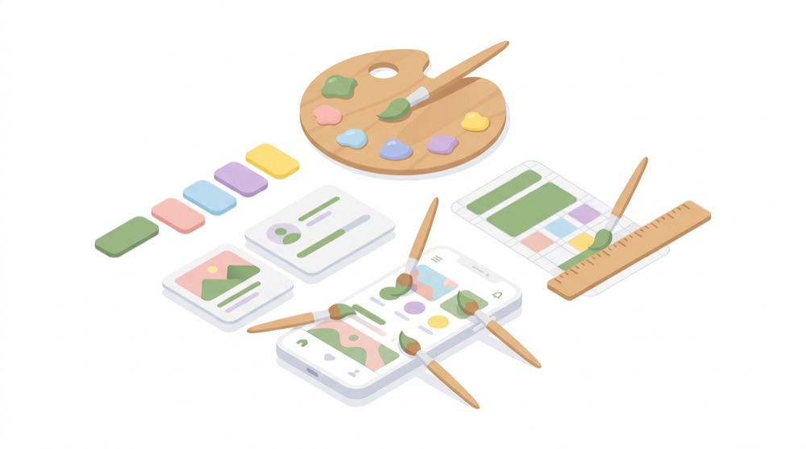
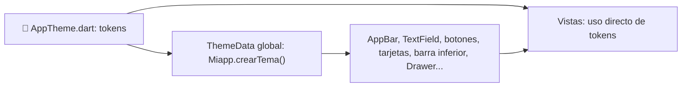

# 🎨 Tema y estilos

> [⬅ Índice de guías](README.md) · [🏠 README principal](../README.md)



En lugar de escribir colores y tamaños "a mano" en cada pantalla, el proyecto los guarda en un
único archivo de **design tokens** y construye con ellos un **tema global**. Si mañana cambia el
verde de la app, se cambia en un solo sitio.

## 🎯 Qué vas a aprender

- Qué son los *design tokens* y cómo están organizados en `AppTheme.dart`.
- Cómo `Miapp.crearTema()` convierte esos tokens en un `ThemeData` global.
- Qué colores tiene la paleta y para qué se usa cada uno.
- Cuándo usar el tema (automático) y cuándo usar un token directamente en una vista.

## 🧠 Conceptos clave

| Término | Qué significa aquí |
|---|---|
| Design token | Constante con nombre para un valor de diseño (`AppColores.principal`, `AppEspacios.md`). Como las etiquetas de un bote de pintura: pides "verde marca", no "146, 183, 123". |
| [ThemeData](13-glosario.md#tema) | "Libro de estilo" de Material: cada widget busca ahí su aspecto por defecto. |
| [ColorScheme](13-glosario.md#colorscheme) | Paleta completa (primary, surface, error...) que usan los componentes Material 3. |
| `static const` | Miembro de clase, constante y conocido al compilar. Se usa sin crear objetos. |
| `copyWith` | Crea una copia de un estilo cambiando solo algunas propiedades. |

## 📁 Archivos implicados

| Archivo | Qué hace |
|---|---|
| [../lib/insLib/theme/AppTheme.dart](../lib/insLib/theme/AppTheme.dart) | Tokens: `AppColores`, `AppEspacios`, `AppRadios`, `AppTextos`. |
| [../lib/MiApp.dart](../lib/MiApp.dart) | `crearTema()`: construye el `ThemeData` global y lo pasa al `MaterialApp`. |
| [../lib/views/](../lib/views/) | Las pantallas usan el tema automáticamente y los tokens directamente para cabeceras, espacios, etc. |

## 🗺 Diagrama



## 👣 Paso a paso

### 1. Las cuatro clases de tokens

Abre [AppTheme.dart](../lib/insLib/theme/AppTheme.dart). Son clases con miembros `static const`:
no se crean objetos, se usan directamente.

| Clase | Qué guarda | Ejemplo |
|---|---|---|
| `AppColores` | Paleta de colores | `AppColores.principal` |
| `AppEspacios` | Márgenes y separaciones en múltiplos de 4, y tamaños fijos | `AppEspacios.md` (16) |
| `AppRadios` | Redondeo de esquinas | `AppRadios.tarjeta` (20) |
| `AppTextos` | Estilos de texto | `AppTextos.tituloCabecera` |

```dart
class AppColores {
  /// Verde de marca (el mismo que usa HomeView).
  static const Color principal = Color.fromARGB(255, 146, 183, 123);
```

([AppTheme.dart:19-21](../lib/insLib/theme/AppTheme.dart#L19-L21))

### 2. La paleta

| Muestra | Token | Valor | Uso |
|---|---|---|---|
|  | `principal` | `#92B77B` | AppBar, cabeceras, color "semilla" del tema |
|  | `oscuro` | `#466E3C` | Botones, degradados, iconos destacados, borde con foco |
|  | `suave` | `#E2EEDA` | Indicador de la barra inferior, fondos suaves |
|  | `fondo` | `#F3F6F0` | Fondo de pantallas y de campos de texto |
|  | `tarjeta` | `#FFFFFF` | Tarjetas, barra inferior, menús |
|  | `texto` | `#21251F` | Texto principal |
|  | `textoSecundario` | `#687064` | Fechas, pistas, subtítulos |
|  | `sobrePrincipal` | `#FFFFFF` | Texto e iconos sobre verde |
| — | `sobrePrincipalSuave` | blanco al 86 % | Texto secundario sobre verde |
| — | `pastilla` | blanco al 22 % | Fondo de etiquetas sobre la cabecera |
| — | `pastillaBorde` | blanco al 43 % | Borde de esas etiquetas |
|  | `divisor` | `#E4E9E0` | Líneas divisorias |
|  | `bordeCampo` | `#CDD6C7` | Borde de campos sin foco |
|  | `error` | `#BA1A1A` | Errores |

> ✍️ **Antes / después:** `Color.fromARGB(255, 146, 183, 123)` repetido en varios archivos
> → `AppColores.principal` definido una sola vez.

### 3. Espacios, radios y textos

| `AppEspacios` | Valor | | `AppRadios` | Valor |
|---|---|---|---|---|
| `xs` | 4 | | `campo` | 14 |
| `sm` | 8 | | `imagen` | 12 |
| `md` | 16 | | `pastilla` | 20 |
| `lg` | 24 | | `tarjeta` | 20 |
| `xl` | 32 | | `cabecera` | 32 |
| `alturaBoton` | 48 (mínimo accesible) | | | |
| `anchoFormulario` | 440 | | | |
| `anchoMaximo` | 720 | | | |
| `iconoGrande` / `imagenLista` | 48 / 56 | | | |

`AppTextos` define: `tituloCabecera`, `etiqueta`, `fecha`, `seccion`, `cuerpo`, `tituloBarra`,
`tituloPantalla`, `tituloLista`, `secundario` y `boton`.

> 💡 Puedes combinar tokens: `EdgeInsets.all(AppEspacios.md-AppEspacios.xs)` (12) en
> `MessagesView`, o ajustar un estilo con `AppTextos.tituloLista.copyWith(fontSize: 22)`.

### 4. `crearTema()`: del token al tema global

[MiApp.dart:52-176](../lib/MiApp.dart#L52-L176). Primero crea la paleta Material 3 a partir del
verde de marca ([MiApp.dart:55-61](../lib/MiApp.dart#L55-L61)):

```dart
ColorScheme colores=ColorScheme.fromSeed(
  seedColor: AppColores.principal,
  primary: AppColores.oscuro,
  onPrimary: AppColores.sobrePrincipal,
  surface: AppColores.tarjeta,
  error: AppColores.error,
);
```

`fromSeed` genera una paleta completa a partir de un color; después se fijan a mano los que
interesan. Luego configura cada componente:

| Componente del tema | Qué fija | Se nota en |
|---|---|---|
| `appBarTheme` | Fondo `principal`, texto blanco, sin sombra | Todas las AppBar |
| `cardTheme` | Blanco, radio `tarjeta`, sombra suave | Tarjetas de login, mensajes... |
| `inputDecorationTheme` | Relleno `fondo`, borde `bordeCampo`, borde `oscuro` con foco | Todos los `TextField` |
| `filledButtonTheme` | Fondo `oscuro`, alto 48, radio `campo` | *Login*, *Guardar*, *Pagar* |
| `outlinedButtonTheme` / `textButtonTheme` | Texto `oscuro` | *Logout*, *Registrarse* |
| `floatingActionButtonTheme` | Fondo `oscuro` | Botón ➕ de mensajes |
| `navigationBarTheme` | Fondo blanco, indicador `suave` | Barra inferior |
| `drawerTheme`, `popupMenuTheme` | Fondos y radios | Menú lateral y menú ⋮ de Home |
| `progressIndicatorTheme` | Barra `oscuro` sobre `suave` | Barra de OnBoarding |
| `dividerTheme` | Color `divisor` | Separadores |

Y se aplica en una línea ([MiApp.dart:230](../lib/MiApp.dart#L230)):

```dart
theme: crearTema(),
```

> 🔑 Gracias a eso, en `ChargeView` basta con escribir `FilledButton(...)` para que el botón
> *Pagar* salga verde oscuro y con esquinas redondeadas: **no hay ni un color escrito en ese botón**.

### 5. Tema o token: ¿cuándo uso cada uno?

- **Tema:** para el aspecto *por defecto* de los componentes (todos los botones principales
  iguales). No escribes nada en la vista.
- **Token directo:** para lo que el tema no cubre: degradados de cabecera, espacios entre
  widgets, tamaños de imagen... Ejemplo en [HomeView.dart:123-130](../lib/views/HomeView.dart#L123-L130):

```dart
gradient: LinearGradient(
  colors: [AppColores.principal, AppColores.oscuro],
  ...
child: Text("BIENVENIDO "+sNombre, style: AppTextos.tituloCabecera),
```

## ⚙️ Configuración necesaria

Ninguna. Es código Dart puro; con *hot reload* ves los cambios de color al instante.

## 🧪 Cómo probarlo

1. Cambia `AppColores.principal` por otro color (por ejemplo `Color.fromARGB(255, 120, 144, 230)`)
   y haz *hot reload*: cambian AppBar, cabeceras y el resto de la paleta generada.
2. Cambia `AppRadios.campo` a `0`: todos los botones y campos pasan a tener esquinas rectas.
3. Deshaz los cambios.

## 🐞 Fallos conocidos y limitaciones

- **Contraste insuficiente en la AppBar** · el texto blanco sobre `principal` (`#92B77B`) tiene un
  contraste aproximado de 2,3:1, por debajo del 4,5:1 que pide WCAG AA (el verde `oscuro` llega a
  unos 5,9:1) · el verde de marca es claro · se arreglaría usando `oscuro` como fondo de la AppBar o
  texto oscuro sobre `principal`.
- **Vistas que no usan tokens** · `ChargeView` escribe `24` y `480` a mano
  ([ChargeView.dart:81-83](../lib/views/ChargeView.dart#L81-L83)), `HomeDesktopView` usa
  `Colors.white` y números sueltos, y el panel de terremotos de `MapView` usa
  `Colors.deepOrangeAccent` · son pantallas añadidas después · se arreglaría sustituyéndolos por
  `AppEspacios.lg`, `AppColores.sobrePrincipal`, etc.
- **Sin modo oscuro** · `MaterialApp` solo recibe `theme`, no `darkTheme` · se arreglaría con un
  segundo `ThemeData` (ver ejercicios).
- **Comentario desactualizado** · `principal` dice "el mismo que usa HomeView", resto de cuando el
  color estaba escrito en esa vista.

## 🛠 Ejercicios

- [ ] Sustituye los `24` y `480` de `ChargeView` por tokens de `AppEspacios`.
- [ ] Sustituye `Colors.white` en `HomeDesktopView` por `AppColores.sobrePrincipal`.
- [ ] Cambia el fondo de la AppBar a `AppColores.oscuro` y comprueba el contraste con una
      herramienta online de contraste.
- [ ] Añade un token `AppColores.aviso` (naranja) y úsalo en el panel de terremotos de `MapView`.
- [ ] Reto: crea `crearTemaOscuro()` con `ColorScheme.fromSeed(..., brightness: Brightness.dark)`
      y pásalo como `darkTheme` al `MaterialApp`.

## ❓ Autoevaluación

1. ¿Qué ventaja tiene usar `AppColores.principal` en lugar de `Color.fromARGB(255, 146, 183, 123)`?
   <details><summary>Ver respuesta</summary>El valor está definido en un solo sitio y tiene un nombre que explica para qué sirve. Si cambia, se cambia una vez y afecta a toda la app.</details>

2. ¿Por qué un `FilledButton` de cualquier pantalla sale verde oscuro sin indicarle el color?
   <details><summary>Ver respuesta</summary>Porque <code>crearTema()</code> define <code>filledButtonTheme</code> con fondo <code>AppColores.oscuro</code>, y el <code>MaterialApp</code> recibe ese tema en <code>theme: crearTema()</code>.</details>

3. ¿Qué hace `ColorScheme.fromSeed`?
   <details><summary>Ver respuesta</summary>Genera una paleta Material 3 completa (primary, secondary, surface...) a partir de un único color semilla. En el proyecto, después se sobrescriben algunos colores a mano.</details>

4. Para el degradado verde de la cabecera de Home, ¿se usa el tema o un token?
   <details><summary>Ver respuesta</summary>Un token directo: <code>LinearGradient(colors: [AppColores.principal, AppColores.oscuro])</code>. El tema no tiene un apartado para degradados de cabecera.</details>

5. ¿Por qué los tokens son `static const`?
   <details><summary>Ver respuesta</summary><code>static</code>: se usan desde la clase sin crear objetos. <code>const</code>: son valores fijos conocidos al compilar, así Flutter puede reutilizarlos sin crearlos de nuevo.</details>
