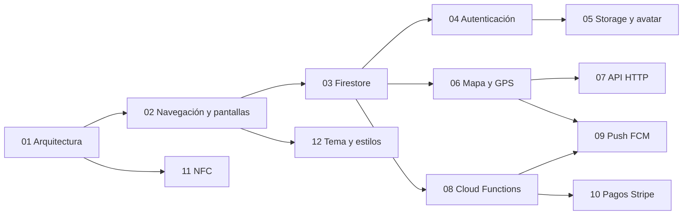

# 📚 Guías del proyecto dam2_2627_a

> [🏠 Volver al README principal](../README.md)

Cada guía explica **un módulo** de la app con la misma estructura, para que sepas siempre dónde
mirar:

| Sección | Qué encontrarás |
|---|---|
| 🎯 Qué vas a aprender | Los objetivos de la guía |
| 🧠 Conceptos clave | Las palabras nuevas (enlazadas al [glosario](13-glosario.md)) |
| 📁 Archivos implicados | Enlaces directos al código |
| 🗺 Diagramas | El flujo dibujado con Mermaid |
| 👣 Paso a paso | El recorrido por el código real, con `archivo:línea` |
| ⚙️ Configuración | Permisos, consola de Firebase, paquetes |
| 🧪 Cómo probarlo | Qué hacer para verlo funcionar |
| 🐞 Fallos conocidos | Errores reales del código: qué pasa, por qué y cómo se arreglaría |
| 🛠 Ejercicios | Retos de menor a mayor dificultad |
| ❓ Autoevaluación | Preguntas con la respuesta escondida |

## 🧭 Ruta de aprendizaje recomendada

> 💡 Si es tu primera vez, lee **01 → 02 → 03** en orden: el resto de guías dan por sabidos el
> `Dataholder`, las rutas y las colecciones de Firestore. Después puedes saltar al módulo que te toque.

## 🗂 Todas las guías

| # | Guía | Qué aprendes | Código principal |
|---|---|---|---|
| 01 | [🏛 Arquitectura](01-arquitectura.md) | Capas, singleton `Dataholder`, patrón Admin, arranque de la app | `lib/main.dart`, `lib/DataHolder.dart` |
| 02 | [🧭 Navegación y pantallas](02-navegacion-y-pantallas.md) | Rutas con nombre, OnBoarding, cada pantalla, versión escritorio | `lib/MiApp.dart`, `lib/views/` |
| 03 | [🔥 Firestore y modelo de datos](03-firestore-modelo-datos.md) | Colecciones, conversión Dart↔Firestore, tiempo real, reglas | `lib/FbObjects/`, `firestore.rules` |
| 04 | [🔐 Autenticación](04-autenticacion.md) | Email, Google y Apple; perfil de usuario | `lib/views/LoginView.dart`, `lib/Admins/FirebaseAdmin.dart` |
| 05 | [🖼 Storage y avatar](05-storage-avatar.md) | Cámara/galería, compresión, subir archivos | `lib/Admins/StorageAdmin.dart` |
| 06 | [🗺 Mapa y GPS](06-mapa-gps.md) | Permisos de ubicación, Streams, `flutter_map`, POIs | `lib/Admins/GPSAdmin.dart`, `lib/views/MapView.dart` |
| 07 | [🌍 API HTTP: terremotos](07-api-http-terremotos.md) | HTTP, JSON/GeoJSON, de JSON a objetos Dart | `lib/Admins/ApisAdmin.dart`, `lib/APIObjects/` |
| 08 | [☁️ Cloud Functions en Python](08-cloud-functions-python.md) | Serverless, triggers, secretos, probar con Postman | `functions/main.py` |
| 09 | [🔔 Notificaciones push (FCM)](09-notificaciones-push-fcm.md) | Token, primer/segundo plano, push por radio | `lib/Admins/FCMAdmin.dart` |
| 10 | [💳 Pagos con Stripe](10-pagos-stripe.md) | PaymentIntent, PaymentSheet, webhook | `lib/Admins/StripeAdmin.dart` |
| 11 | [📶 NFC](11-nfc.md) | Intents de Android, código nativo Kotlin, MethodChannel | `MainActivity.kt`, `lib/Admins/NFCAdmin.dart` |
| 12 | [🎨 Tema y estilos](12-tema-y-estilos.md) | Tokens de diseño y `ThemeData` | `lib/insLib/theme/AppTheme.dart` |
| 13 | [📖 Glosario](13-glosario.md) | Todas las palabras técnicas | — |

## 🤖 ¿Te atascas?

Pregunta al **tutor IA** del proyecto: abre Claude Code en la carpeta del proyecto y escribe
`claude --agent tutor-dam2`, o en Codex pide "usa el tutor del proyecto". Lee las guías antes de
responder y te señala el código exacto. Más detalles en el [README principal](../README.md#-aprende-con-el-tutor-ia).
