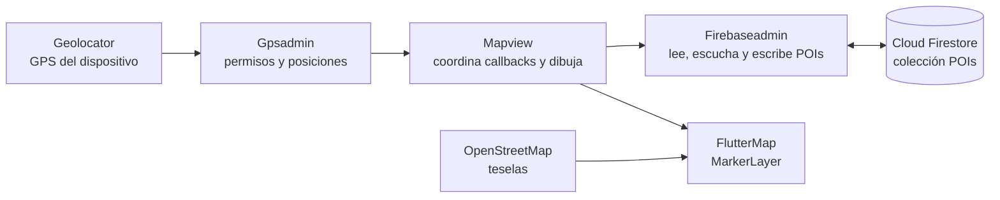
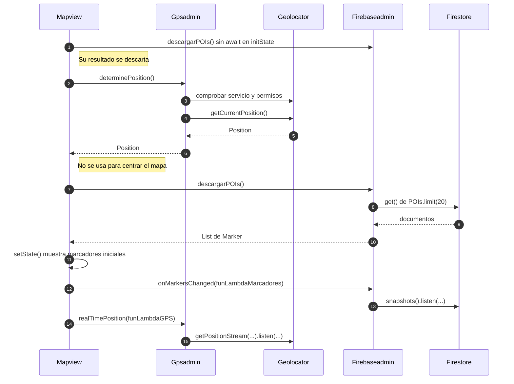
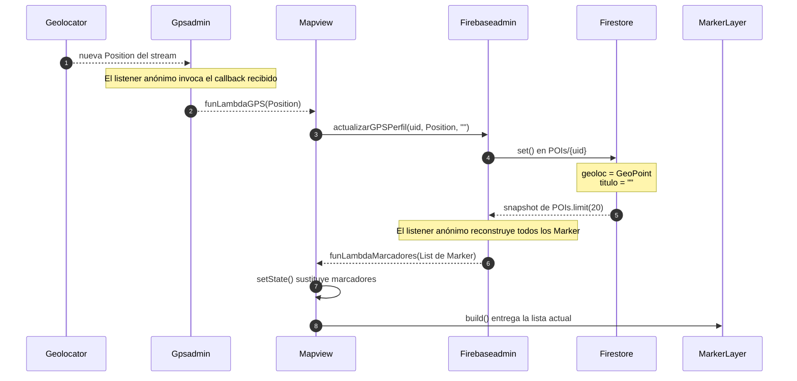

# Mapa, GPS y callbacks de Firebaseadmin y Gpsadmin

## Qué significa «lambda» aquí

En este flujo, una lambda o callback es una función de Dart que se entrega a otro método para que este la invoque cuando llegue un dato. `Mapview` pasa sus métodos `funLambdaMarcadores` y `funLambdaGPS`; los `listen(...)` de Firestore y Geolocator usan además funciones anónimas para recibir eventos. Todo se ejecuta en el cliente Flutter. `functions/main.py` define un ejemplo HTTP independiente: no procesa posiciones.

Las instancias de `Firebaseadmin` y `Gpsadmin` se guardan en `Dataholder.instance`, pero los listeners que crean viven por separado.

### Quién hace cada trabajo

Las flechas muestran el intercambio de datos. `Mapview` usa las instancias de los dos administradores guardadas en `Dataholder`; `FlutterMap` recibe los marcadores de la vista y las teselas se descargan aparte de OpenStreetMap.

## Flujo al abrir el mapa

1. `Mapview.initState()` selecciona la pestaña del mapa, llama a `descargarPOIs()` una vez sin esperar su resultado y arranca `descargarDatos()`. Esa primera llamada no aporta marcadores a la pantalla.
2. `descargarDatos()` espera `Gpsadmin.determinePosition()`. Este método comprueba que el servicio de ubicación esté activo, consulta o solicita permisos y obtiene una posición con `Geolocator.getCurrentPosition()`. Si el servicio o el permiso fallan, el `Future` produce un error; la vista no lo captura ni muestra un mensaje propio. La posición obtenida no se usa para centrar ni marcar el mapa.
3. Después espera `Firebaseadmin.descargarPOIs()`, que hace una lectura puntual de `POIs` con `limit(20)`. Cada documento debe contener `geoloc` como `GeoPoint`; sus coordenadas se convierten en un `Marker` con `Icons.pin_drop`. La vista guarda esa lista con `setState()`.
4. La vista registra `funLambdaMarcadores` mediante `Firebaseadmin.onMarkersChanged(...)` y `funLambdaGPS` mediante `Gpsadmin.realTimePosition(...)`.

Las dos llamadas finales **registran escuchas**; no esperan a que llegue un cambio. Si `determinePosition()` falla, `descargarDatos()` se detiene antes de la lectura usada por la vista y antes de registrar ambas escuchas.

## Qué hace cada callback

En el diagrama, las flechas hacia `funLambdaGPS` y `funLambdaMarcadores` son **llamadas a funciones que la vista pasó como parámetro**. Por eso `Gpsadmin` y `Firebaseadmin` pueden avisar a la vista sin guardar una referencia directa a ella. El mismo listener de Firestore puede activarse por cambios hechos desde otro cliente, aunque no haya llegado una posición nueva de este dispositivo.

`Gpsadmin.realTimePosition` configura `LocationAccuracy.bestForNavigation` y `distanceFilter: 2`: el flujo solicita nuevas posiciones al haber al menos 2 metros de desplazamiento, sujeto al comportamiento del proveedor de ubicación. Su función anónima llama al callback recibido por parámetro con cada `Position`. No devuelve una suscripción a la vista.

`funLambdaGPS` usa `Dataholder.instance.perfilUsuario.uid` como id del documento. `actualizarGPSPerfil` convierte latitud y longitud en `GeoPoint` y hace `set()` sobre `POIs/{uid}` con `geoloc` y `titulo` vacío. Esto sustituye esos campos del documento cada vez; no escribe en `Perfiles/{uid}`. El método devuelve `void` y la vista no espera la escritura ni gestiona sus errores.

`Firebaseadmin.onMarkersChanged` escucha `POIs.limit(20).snapshots()`. En cada instantánea vacía y reconstruye la lista completa de marcadores, y entonces invoca `funLambdaMarcadores`. Esta última asigna la lista en `setState()`, de modo que `MarkerLayer` se vuelve a dibujar. El listener recibe tanto cambios locales como cambios de otros clientes a través de Firestore; la escritura de GPS no modifica directamente la lista de la vista. Los errores de este listener solo se imprimen en consola.

## Qué aparece realmente en pantalla

- El mapa arranca centrado en Madrid (`40.4168, -3.7038`) con zoom 5. No sigue la ubicación del usuario ni mueve la cámara cuando cambia el GPS.
- Se dibujan hasta 20 POIs, sin orden explícito. Por ello, no está garantizado que el documento del usuario figure entre los 20 marcadores visibles.
- El campo `titulo` se guarda, pero no se muestra en el marcador. Todos usan el mismo icono.
- Las teselas proceden de OpenStreetMap por Internet. El widget de atribución está comentado en `MapView.dart`.
- El código no conserva ni cancela las suscripciones de GPS y Firestore al salir de `Mapview`. Tampoco comprueba `mounted` antes de los `setState()` asíncronos; una emisión posterior a cerrar la vista puede causar errores. Reabrirla puede crear escuchas adicionales.

## Archivos relacionados

- `lib/views/MapView.dart`: coordina las lecturas, callbacks y el redibujado.
- `lib/Admins/GPSAdmin.dart`: permisos, posición puntual y flujo GPS.
- `lib/Admins/FirebaseAdmin.dart`: lectura y escucha de POIs; escritura de la posición.
- `lib/DataHolder.dart`: conserva las instancias compartidas y el perfil del usuario.
